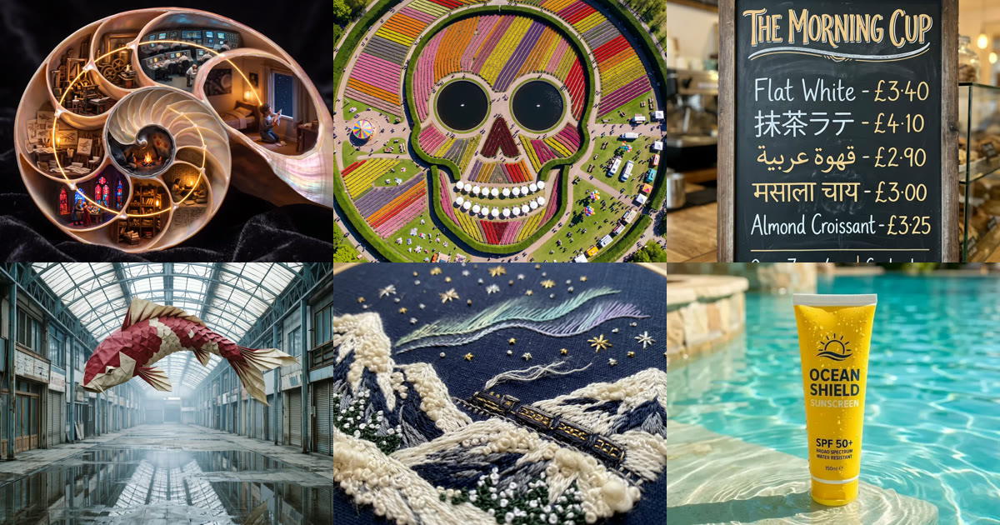

<div align="center">

<a href="https://apiko.app/zh/nano-banana-2-1-prompts?utm_source=github&utm_medium=banner&utm_campaign=awesome-nano-banana-2.1-prompts"></a>

[](LICENSE)
[](README_zh-CN.md#menu)
[](https://apiko.app/zh/models/nano-banana-2.1?utm_source=github&utm_medium=badge&utm_campaign=awesome-nano-banana-2.1-prompts&utm_content=model_try)
[](https://apiko.app/zh/docs/api-manual/image-series/nano-banana-2.1/images?utm_source=github&utm_medium=badge&utm_campaign=awesome-nano-banana-2.1-prompts&utm_content=docs)

[](README.md)
[](README_zh-CN.md)
[](README_zh-TW.md)
[](README_ko.md)

</div>

# Awesome Nano Banana 2.1 提示词

<a id="introduction"></a>
## 🌟 简介

**Nano Banana 2.1 提示词：117 条可直接复制的示例，附效果图，涵盖电商商品图、照片编辑、多语言菜单、海报和人像。**

每条提示词都附上它生成的图片：直接复制，或发送到试用台改几处细节再跑。

在线搜索和筛选： [apiko.app/nano-banana-2-1-prompts](https://apiko.app/zh/nano-banana-2-1-prompts?utm_source=github&utm_medium=readme&utm_campaign=awesome-nano-banana-2.1-prompts&utm_content=intro).

> [!NOTE]
> 提示词保持作者发布时的原文，所以大多是英文；标题和简介是我们写的。每条都署名作者并链接原帖。

<a id="quick-start"></a>
## 🚀 快速开始

**网页上用：** 每条都有「在 APIKO 运行」链接，会在 [apiko.app](https://apiko.app/zh/nano-banana-2-1-prompts?utm_source=github&utm_medium=quickstart&utm_campaign=awesome-nano-banana-2.1-prompts&utm_content=browser) 打开这条示例；点「使用」，提示词就会填进 Nano Banana 2.1 试用台。

**用 API：** 先创建 [APIKO API Key](https://apiko.app/zh/dashboard/apikeys?utm_source=github&utm_medium=quickstart&utm_campaign=awesome-nano-banana-2.1-prompts&utm_content=api_key)，再创建异步任务并轮询，直到图片生成完成。

```bash
export APIKO_API_KEY="your_key_here"

TASK_ID=$(curl -s https://api.apiko.app/v1/images/generations \
  -H "Authorization: Bearer $APIKO_API_KEY" \
  -H "Content-Type: application/json" \
  -d '{
  "model": "nano-banana-2.1",
  "prompt": "A studio product photo of a ceramic coffee mug on a pale oak table, soft morning light, clean background.",
  "size": "16:9",
  "resolution": "1k",
  "async": true
}' | python3 -c 'import json,sys; print(json.load(sys.stdin)["id"])')

# When status is "completed", the image is at data[0].url (kept for 24 hours).
while :; do
  TASK=$(curl -s https://api.apiko.app/v1/tasks/$TASK_ID \
    -H "Authorization: Bearer $APIKO_API_KEY")
  printf '%s\n' "$TASK"
  printf '%s' "$TASK" | grep -qE '"status": *"(completed|failed)"|"error": *\{' && break
  sleep 5
done
```

接口: `POST https://api.apiko.app/v1/images/generations` (创建任务) · `GET https://api.apiko.app/v1/tasks/{id}` (查询状态和结果)

<a id="how-to-write"></a>
## ✍️ Nano Banana 2.1 提示词怎么写

本页提示词里反复出现的四种结构。

- **商品不动，只换其余部分** · `[商品] 保持原样 + 新台面或场景 + 光线 + 阴影` — 电商提示词先锁定形状、标签、颜色和比例，再只描述背景、光线和接触阴影。
- **把文字原样写进引号** · `物体 + "引号里的原文" + 文字或语言 + 位置` — 菜单、招牌和报纸把每一行都放进引号并写明文字种类，价格、阿拉伯文连写和印地语才会照写出来。
- **用照片锁定脸** · `参考图只用于脸 + 新的发型、服装、场景和机位` — 人像提示词写明从上传图里保留哪些五官，其余全部重新设计，一组照片里就能保持同一个人。
- **数量和位置写死** · `恰好 N 个 + 物体 + 画面中的位置` — 压力测试提示词用 JSON 字段列出数量和位置，时钟和手表写到具体时间，比如 10:42。

**从示例里能看到什么**

- **给上传的图编号。** 双图提示词写 IMG_1、IMG_2 或 image1、image2，模型才知道哪张是场景、哪张是商品或风格。
- **JSON 和自然语言一样好用。** 有几条人像和测试用 JSON 写成镜头、人物、光线等字段，改其中一项不会动到其他部分。
- **联网搜索能补上真实信息。** 小提琴和发布海报两条提示词让模型先查资料，铭牌文字和海报内容都来自最新信息。
- **模板里留空。** 模板提示词用方括号标出要替换的部分，比如 [NAME]、[medium close-up]，光线和构图保持不变。
- **编辑类需要原图。** 标注需要参考图的卡片要先上传自己的照片才能用，卡片上的原图示意了哪类照片合适。

<a id="menu"></a>
## 📑 目录

- [🛍️ 商品与电商](#product-ecommerce) (31)
  - [指定数量与位置的俯拍静物，时钟 10:42](#product-ecommerce-01)
  - [指尖写数字、手表 3:15 与毛衣袖](#product-ecommerce-02)
  - [博物馆展柜里的斯特拉迪瓦里小提琴](#product-ecommerce-03)
  - [美妆广告首帧：手持腮红棒](#product-ecommerce-04)
  - [一张商品图生成包包 UGC 实拍](#product-ecommerce-05)
  - [电商纯白底主图](#product-ecommerce-06)
  - [黑色亚克力镜面倒影](#product-ecommerce-07)
  - [悬浮主图与柔和投影](#product-ecommerce-08)
  - [浅灰底俯拍平铺](#product-ecommerce-09)
  - [四分之三角度目录图](#product-ecommerce-10)
  - [详情页材质特写](#product-ecommerce-11)
  - [四种配色并排预览](#product-ecommerce-12)
  - [包装文字翻译成西班牙语](#product-ecommerce-13)
  - [晨光洞石台上的商品](#product-ecommerce-14)
  - [带水珠的大理石台面](#product-ecommerce-15)
  - [橡木桌与厨房道具](#product-ecommerce-16)
  - [科技风水泥展台](#product-ecommerce-17)
  - [明亮现代客厅场景](#product-ecommerce-18)
  - [阳光下的格纹野餐布](#product-ecommerce-19)
  - [霓虹电竞桌面](#product-ecommerce-20)
  - [去除灰尘和指纹](#product-ecommerce-21)
  - [把商品放进你的场景图](#product-ecommerce-22)
  - [两件商品合成套装图](#product-ecommerce-23)
  - [统一成现有目录风格](#product-ecommerce-24)
  - [隐形模特图换成街拍模特](#product-ecommerce-25)
  - [两张图做虚拟试穿](#product-ecommerce-26)
  - [模特图换成干净棚拍背景](#product-ecommerce-27)
  - [圣诞松枝与暖色光斑](#product-ecommerce-28)
  - [夏日泳池水波与焦散](#product-ecommerce-29)
  - [黑五黑金展台](#product-ecommerce-30)
  - [春节红金场景](#product-ecommerce-31)
- [✏️ 照片编辑](#image-editing) (23)
  - [照片渐变为钢笔速写的手账页](#image-editing-01)
  - [雨天车窗上的玻璃音乐播放器](#image-editing-02)
  - [角色抡起机甲甩出：倾斜构图](#image-editing-03)
  - [拍立得上的秘密影子](#image-editing-04)
  - [纸币改图：香蕉电话与新文字](#image-editing-05)
  - [雕版纸币重绘成油画](#image-editing-06)
  - [用报纸碎片拼出原图](#image-editing-07)
  - [自然肤质修图](#image-editing-08)
  - [生活照变职业形象照](#image-editing-09)
  - [白底证件照](#image-editing-10)
  - [修复褪色老照片](#image-editing-11)
  - [黑白照片上色](#image-editing-12)
  - [去模糊与降噪](#image-editing-13)
  - [提亮欠曝照片](#image-editing-14)
  - [宠物变成收藏手办](#image-editing-15)
  - [照片转水彩插画](#image-editing-16)
  - [照片转 3D 黏土角色](#image-editing-17)
  - [铅笔草图转产品渲染](#image-editing-18)
  - [借用参考图的画风](#image-editing-19)
  - [照片扩展成 3:2 壁纸](#image-editing-20)
  - [电影剧照风壁纸](#image-editing-21)
  - [水粉插画壁纸](#image-editing-22)
  - [极简渐变壁纸](#image-editing-23)
- [🔤 文字、菜单与海报](#posters-typography) (12)
  - [维也纳咖啡馆门口的粉笔菜单](#posters-typography-01)
  - [枫糖浆淋出 SUNDAY 字样](#posters-typography-02)
  - [四种文字的咖啡馆黑板菜单](#posters-typography-03)
  - [正文可读的报纸头版](#posters-typography-04)
  - [魔法少女动画主视觉海报](#posters-typography-05)
  - [联网搜索后生成的发布海报](#posters-typography-06)
  - [雨夜街市里的六种文字招牌](#posters-typography-07)
  - [杂志跨页：巴黎秀场上的盆栽高定](#posters-typography-08)
  - [大面积留白的瑞士网格展览海报](#posters-typography-09)
  - [半张脸加由五官拼出的名字](#posters-typography-10)
  - [商品图变促销海报](#posters-typography-11)
  - [改掉促销图上的折扣数字](#posters-typography-12)
- [📷 人像与摄影](#portrait-photography) (23)
  - [未修图的 UGC 博主 Jess](#portrait-photography-01)
  - [剧情广告里的母亲 Ana](#portrait-photography-02)
  - [直闪街拍：大口吃面的女生](#portrait-photography-03)
  - [拿骷髅滑板的街头人像](#portrait-photography-04)
  - [秋日人行道上的红裙红帽](#portrait-photography-05)
  - [夜晚涩谷路口的四人合照](#portrait-photography-06)
  - [废弃鬼屋里的随手自拍](#portrait-photography-07)
  - [加油站冷柜旁的夜间人像](#portrait-photography-08)
  - [俯拍斑马线街头穿搭](#portrait-photography-09)
  - [80 年代奇幻电影里的金发女巫](#portrait-photography-10)
  - [上传照片做明暗对照特写](#portrait-photography-11)
  - [扶桑花丛中的胶片人像](#portrait-photography-12)
  - [台阶上扎马尾的 iPhone 闪光抓拍](#portrait-photography-13)
  - [黑白圆窗构图：混凝土楼梯人像](#portrait-photography-14)
  - [车外后视镜里的 60 年代时装照](#portrait-photography-15)
  - [可替换变量的高管肖像模板](#portrait-photography-16)
  - [蓝橙电影光下的卷发胡子男](#portrait-photography-17)
  - [云海白玉台上的东方仙女](#portrait-photography-18)
  - [同一张脸的日系胶片写真](#portrait-photography-19)
  - [窗光里拉坯的老陶艺师](#portrait-photography-20)
  - [钴蓝圆环布景里的铂金短发](#portrait-photography-21)
  - [90 年代咖啡馆鱼眼镜面自拍](#portrait-photography-22)
  - [抱巨型花束的奢华时装照](#portrait-photography-23)
- [🎨 插画与艺术](#illustration-art) (15)
  - [只有一张脸的无头三视图设定](#illustration-art-01)
  - [月夜湖边的毛茸茸天蛾人](#illustration-art-02)
  - [缠满彩灯的圣诞小恐龙](#illustration-art-03)
  - [身影化作迷宫的哲学家纸币](#illustration-art-04)
  - [鹦鹉螺壳里的人类历史](#illustration-art-05)
  - [同样四个角色的四格漫画](#illustration-art-06)
  - [颜料管挤出四幅浮雕画](#illustration-art-07)
  - [2×2 网格的线场视错觉](#illustration-art-08)
  - [月夜森林里的发光蘑菇](#illustration-art-09)
  - [刺绣雪山夜行列车](#illustration-art-10)
  - [银河湖面上的少女与极光莲花](#illustration-art-11)
  - [带 HUD 的城堡建造游戏画面](#illustration-art-12)
  - [大脚怪掌心的小黄鸟](#illustration-art-13)
  - [景泰蓝与金丝的极繁浑天仪](#illustration-art-14)
  - [绿色卫衣的几何时装插画](#illustration-art-15)
- [🏙️ 场景与风景](#scenes-places) (13)
  - [镜面盐湖上的一把红伞](#scenes-places-01)
  - [靛蓝暮色下的山脊孤影](#scenes-places-02)
  - [从太空看印度上空的地平线](#scenes-places-03)
  - [博斯普鲁斯海边的夜间烤肉丸小车](#scenes-places-04)
  - [晨光里在壁画下献花的男孩](#scenes-places-05)
  - [俯瞰成骷髅的郁金香公园](#scenes-places-06)
  - [咖啡馆测试：左手写字与满杯红酒](#scenes-places-07)
  - [空荡商店街里的巨型折纸锦鲤](#scenes-places-08)
  - [雾湖小舟与一行小字](#scenes-places-09)
  - [三只半人马同时后空翻](#scenes-places-10)
  - [棋子影子连成城市天际线](#scenes-places-11)
  - [指针正好 4:37 的咖啡馆挂钟](#scenes-places-12)
  - [草原积云下的骑马牛仔](#scenes-places-13)
- [❓ 常见问题](#faq)
- [🔗 相关链接](#related)

<a id="product-ecommerce"></a>
## 🛍️ 商品与电商

> 白底主图、换场景、配色预览、虚拟试穿和节日场景，商品本身保持不变。 · 31 条

<a id="product-ecommerce-01"></a>
### 1. 指定数量与位置的俯拍静物，时钟 10:42

作者 [@Dheepanratnam](https://x.com/Dheepanratnam) · 1:1 · **[▶ 在 APIKO 运行](https://apiko.app/zh/nano-banana-2-1-prompts?utm_source=github&utm_medium=case&utm_campaign=awesome-nano-banana-2.1-prompts&utm_content=product-ecommerce-01#product-ecommerce-01)** · [原帖](https://x.com/Dheepanratnam/status/2107534294927413696)

<table>
<tr><td align="center"><a href="https://apiko.app/zh/nano-banana-2-1-prompts?utm_source=github&utm_medium=case&utm_campaign=awesome-nano-banana-2.1-prompts&utm_content=product-ecommerce-01#product-ecommerce-01"></a></td><td align="center"><a href="https://apiko.app/zh/nano-banana-2-1-prompts?utm_source=github&utm_medium=case&utm_campaign=awesome-nano-banana-2.1-prompts&utm_content=product-ecommerce-01#product-ecommerce-01"></a></td><td align="center"><a href="https://apiko.app/zh/nano-banana-2-1-prompts?utm_source=github&utm_medium=case&utm_campaign=awesome-nano-banana-2.1-prompts&utm_content=product-ecommerce-01#product-ecommerce-01"></a></td><td align="center"><a href="https://apiko.app/zh/nano-banana-2-1-prompts?utm_source=github&utm_medium=case&utm_campaign=awesome-nano-banana-2.1-prompts&utm_content=product-ecommerce-01#product-ecommerce-01"></a></td></tr>
</table>

**提示词:**

```text
{
  "shot": "top-down flat lay, 90-degree overhead, photorealistic, sharp focus edge to edge",
  "surface": "weathered oak table",
  "lighting": "soft north-facing window light from the top edge of frame",
  "objects": [
    "exactly 3 red apples in the top-left corner",
    "exactly 7 silver paperclips in a straight horizontal line along the bottom edge",
    "a round analogue wall clock in the centre with hands clearly showing 10:42",
    "one blue ceramic mug, handle pointing right, in the top-right corner",
    "exactly 5 yellow pencils fanned out to the left of the clock",
    "a single green leaf resting on top of the mug rim",
    "2 white dice showing a 6 and a 3, bottom-right corner",
    "an open notebook on the right of the clock with the handwritten word 'ADHERENCE'"
  ],
  "rules": ["every count is exact", "every position is exact", "no other objects, no people, no hands, no extra fruit"]
}
```

<a id="product-ecommerce-02"></a>
### 2. 指尖写数字、手表 3:15 与毛衣袖

作者 [@Dheepanratnam](https://x.com/Dheepanratnam) · 4:5 · **[▶ 在 APIKO 运行](https://apiko.app/zh/nano-banana-2-1-prompts?utm_source=github&utm_medium=case&utm_campaign=awesome-nano-banana-2.1-prompts&utm_content=product-ecommerce-02#product-ecommerce-02)** · [原帖](https://x.com/Dheepanratnam/status/2107534303907225645)

<table>
<tr><td align="center"><a href="https://apiko.app/zh/nano-banana-2-1-prompts?utm_source=github&utm_medium=case&utm_campaign=awesome-nano-banana-2.1-prompts&utm_content=product-ecommerce-02#product-ecommerce-02"></a></td><td align="center"><a href="https://apiko.app/zh/nano-banana-2-1-prompts?utm_source=github&utm_medium=case&utm_campaign=awesome-nano-banana-2.1-prompts&utm_content=product-ecommerce-02#product-ecommerce-02"></a></td><td align="center"><a href="https://apiko.app/zh/nano-banana-2-1-prompts?utm_source=github&utm_medium=case&utm_campaign=awesome-nano-banana-2.1-prompts&utm_content=product-ecommerce-02#product-ecommerce-02"></a></td><td align="center"><a href="https://apiko.app/zh/nano-banana-2-1-prompts?utm_source=github&utm_medium=case&utm_campaign=awesome-nano-banana-2.1-prompts&utm_content=product-ecommerce-02#product-ecommerce-02"></a></td></tr>
</table>

**提示词:**

```text
{
  "subject": "an adult's right hand, palm facing camera, all five fingers spread",
  "markings": "the numbers 1, 2, 3, 4, 5 written in black marker on the fingertips, thumb = 1 through little finger = 5",
  "accessory": "a vintage steel wristwatch on the wrist, dial facing camera, hands showing 3:15",
  "texture_1": "chunky cream cable-knit wool sleeve pushed up to mid-forearm, individual fibres visible",
  "texture_2": "small water droplets on the skin of the palm",
  "background": "dark slate grey seamless backdrop",
  "camera": "100mm macro lens, f/8, studio softbox from the left",
  "rules": ["exactly five fingers", "correct anatomy and knuckle creases", "numbers sharp and in the stated order", "watch time exactly as stated", "photoreal, no plastic skin"]
}
```

<a id="product-ecommerce-03"></a>
### 3. 博物馆展柜里的斯特拉迪瓦里小提琴

作者 [@PElfines71321](https://x.com/PElfines71321) · 16:9 · **[▶ 在 APIKO 运行](https://apiko.app/zh/nano-banana-2-1-prompts?utm_source=github&utm_medium=case&utm_campaign=awesome-nano-banana-2.1-prompts&utm_content=product-ecommerce-03#product-ecommerce-03)** · [原帖](https://x.com/PElfines71321/status/2107521814113263727)

<table>
<tr><td align="center"><a href="https://apiko.app/zh/nano-banana-2-1-prompts?utm_source=github&utm_medium=case&utm_campaign=awesome-nano-banana-2.1-prompts&utm_content=product-ecommerce-03#product-ecommerce-03"></a></td><td align="center"><a href="https://apiko.app/zh/nano-banana-2-1-prompts?utm_source=github&utm_medium=case&utm_campaign=awesome-nano-banana-2.1-prompts&utm_content=product-ecommerce-03#product-ecommerce-03"></a></td></tr>
</table>

**提示词:**

```text
世界で一番高価なストラディヴァリのバイオリンをショーケースの中に入れた状態で展示している様子を、現地でプロカメラマンが撮影したスチル写真として作画して。
```

<a id="product-ecommerce-04"></a>
### 4. 美妆广告首帧：手持腮红棒

作者 [@Justin_lords](https://x.com/Justin_lords) · 16:9 · **[▶ 在 APIKO 运行](https://apiko.app/zh/nano-banana-2-1-prompts?utm_source=github&utm_medium=case&utm_campaign=awesome-nano-banana-2.1-prompts&utm_content=product-ecommerce-04#product-ecommerce-04)** · [原帖](https://x.com/Justin_lords/status/2107832260032606378)

<a href="https://apiko.app/zh/nano-banana-2-1-prompts?utm_source=github&utm_medium=case&utm_campaign=awesome-nano-banana-2.1-prompts&utm_content=product-ecommerce-04#product-ecommerce-04"></a>

**提示词:**

```text
Create a photorealistic first frame for a human-led beauty advertisement. An original fictional adult woman aged 28, warm medium-brown skin with visible natural pores and a few faint freckles, dark brown eyes, shoulder-length dark-brown wavy hair worn loose, simple small gold stud earrings, plain cream cotton crew-neck T-shirt. Friendly expressive face with normal asymmetry. Subtle natural makeup, not airbrushed.A believable modest apartment bathroom beside a window, soft morning daylight, cream painted wall, muted green tile detail, blurred ordinary towel in background. Casual premium creator UGC, recorded on a good smartphone, natural depth of field, mild phone-camera grain, realistic everyday exposure. Portrait framing. No studio glamour lighting, no cinematic teal-orange grade, no beauty filter.She stands facing the phone camera, framed from mid-chest to just above her head, eyes looking directly into the lens, with an engaged conversational expression and mouth gently closed. One small unbranded lip-and-cheek tint stick: short matte warm-ivory cylindrical barrel, muted terracotta band around its base, rounded dusty-rose cream tip exposed. Simple solid geometry, no text, no logo, no transparent packaging. A cosmetic concept product, not a real brand.She holds exactly one tint stick upright in her right hand at upper-chest height, clearly visible beside her face. Five anatomically correct fingers and a natural relaxed grip, product not touching her face. Her other hand is out of frame. Hair tucked away from her right cheek.Leave modest room above her head and below the product for small later captions. Single person. No writing, overlay, collage, inset, watermark or logos. Skin and hands must look like an ordinary unretouched phone photograph.
```

<a id="product-ecommerce-05"></a>
### 5. 一张商品图生成包包 UGC 实拍

作者 [@modisulak](https://x.com/modisulak) · 9:16 · **[▶ 在 APIKO 运行](https://apiko.app/zh/nano-banana-2-1-prompts?utm_source=github&utm_medium=case&utm_campaign=awesome-nano-banana-2.1-prompts&utm_content=product-ecommerce-05#product-ecommerce-05)** · [原帖](https://x.com/modisulak/status/2107232476905291892)

<a href="https://apiko.app/zh/nano-banana-2-1-prompts?utm_source=github&utm_medium=case&utm_campaign=awesome-nano-banana-2.1-prompts&utm_content=product-ecommerce-05#product-ecommerce-05"></a>

> 📎 这条需要你自己上传参考图。

**提示词:**

```text
A UGC Image of this Bag
```

<a id="product-ecommerce-06"></a>
### 6. 电商纯白底主图

作者 [@lygerone](https://github.com/lygerone/awesome-nano-banana-prompts) · 1:1 · **[▶ 在 APIKO 运行](https://apiko.app/zh/nano-banana-2-1-prompts?utm_source=github&utm_medium=case&utm_campaign=awesome-nano-banana-2.1-prompts&utm_content=product-ecommerce-06#product-ecommerce-06)** · [原帖](https://github.com/lygerone/awesome-nano-banana-prompts#pure-white-marketplace-packshot)

<table>
<tr><td align="center"><a href="https://apiko.app/zh/nano-banana-2-1-prompts?utm_source=github&utm_medium=case&utm_campaign=awesome-nano-banana-2.1-prompts&utm_content=product-ecommerce-06#product-ecommerce-06"></a></td><td align="center"><a href="https://apiko.app/zh/nano-banana-2-1-prompts?utm_source=github&utm_medium=case&utm_campaign=awesome-nano-banana-2.1-prompts&utm_content=product-ecommerce-06#product-ecommerce-06"></a></td></tr>
</table>

> 📎 这条需要你自己上传参考图。

**提示词:**

```text
Keep the product exactly as it is, including its shape, label, colors and proportions. Replace the background with pure white (#FFFFFF) and center the product. Light it with soft, even studio light from both sides and add a subtle natural contact shadow under its base. Crisp edges, no color spill, clean e-commerce packshot.
```

<a id="product-ecommerce-07"></a>
### 7. 黑色亚克力镜面倒影

作者 [@lygerone](https://github.com/lygerone/awesome-nano-banana-prompts) · 3:4 · **[▶ 在 APIKO 运行](https://apiko.app/zh/nano-banana-2-1-prompts?utm_source=github&utm_medium=case&utm_campaign=awesome-nano-banana-2.1-prompts&utm_content=product-ecommerce-07#product-ecommerce-07)** · [原帖](https://github.com/lygerone/awesome-nano-banana-prompts#black-acrylic-mirror-reflection)

<table>
<tr><td align="center"><a href="https://apiko.app/zh/nano-banana-2-1-prompts?utm_source=github&utm_medium=case&utm_campaign=awesome-nano-banana-2.1-prompts&utm_content=product-ecommerce-07#product-ecommerce-07"></a></td><td align="center"><a href="https://apiko.app/zh/nano-banana-2-1-prompts?utm_source=github&utm_medium=case&utm_campaign=awesome-nano-banana-2.1-prompts&utm_content=product-ecommerce-07#product-ecommerce-07"></a></td></tr>
</table>

> 📎 这条需要你自己上传参考图。

**提示词:**

```text
Keep the product unchanged. Place it on glossy black acrylic with a crisp mirror reflection that fades downward. Use a dark, seamless background and a dramatic rim light along both edges of the product. Deep contrast, luxury brand look, ultra-sharp detail.
```

<a id="product-ecommerce-08"></a>
### 8. 悬浮主图与柔和投影

作者 [@lygerone](https://github.com/lygerone/awesome-nano-banana-prompts) · 1:1 · **[▶ 在 APIKO 运行](https://apiko.app/zh/nano-banana-2-1-prompts?utm_source=github&utm_medium=case&utm_campaign=awesome-nano-banana-2.1-prompts&utm_content=product-ecommerce-08#product-ecommerce-08)** · [原帖](https://github.com/lygerone/awesome-nano-banana-prompts#floating-hero-shot)

<table>
<tr><td align="center"><a href="https://apiko.app/zh/nano-banana-2-1-prompts?utm_source=github&utm_medium=case&utm_campaign=awesome-nano-banana-2.1-prompts&utm_content=product-ecommerce-08#product-ecommerce-08"></a></td><td align="center"><a href="https://apiko.app/zh/nano-banana-2-1-prompts?utm_source=github&utm_medium=case&utm_campaign=awesome-nano-banana-2.1-prompts&utm_content=product-ecommerce-08#product-ecommerce-08"></a></td></tr>
</table>

> 📎 这条需要你自己上传参考图。

**提示词:**

```text
Keep the product unchanged. Make it float about 2 cm above a seamless off-white studio backdrop, with a soft, diffused shadow on the floor directly beneath it. Soft overhead lighting, clean and minimal catalog style.
```

<a id="product-ecommerce-09"></a>
### 9. 浅灰底俯拍平铺

作者 [@lygerone](https://github.com/lygerone/awesome-nano-banana-prompts) · 1:1 · **[▶ 在 APIKO 运行](https://apiko.app/zh/nano-banana-2-1-prompts?utm_source=github&utm_medium=case&utm_campaign=awesome-nano-banana-2.1-prompts&utm_content=product-ecommerce-09#product-ecommerce-09)** · [原帖](https://github.com/lygerone/awesome-nano-banana-prompts#overhead-flat-lay-on-light-gray)

<table>
<tr><td align="center"><a href="https://apiko.app/zh/nano-banana-2-1-prompts?utm_source=github&utm_medium=case&utm_campaign=awesome-nano-banana-2.1-prompts&utm_content=product-ecommerce-09#product-ecommerce-09"></a></td><td align="center"><a href="https://apiko.app/zh/nano-banana-2-1-prompts?utm_source=github&utm_medium=case&utm_campaign=awesome-nano-banana-2.1-prompts&utm_content=product-ecommerce-09#product-ecommerce-09"></a></td></tr>
</table>

> 📎 这条需要你自己上传参考图。

**提示词:**

```text
Keep the product exactly as it is, including its shape, stitching, colors and any logo. Show it as an overhead flat lay, photographed straight down and centered on a light gray seamless background. Soft, even lighting with only a faint shadow. Clean, minimal marketplace listing photo.
```

<a id="product-ecommerce-10"></a>
### 10. 四分之三角度目录图

作者 [@lygerone](https://github.com/lygerone/awesome-nano-banana-prompts) · 1:1 · **[▶ 在 APIKO 运行](https://apiko.app/zh/nano-banana-2-1-prompts?utm_source=github&utm_medium=case&utm_campaign=awesome-nano-banana-2.1-prompts&utm_content=product-ecommerce-10#product-ecommerce-10)** · [原帖](https://github.com/lygerone/awesome-nano-banana-prompts#three-quarter-catalog-angle)

<table>
<tr><td align="center"><a href="https://apiko.app/zh/nano-banana-2-1-prompts?utm_source=github&utm_medium=case&utm_campaign=awesome-nano-banana-2.1-prompts&utm_content=product-ecommerce-10#product-ecommerce-10"></a></td><td align="center"><a href="https://apiko.app/zh/nano-banana-2-1-prompts?utm_source=github&utm_medium=case&utm_campaign=awesome-nano-banana-2.1-prompts&utm_content=product-ecommerce-10#product-ecommerce-10"></a></td></tr>
</table>

> 📎 这条需要你自己上传参考图。

**提示词:**

```text
Keep the product's design, colors, materials and logo exactly as they are. Show it at a three-quarter angle, turned about 45 degrees to the left, on a pure white background with a soft contact shadow. Even studio lighting, consistent e-commerce catalog style.
```

<a id="product-ecommerce-11"></a>
### 11. 详情页材质特写

作者 [@lygerone](https://github.com/lygerone/awesome-nano-banana-prompts) · 3:4 · **[▶ 在 APIKO 运行](https://apiko.app/zh/nano-banana-2-1-prompts?utm_source=github&utm_medium=case&utm_campaign=awesome-nano-banana-2.1-prompts&utm_content=product-ecommerce-11#product-ecommerce-11)** · [原帖](https://github.com/lygerone/awesome-nano-banana-prompts#material-close-up-for-detail-images)

<table>
<tr><td align="center"><a href="https://apiko.app/zh/nano-banana-2-1-prompts?utm_source=github&utm_medium=case&utm_campaign=awesome-nano-banana-2.1-prompts&utm_content=product-ecommerce-11#product-ecommerce-11"></a></td><td align="center"><a href="https://apiko.app/zh/nano-banana-2-1-prompts?utm_source=github&utm_medium=case&utm_campaign=awesome-nano-banana-2.1-prompts&utm_content=product-ecommerce-11#product-ecommerce-11"></a></td></tr>
</table>

> 📎 这条需要你自己上传参考图。

**提示词:**

```text
Turn this into a close-up detail shot of the product's material and craftsmanship. Fill the frame with its surface texture, stitching and hardware, using a shallow depth of field and soft side light that brings out the texture. Keep the colors, materials and hardware finish exactly as in the original photo.
```

<a id="product-ecommerce-12"></a>
### 12. 四种配色并排预览

作者 [@lygerone](https://github.com/lygerone/awesome-nano-banana-prompts) · 4:3 · **[▶ 在 APIKO 运行](https://apiko.app/zh/nano-banana-2-1-prompts?utm_source=github&utm_medium=case&utm_campaign=awesome-nano-banana-2.1-prompts&utm_content=product-ecommerce-12#product-ecommerce-12)** · [原帖](https://github.com/lygerone/awesome-nano-banana-prompts#preview-colorways-side-by-side)

<table>
<tr><td align="center"><a href="https://apiko.app/zh/nano-banana-2-1-prompts?utm_source=github&utm_medium=case&utm_campaign=awesome-nano-banana-2.1-prompts&utm_content=product-ecommerce-12#product-ecommerce-12"></a></td><td align="center"><a href="https://apiko.app/zh/nano-banana-2-1-prompts?utm_source=github&utm_medium=case&utm_campaign=awesome-nano-banana-2.1-prompts&utm_content=product-ecommerce-12#product-ecommerce-12"></a></td></tr>
</table>

> 📎 这条需要你自己上传参考图。

**提示词:**

```text
Show this product in four colorways side by side: its original color, sage green, sand beige and charcoal black. Keep the shape, materials, details and logo identical across all four. Space them evenly on a light gray background with the same soft studio light and matching shadows.
```

<a id="product-ecommerce-13"></a>
### 13. 包装文字翻译成西班牙语

作者 [@lygerone](https://github.com/lygerone/awesome-nano-banana-prompts) · 1:1 · **[▶ 在 APIKO 运行](https://apiko.app/zh/nano-banana-2-1-prompts?utm_source=github&utm_medium=case&utm_campaign=awesome-nano-banana-2.1-prompts&utm_content=product-ecommerce-13#product-ecommerce-13)** · [原帖](https://github.com/lygerone/awesome-nano-banana-prompts#translate-the-text-on-packaging)

<table>
<tr><td align="center"><a href="https://apiko.app/zh/nano-banana-2-1-prompts?utm_source=github&utm_medium=case&utm_campaign=awesome-nano-banana-2.1-prompts&utm_content=product-ecommerce-13#product-ecommerce-13"></a></td><td align="center"><a href="https://apiko.app/zh/nano-banana-2-1-prompts?utm_source=github&utm_medium=case&utm_campaign=awesome-nano-banana-2.1-prompts&utm_content=product-ecommerce-13#product-ecommerce-13"></a></td></tr>
</table>

> 📎 这条需要你自己上传参考图。

**提示词:**

```text
Translate the English text on the packaging into Spanish. Keep the brand name as it is, and give each translated line the same typeface, size, color and position as the original. Leave the product, the rest of the packaging and the background unchanged.
```

<a id="product-ecommerce-14"></a>
### 14. 晨光洞石台上的商品

作者 [@lygerone](https://github.com/lygerone/awesome-nano-banana-prompts) · 3:4 · **[▶ 在 APIKO 运行](https://apiko.app/zh/nano-banana-2-1-prompts?utm_source=github&utm_medium=case&utm_campaign=awesome-nano-banana-2.1-prompts&utm_content=product-ecommerce-14#product-ecommerce-14)** · [原帖](https://github.com/lygerone/awesome-nano-banana-prompts#travertine-block-in-morning-light)

<table>
<tr><td align="center"><a href="https://apiko.app/zh/nano-banana-2-1-prompts?utm_source=github&utm_medium=case&utm_campaign=awesome-nano-banana-2.1-prompts&utm_content=product-ecommerce-14#product-ecommerce-14"></a></td><td align="center"><a href="https://apiko.app/zh/nano-banana-2-1-prompts?utm_source=github&utm_medium=case&utm_campaign=awesome-nano-banana-2.1-prompts&utm_content=product-ecommerce-14#product-ecommerce-14"></a></td></tr>
</table>

> 📎 这条需要你自己上传参考图。

**提示词:**

```text
Keep the product exactly as it is, including its shape, label and colors. Place it on a raw-cut beige travertine block with a few dried botanical stems beside it. Soft morning window light casts dappled leaf shadows across the scene. Warm, organic mood, shallow depth of field, editorial lifestyle photo.
```

<a id="product-ecommerce-15"></a>
### 15. 带水珠的大理石台面

作者 [@lygerone](https://github.com/lygerone/awesome-nano-banana-prompts) · 3:4 · **[▶ 在 APIKO 运行](https://apiko.app/zh/nano-banana-2-1-prompts?utm_source=github&utm_medium=case&utm_campaign=awesome-nano-banana-2.1-prompts&utm_content=product-ecommerce-15#product-ecommerce-15)** · [原帖](https://github.com/lygerone/awesome-nano-banana-prompts#marble-vanity-with-water-droplets)

<table>
<tr><td align="center"><a href="https://apiko.app/zh/nano-banana-2-1-prompts?utm_source=github&utm_medium=case&utm_campaign=awesome-nano-banana-2.1-prompts&utm_content=product-ecommerce-15#product-ecommerce-15"></a></td><td align="center"><a href="https://apiko.app/zh/nano-banana-2-1-prompts?utm_source=github&utm_medium=case&utm_campaign=awesome-nano-banana-2.1-prompts&utm_content=product-ecommerce-15#product-ecommerce-15"></a></td></tr>
</table>

> 📎 这条需要你自己上传参考图。

**提示词:**

```text
Keep the product unchanged. Place it on a polished white Carrara marble bathroom vanity with fine water droplets on the surface. Soft light through a frosted window, a blurred luxury spa bathroom in the background. Fresh, clean skincare advertising look with crisp focus on the product.
```

<a id="product-ecommerce-16"></a>
### 16. 橡木桌与厨房道具

作者 [@lygerone](https://github.com/lygerone/awesome-nano-banana-prompts) · 4:3 · **[▶ 在 APIKO 运行](https://apiko.app/zh/nano-banana-2-1-prompts?utm_source=github&utm_medium=case&utm_campaign=awesome-nano-banana-2.1-prompts&utm_content=product-ecommerce-16#product-ecommerce-16)** · [原帖](https://github.com/lygerone/awesome-nano-banana-prompts#oak-table-with-kitchen-props)

<table>
<tr><td align="center"><a href="https://apiko.app/zh/nano-banana-2-1-prompts?utm_source=github&utm_medium=case&utm_campaign=awesome-nano-banana-2.1-prompts&utm_content=product-ecommerce-16#product-ecommerce-16"></a></td><td align="center"><a href="https://apiko.app/zh/nano-banana-2-1-prompts?utm_source=github&utm_medium=case&utm_campaign=awesome-nano-banana-2.1-prompts&utm_content=product-ecommerce-16#product-ecommerce-16"></a></td></tr>
</table>

> 📎 这条需要你自己上传参考图。

**提示词:**

```text
Keep the product unchanged. Place it on a natural oak tabletop with visible wood grain, with a ceramic cup and a linen napkin nearby. Warm daylight from a side window, authentic Scandinavian home atmosphere, f/4 depth of field, product in sharp focus.
```

<a id="product-ecommerce-17"></a>
### 17. 科技风水泥展台

作者 [@lygerone](https://github.com/lygerone/awesome-nano-banana-prompts) · 1:1 · **[▶ 在 APIKO 运行](https://apiko.app/zh/nano-banana-2-1-prompts?utm_source=github&utm_medium=case&utm_campaign=awesome-nano-banana-2.1-prompts&utm_content=product-ecommerce-17#product-ecommerce-17)** · [原帖](https://github.com/lygerone/awesome-nano-banana-prompts#concrete-podium-tech-style)

<table>
<tr><td align="center"><a href="https://apiko.app/zh/nano-banana-2-1-prompts?utm_source=github&utm_medium=case&utm_campaign=awesome-nano-banana-2.1-prompts&utm_content=product-ecommerce-17#product-ecommerce-17"></a></td><td align="center"><a href="https://apiko.app/zh/nano-banana-2-1-prompts?utm_source=github&utm_medium=case&utm_campaign=awesome-nano-banana-2.1-prompts&utm_content=product-ecommerce-17#product-ecommerce-17"></a></td></tr>
</table>

> 📎 这条需要你自己上传参考图。

**提示词:**

```text
Keep the product unchanged. Place it on a minimalist raw gray concrete cylinder podium with a few brushed-metal geometric shapes around it. Cool architectural light with sharp, angular shadows. Modern industrial look for tech accessories, high detail.
```

<a id="product-ecommerce-18"></a>
### 18. 明亮现代客厅场景

作者 [@lygerone](https://github.com/lygerone/awesome-nano-banana-prompts) · 4:3 · **[▶ 在 APIKO 运行](https://apiko.app/zh/nano-banana-2-1-prompts?utm_source=github&utm_medium=case&utm_campaign=awesome-nano-banana-2.1-prompts&utm_content=product-ecommerce-18#product-ecommerce-18)** · [原帖](https://github.com/lygerone/awesome-nano-banana-prompts#bright-modern-living-room)

<table>
<tr><td align="center"><a href="https://apiko.app/zh/nano-banana-2-1-prompts?utm_source=github&utm_medium=case&utm_campaign=awesome-nano-banana-2.1-prompts&utm_content=product-ecommerce-18#product-ecommerce-18"></a></td><td align="center"><a href="https://apiko.app/zh/nano-banana-2-1-prompts?utm_source=github&utm_medium=case&utm_campaign=awesome-nano-banana-2.1-prompts&utm_content=product-ecommerce-18#product-ecommerce-18"></a></td></tr>
</table>

> 📎 这条需要你自己上传参考图。

**提示词:**

```text
Keep the product exactly as it is, including its shape, finish and colors. Place it on a light oak sideboard in a bright, modern living room, with a sofa and green plants softly blurred behind it. Natural daylight from a large window, shadows that match the light, photorealistic interior catalog photo.
```

<a id="product-ecommerce-19"></a>
### 19. 阳光下的格纹野餐布

作者 [@lygerone](https://github.com/lygerone/awesome-nano-banana-prompts) · 3:4 · **[▶ 在 APIKO 运行](https://apiko.app/zh/nano-banana-2-1-prompts?utm_source=github&utm_medium=case&utm_campaign=awesome-nano-banana-2.1-prompts&utm_content=product-ecommerce-19#product-ecommerce-19)** · [原帖](https://github.com/lygerone/awesome-nano-banana-prompts#sunny-picnic-blanket)

<table>
<tr><td align="center"><a href="https://apiko.app/zh/nano-banana-2-1-prompts?utm_source=github&utm_medium=case&utm_campaign=awesome-nano-banana-2.1-prompts&utm_content=product-ecommerce-19#product-ecommerce-19"></a></td><td align="center"><a href="https://apiko.app/zh/nano-banana-2-1-prompts?utm_source=github&utm_medium=case&utm_campaign=awesome-nano-banana-2.1-prompts&utm_content=product-ecommerce-19#product-ecommerce-19"></a></td></tr>
</table>

> 📎 这条需要你自己上传参考图。

**提示词:**

```text
Keep the product unchanged. Place it on a red and white checkered picnic blanket in a sunny park, with a wicker basket and fresh fruit nearby and trees softly blurred in the background. Bright natural daylight with soft shadows, shallow depth of field, cheerful summer lifestyle photo.
```

<a id="product-ecommerce-20"></a>
### 20. 霓虹电竞桌面

作者 [@lygerone](https://github.com/lygerone/awesome-nano-banana-prompts) · 1:1 · **[▶ 在 APIKO 运行](https://apiko.app/zh/nano-banana-2-1-prompts?utm_source=github&utm_medium=case&utm_campaign=awesome-nano-banana-2.1-prompts&utm_content=product-ecommerce-20#product-ecommerce-20)** · [原帖](https://github.com/lygerone/awesome-nano-banana-prompts#neon-gaming-desk)

<table>
<tr><td align="center"><a href="https://apiko.app/zh/nano-banana-2-1-prompts?utm_source=github&utm_medium=case&utm_campaign=awesome-nano-banana-2.1-prompts&utm_content=product-ecommerce-20#product-ecommerce-20"></a></td><td align="center"><a href="https://apiko.app/zh/nano-banana-2-1-prompts?utm_source=github&utm_medium=case&utm_campaign=awesome-nano-banana-2.1-prompts&utm_content=product-ecommerce-20#product-ecommerce-20"></a></td></tr>
</table>

> 📎 这条需要你自己上传参考图。

**提示词:**

```text
Keep the product unchanged, including its shape, buttons and logo. Place it on a dark desk mat in a gaming setup, with a mechanical keyboard and the glow of a monitor softly blurred behind it. Purple and cyan neon light with subtle RGB reflections along the product's edges. Moody, high-contrast tech product photo.
```

<a id="product-ecommerce-21"></a>
### 21. 去除灰尘和指纹

作者 [@lygerone](https://github.com/lygerone/awesome-nano-banana-prompts) · 1:1 · **[▶ 在 APIKO 运行](https://apiko.app/zh/nano-banana-2-1-prompts?utm_source=github&utm_medium=case&utm_campaign=awesome-nano-banana-2.1-prompts&utm_content=product-ecommerce-21#product-ecommerce-21)** · [原帖](https://github.com/lygerone/awesome-nano-banana-prompts#remove-dust-and-fingerprints)

<table>
<tr><td align="center"><a href="https://apiko.app/zh/nano-banana-2-1-prompts?utm_source=github&utm_medium=case&utm_campaign=awesome-nano-banana-2.1-prompts&utm_content=product-ecommerce-21#product-ecommerce-21"></a></td><td align="center"><a href="https://apiko.app/zh/nano-banana-2-1-prompts?utm_source=github&utm_medium=case&utm_campaign=awesome-nano-banana-2.1-prompts&utm_content=product-ecommerce-21#product-ecommerce-21"></a></td></tr>
</table>

> 📎 这条需要你自己上传参考图。

**提示词:**

```text
Remove all dust, lint, fingerprints and fine scratches from the product's surface. Keep its shape, color, glossy finish, logo and reflections exactly as they are, and leave the background unchanged. Clean, freshly unboxed look.
```

<a id="product-ecommerce-22"></a>
### 22. 把商品放进你的场景图

作者 [@lygerone](https://github.com/lygerone/awesome-nano-banana-prompts) · 4:3 · **[▶ 在 APIKO 运行](https://apiko.app/zh/nano-banana-2-1-prompts?utm_source=github&utm_medium=case&utm_campaign=awesome-nano-banana-2.1-prompts&utm_content=product-ecommerce-22#product-ecommerce-22)** · [原帖](https://github.com/lygerone/awesome-nano-banana-prompts#place-a-product-into-your-scene)

<table>
<tr><td align="center"><a href="https://apiko.app/zh/nano-banana-2-1-prompts?utm_source=github&utm_medium=case&utm_campaign=awesome-nano-banana-2.1-prompts&utm_content=product-ecommerce-22#product-ecommerce-22"></a></td><td align="center"><a href="https://apiko.app/zh/nano-banana-2-1-prompts?utm_source=github&utm_medium=case&utm_campaign=awesome-nano-banana-2.1-prompts&utm_content=product-ecommerce-22#product-ecommerce-22"></a></td><td align="center"><a href="https://apiko.app/zh/nano-banana-2-1-prompts?utm_source=github&utm_medium=case&utm_campaign=awesome-nano-banana-2.1-prompts&utm_content=product-ecommerce-22#product-ecommerce-22"></a></td></tr>
</table>

> 📎 这条需要你自己上传参考图。

**提示词:**

```text
Place the product from IMG_2 on the table in IMG_1. Keep the product's shape, label and colors exactly as in IMG_2. Match IMG_1's perspective, lighting direction and color temperature, and add a natural contact shadow so the product looks photographed in place. Keep the rest of IMG_1 unchanged.
```

<a id="product-ecommerce-23"></a>
### 23. 两件商品合成套装图

作者 [@lygerone](https://github.com/lygerone/awesome-nano-banana-prompts) · 4:3 · **[▶ 在 APIKO 运行](https://apiko.app/zh/nano-banana-2-1-prompts?utm_source=github&utm_medium=case&utm_campaign=awesome-nano-banana-2.1-prompts&utm_content=product-ecommerce-23#product-ecommerce-23)** · [原帖](https://github.com/lygerone/awesome-nano-banana-prompts#bundle-two-products-into-one-shot)

<table>
<tr><td align="center"><a href="https://apiko.app/zh/nano-banana-2-1-prompts?utm_source=github&utm_medium=case&utm_campaign=awesome-nano-banana-2.1-prompts&utm_content=product-ecommerce-23#product-ecommerce-23"></a></td><td align="center"><a href="https://apiko.app/zh/nano-banana-2-1-prompts?utm_source=github&utm_medium=case&utm_campaign=awesome-nano-banana-2.1-prompts&utm_content=product-ecommerce-23#product-ecommerce-23"></a></td><td align="center"><a href="https://apiko.app/zh/nano-banana-2-1-prompts?utm_source=github&utm_medium=case&utm_campaign=awesome-nano-banana-2.1-prompts&utm_content=product-ecommerce-23#product-ecommerce-23"></a></td></tr>
</table>

> 📎 这条需要你自己上传参考图。

**提示词:**

```text
Combine the product in IMG_1 and the product in IMG_2 into one bundle photo. Keep both products exactly as they are, including their shapes, labels and colors. Arrange them side by side on a pure white background with the same soft studio light and natural contact shadows. Clean gift-set listing image.
```

<a id="product-ecommerce-24"></a>
### 24. 统一成现有目录风格

作者 [@lygerone](https://github.com/lygerone/awesome-nano-banana-prompts) · 1:1 · **[▶ 在 APIKO 运行](https://apiko.app/zh/nano-banana-2-1-prompts?utm_source=github&utm_medium=case&utm_campaign=awesome-nano-banana-2.1-prompts&utm_content=product-ecommerce-24#product-ecommerce-24)** · [原帖](https://github.com/lygerone/awesome-nano-banana-prompts#match-your-existing-catalog-look)

<table>
<tr><td align="center"><a href="https://apiko.app/zh/nano-banana-2-1-prompts?utm_source=github&utm_medium=case&utm_campaign=awesome-nano-banana-2.1-prompts&utm_content=product-ecommerce-24#product-ecommerce-24"></a></td><td align="center"><a href="https://apiko.app/zh/nano-banana-2-1-prompts?utm_source=github&utm_medium=case&utm_campaign=awesome-nano-banana-2.1-prompts&utm_content=product-ecommerce-24#product-ecommerce-24"></a></td><td align="center"><a href="https://apiko.app/zh/nano-banana-2-1-prompts?utm_source=github&utm_medium=case&utm_campaign=awesome-nano-banana-2.1-prompts&utm_content=product-ecommerce-24#product-ecommerce-24"></a></td></tr>
</table>

> 📎 这条需要你自己上传参考图。

**提示词:**

```text
Restyle IMG_1 to match the look of IMG_2: use the same background color, lighting direction, shadow style and color grade. Keep the product in IMG_1 exactly as it is, including its shape, label and colors. Do not copy the product or props from IMG_2.
```

<a id="product-ecommerce-25"></a>
### 25. 隐形模特图换成街拍模特

作者 [@lygerone](https://github.com/lygerone/awesome-nano-banana-prompts) · 3:4 · **[▶ 在 APIKO 运行](https://apiko.app/zh/nano-banana-2-1-prompts?utm_source=github&utm_medium=case&utm_campaign=awesome-nano-banana-2.1-prompts&utm_content=product-ecommerce-25#product-ecommerce-25)** · [原帖](https://github.com/lygerone/awesome-nano-banana-prompts#ghost-mannequin-to-street-model)

<table>
<tr><td align="center"><a href="https://apiko.app/zh/nano-banana-2-1-prompts?utm_source=github&utm_medium=case&utm_campaign=awesome-nano-banana-2.1-prompts&utm_content=product-ecommerce-25#product-ecommerce-25"></a></td><td align="center"><a href="https://apiko.app/zh/nano-banana-2-1-prompts?utm_source=github&utm_medium=case&utm_campaign=awesome-nano-banana-2.1-prompts&utm_content=product-ecommerce-25#product-ecommerce-25"></a></td></tr>
</table>

> 📎 这条需要你自己上传参考图。

**提示词:**

```text
Show the garment in this photo worn by a tall female model walking on a European cobblestone street. Keep the garment exactly as it is: cut, color, pattern, buttons and seams. Natural fabric folds and movement, golden-hour side light, 35mm street fashion photo.
```

<a id="product-ecommerce-26"></a>
### 26. 两张图做虚拟试穿

作者 [@lygerone](https://github.com/lygerone/awesome-nano-banana-prompts) · 3:4 · **[▶ 在 APIKO 运行](https://apiko.app/zh/nano-banana-2-1-prompts?utm_source=github&utm_medium=case&utm_campaign=awesome-nano-banana-2.1-prompts&utm_content=product-ecommerce-26#product-ecommerce-26)** · [原帖](https://github.com/lygerone/awesome-nano-banana-prompts#virtual-try-on)

<table>
<tr><td align="center"><a href="https://apiko.app/zh/nano-banana-2-1-prompts?utm_source=github&utm_medium=case&utm_campaign=awesome-nano-banana-2.1-prompts&utm_content=product-ecommerce-26#product-ecommerce-26"></a></td><td align="center"><a href="https://apiko.app/zh/nano-banana-2-1-prompts?utm_source=github&utm_medium=case&utm_campaign=awesome-nano-banana-2.1-prompts&utm_content=product-ecommerce-26#product-ecommerce-26"></a></td><td align="center"><a href="https://apiko.app/zh/nano-banana-2-1-prompts?utm_source=github&utm_medium=case&utm_campaign=awesome-nano-banana-2.1-prompts&utm_content=product-ecommerce-26#product-ecommerce-26"></a></td></tr>
</table>

> 📎 这条需要你自己上传参考图。

**提示词:**

```text
Dress the person in IMG_1 in the garment from IMG_2. Keep the person's face, hairstyle, body shape and pose unchanged. Keep the garment's cut, color, fabric texture and seams exactly as in IMG_2, with natural folds that fit the pose. Keep IMG_1's background and lighting.
```

<a id="product-ecommerce-27"></a>
### 27. 模特图换成干净棚拍背景

作者 [@lygerone](https://github.com/lygerone/awesome-nano-banana-prompts) · 3:4 · **[▶ 在 APIKO 运行](https://apiko.app/zh/nano-banana-2-1-prompts?utm_source=github&utm_medium=case&utm_campaign=awesome-nano-banana-2.1-prompts&utm_content=product-ecommerce-27#product-ecommerce-27)** · [原帖](https://github.com/lygerone/awesome-nano-banana-prompts#clean-studio-backdrop-for-model-shots)

<table>
<tr><td align="center"><a href="https://apiko.app/zh/nano-banana-2-1-prompts?utm_source=github&utm_medium=case&utm_campaign=awesome-nano-banana-2.1-prompts&utm_content=product-ecommerce-27#product-ecommerce-27"></a></td><td align="center"><a href="https://apiko.app/zh/nano-banana-2-1-prompts?utm_source=github&utm_medium=case&utm_campaign=awesome-nano-banana-2.1-prompts&utm_content=product-ecommerce-27#product-ecommerce-27"></a></td></tr>
</table>

> 📎 这条需要你自己上传参考图。

**提示词:**

```text
Keep the model, pose, outfit and the lighting on the model exactly as they are. Replace the cluttered background with a seamless light gray studio backdrop and add a soft, natural shadow on the floor behind the feet. Clean fashion e-commerce look.
```

<a id="product-ecommerce-28"></a>
### 28. 圣诞松枝与暖色光斑

作者 [@lygerone](https://github.com/lygerone/awesome-nano-banana-prompts) · 3:4 · **[▶ 在 APIKO 运行](https://apiko.app/zh/nano-banana-2-1-prompts?utm_source=github&utm_medium=case&utm_campaign=awesome-nano-banana-2.1-prompts&utm_content=product-ecommerce-28#product-ecommerce-28)** · [原帖](https://github.com/lygerone/awesome-nano-banana-prompts#christmas-pine-and-warm-bokeh)

<table>
<tr><td align="center"><a href="https://apiko.app/zh/nano-banana-2-1-prompts?utm_source=github&utm_medium=case&utm_campaign=awesome-nano-banana-2.1-prompts&utm_content=product-ecommerce-28#product-ecommerce-28"></a></td><td align="center"><a href="https://apiko.app/zh/nano-banana-2-1-prompts?utm_source=github&utm_medium=case&utm_campaign=awesome-nano-banana-2.1-prompts&utm_content=product-ecommerce-28#product-ecommerce-28"></a></td></tr>
</table>

> 📎 这条需要你自己上传参考图。

**提示词:**

```text
Keep the product unchanged. Place it on dark rustic wood surrounded by fresh pine branches and a few frosted pinecones, with golden fairy lights forming warm, round bokeh in the background. Cozy, premium Christmas campaign look.
```

<a id="product-ecommerce-29"></a>
### 29. 夏日泳池水波与焦散

作者 [@lygerone](https://github.com/lygerone/awesome-nano-banana-prompts) · 3:4 · **[▶ 在 APIKO 运行](https://apiko.app/zh/nano-banana-2-1-prompts?utm_source=github&utm_medium=case&utm_campaign=awesome-nano-banana-2.1-prompts&utm_content=product-ecommerce-29#product-ecommerce-29)** · [原帖](https://github.com/lygerone/awesome-nano-banana-prompts#summer-pool-water-and-caustics)

<table>
<tr><td align="center"><a href="https://apiko.app/zh/nano-banana-2-1-prompts?utm_source=github&utm_medium=case&utm_campaign=awesome-nano-banana-2.1-prompts&utm_content=product-ecommerce-29#product-ecommerce-29"></a></td><td align="center"><a href="https://apiko.app/zh/nano-banana-2-1-prompts?utm_source=github&utm_medium=case&utm_campaign=awesome-nano-banana-2.1-prompts&utm_content=product-ecommerce-29#product-ecommerce-29"></a></td></tr>
</table>

> 📎 这条需要你自己上传参考图。

**提示词:**

```text
Keep the product unchanged. Place it standing in shallow, crystal-clear turquoise pool water, with dancing sunlight caustics across the product and gentle ripples around its base. Bright tropical sunlight, refreshing summer campaign look.
```

<a id="product-ecommerce-30"></a>
### 30. 黑五黑金展台

作者 [@lygerone](https://github.com/lygerone/awesome-nano-banana-prompts) · 1:1 · **[▶ 在 APIKO 运行](https://apiko.app/zh/nano-banana-2-1-prompts?utm_source=github&utm_medium=case&utm_campaign=awesome-nano-banana-2.1-prompts&utm_content=product-ecommerce-30#product-ecommerce-30)** · [原帖](https://github.com/lygerone/awesome-nano-banana-prompts#black-friday-black-and-gold-pedestal)

<table>
<tr><td align="center"><a href="https://apiko.app/zh/nano-banana-2-1-prompts?utm_source=github&utm_medium=case&utm_campaign=awesome-nano-banana-2.1-prompts&utm_content=product-ecommerce-30#product-ecommerce-30"></a></td><td align="center"><a href="https://apiko.app/zh/nano-banana-2-1-prompts?utm_source=github&utm_medium=case&utm_campaign=awesome-nano-banana-2.1-prompts&utm_content=product-ecommerce-30#product-ecommerce-30"></a></td></tr>
</table>

> 📎 这条需要你自己上传参考图。

**提示词:**

```text
Keep the product unchanged. Place it on a matte black hexagonal pedestal with polished brass edges, with flowing dark satin fabric in the background and a dramatic spotlight from above. Luxurious Black Friday campaign look, premium commercial photography. Do not add any text.
```

<a id="product-ecommerce-31"></a>
### 31. 春节红金场景

作者 [@lygerone](https://github.com/lygerone/awesome-nano-banana-prompts) · 3:4 · **[▶ 在 APIKO 运行](https://apiko.app/zh/nano-banana-2-1-prompts?utm_source=github&utm_medium=case&utm_campaign=awesome-nano-banana-2.1-prompts&utm_content=product-ecommerce-31#product-ecommerce-31)** · [原帖](https://github.com/lygerone/awesome-nano-banana-prompts#lunar-new-year-red-and-gold)

<table>
<tr><td align="center"><a href="https://apiko.app/zh/nano-banana-2-1-prompts?utm_source=github&utm_medium=case&utm_campaign=awesome-nano-banana-2.1-prompts&utm_content=product-ecommerce-31#product-ecommerce-31"></a></td><td align="center"><a href="https://apiko.app/zh/nano-banana-2-1-prompts?utm_source=github&utm_medium=case&utm_campaign=awesome-nano-banana-2.1-prompts&utm_content=product-ecommerce-31#product-ecommerce-31"></a></td></tr>
</table>

> 📎 这条需要你自己上传参考图。

**提示词:**

```text
Keep the product unchanged. Place it on a red lacquer tray with plum blossom branches and small gold ornaments around it, and blurred red paper lanterns glowing in the background. Warm, festive Lunar New Year campaign look with rich red and gold tones.
```

<a id="image-editing"></a>
## ✏️ 照片编辑

> 上传一张照片，做修图、老照片修复、风格转换或壁纸。 · 23 条

<a id="image-editing-01"></a>
### 32. 照片渐变为钢笔速写的手账页

作者 [@Just_sharon7](https://x.com/Just_sharon7) · 3:4 · **[▶ 在 APIKO 运行](https://apiko.app/zh/nano-banana-2-1-prompts?utm_source=github&utm_medium=case&utm_campaign=awesome-nano-banana-2.1-prompts&utm_content=image-editing-01#image-editing-01)** · [原帖](https://x.com/Just_sharon7/status/2107574724041769179)

<table>
<tr><td align="center"><a href="https://apiko.app/zh/nano-banana-2-1-prompts?utm_source=github&utm_medium=case&utm_campaign=awesome-nano-banana-2.1-prompts&utm_content=image-editing-01#image-editing-01"></a></td><td align="center"><a href="https://apiko.app/zh/nano-banana-2-1-prompts?utm_source=github&utm_medium=case&utm_campaign=awesome-nano-banana-2.1-prompts&utm_content=image-editing-01#image-editing-01"></a></td></tr>
</table>

> 📎 这条需要你自己上传参考图。

**提示词:**

```text
Create a nostalgic, magazine-inspired photo-and-illustration artbook spread using the reference image as the visual foundation. Maintain the original subjects, identities, poses, expressions, wardrobe, framing, and emotional tone without altering their recognizable appearance.

Design the composition as two vertically flowing interpretations of the same moment.

In the upper portion, recreate the reference as an intimate cinematic photograph. Use gentle natural light, realistic skin and fabric textures, muted authentic colors, delicate analog film grain, soft background separation, and shallow depth of field. The image should feel spontaneous and personal, like a quiet memory captured on film rather than a staged portrait.

In the lower portion, reinterpret that identical moment as a raw black-and-white ink drawing printed on warm ivory sketchbook paper. Preserve the characters, pose, proportions, and composition while replacing photographic detail with expressive hand-drawn linework, irregular pen strokes, loose cross-hatching, unfinished contours, and restrained shading. Allow small imperfections so the illustration feels genuinely handmade rather than digitally traced.

Blend both sections naturally so the photograph appears to dissolve into the drawing, creating the impression of a memory gradually becoming an illustration.

Surround the lower artwork with restrained editorial design elements: a small numbered chapter heading, a brief poetic handwritten annotation, tiny archival or documentary notes, and subtle typographic details. Keep all typography secondary to the imagery.

Use generous cream-toned negative space, tactile paper grain, faint printing imperfections, understated vintage publishing details, and an elegant minimalist layout inspired by contemporary photography journals and Japanese visual diaries.

Overall mood: nostalgic, intimate, poetic, cinematic, handcrafted, sophisticated, and emotionally warm.

Maintain realistic anatomy, natural body proportions, recognizable faces, believable hands, and consistent clothing throughout both versions. High-detail editorial finish, cohesive photo-to-sketch transition, no branding, no logos, and no watermark.
```

<a id="image-editing-02"></a>
### 33. 雨天车窗上的玻璃音乐播放器

作者 [@kaanakz](https://x.com/kaanakz) · 1:1 · **[▶ 在 APIKO 运行](https://apiko.app/zh/nano-banana-2-1-prompts?utm_source=github&utm_medium=case&utm_campaign=awesome-nano-banana-2.1-prompts&utm_content=image-editing-02#image-editing-02)** · [原帖](https://x.com/kaanakz/status/2107540710912033099)

<table>
<tr><td align="center"><a href="https://apiko.app/zh/nano-banana-2-1-prompts?utm_source=github&utm_medium=case&utm_campaign=awesome-nano-banana-2.1-prompts&utm_content=image-editing-02#image-editing-02"></a></td><td align="center"><a href="https://apiko.app/zh/nano-banana-2-1-prompts?utm_source=github&utm_medium=case&utm_campaign=awesome-nano-banana-2.1-prompts&utm_content=image-editing-02#image-editing-02"></a></td></tr>
</table>

> 📎 这条需要你自己上传参考图。

**提示词:**

```text
{
    "promptDetails": {
        "description": "A prompt to *create a new scene* by placing a subject (based on a reference photo) into a new atmospheric background, then overlaying a music UI.",
        "styleTags": [
            "Aesthetic Edit",
            "Cinematic",
            "Scene Compositing",
            "Glassmorphism"
        ]
    },
    "subjectReference": {
        "source": "[UPLOADED IMAGE]",
        "description": "Use this image *only* as a reference for the subject's face, hair, and appearance. Do *not* use its original background."
    },
    "scene": {
        "background": {
            "setting": "the window on the bus is sad, troubled, sorrowful",
            "details": "This is the *new* environment the subject must be placed into, completely replacing the original background."
        },
        "subject": {
            "description": "The young man whose appearance is defined by the `[UPLOADED IMAGE]`.",
            "pose": "her head against the window on the bus",
            "focus": "Subject is in sharp focus, fully integrated into the new background."
        }
    },
    "overlayObject": {
        "type": "Floating Glassmorphism Music Player UI",
        "relationshipToEnvironment": "the UI is physically bonded to the same plane as the bus window glass, not screen-space overlay",
        "transform": "the UI matches the *exact same rotation and perspective* as the window glass surface. If the window is at a 45° angle, the UI also visually appears rotated 45° with light distortion consistent with that plane.",
        "surfaceInteraction": "slight reflection + subtle refraction through glass, extremely thin glassmorphism layer, physically plausible",
        "components": {
            "songTitle": "Bak",
            "artistName": "Pilli Bebek",
            "position": "mounted onto the window plane at the middle-left region of the frame; not floating in front"
        }
    },
    "technicalStyle": {
        "aspectRatio": "1:1",
        "photographyStyle": "Cinematic Portrait, Realistic Compositing",
        "camera": {
            "shotType": "Medium Shot or Medium Close-Up",
            "angle": "Eye-level",
            "depthOfField": "Shallow, to blur the new background (bokeh)."
        },
        "lighting": {
            "type": "Soft, Ambient, Moody",
            "description": "Lighting on the subject *must match* the lighting of the new background setting (e.g., neon reflections, soft cafe light)."
        },
        "color": {
            "palette": "Muted, cinematic color grading."
        }
    },
    "audioDevice": {
        "type": "subtle in-ear wireless earbuds",
        "fit": "naturally seated in both ears with correct realistic skin contact",
        "color": "matte black or dark neutral tone",
        "consistencyNote": "no cable, no bulky gaming headset"
    },
    "moodReinforcement": "earbuds imply the sad music 'Bak - Pilli Bebek' is what the subject is listening to."
}
```

<a id="image-editing-03"></a>
### 34. 角色抡起机甲甩出：倾斜构图

作者 [@Nokosu_kansoku](https://x.com/Nokosu_kansoku) · 16:9 · **[▶ 在 APIKO 运行](https://apiko.app/zh/nano-banana-2-1-prompts?utm_source=github&utm_medium=case&utm_campaign=awesome-nano-banana-2.1-prompts&utm_content=image-editing-03#image-editing-03)** · [原帖](https://x.com/Nokosu_kansoku/status/2107668460012802467)

<a href="https://apiko.app/zh/nano-banana-2-1-prompts?utm_source=github&utm_medium=case&utm_campaign=awesome-nano-banana-2.1-prompts&utm_content=image-editing-03#image-editing-03"></a>

> 📎 这条需要你自己上传参考图。

**提示词:**

```text
image1がimage2を持ち上げてダイナミックにぶん投げている画像。構図はダッチアングル
```

<a id="image-editing-04"></a>
### 35. 拍立得上的秘密影子

作者 [@AIWithRaza](https://x.com/AIWithRaza) · 16:9 · **[▶ 在 APIKO 运行](https://apiko.app/zh/nano-banana-2-1-prompts?utm_source=github&utm_medium=case&utm_campaign=awesome-nano-banana-2.1-prompts&utm_content=image-editing-04#image-editing-04)** · [原帖](https://x.com/AIWithRaza/status/2107548617687130522)

<a href="https://apiko.app/zh/nano-banana-2-1-prompts?utm_source=github&utm_medium=case&utm_campaign=awesome-nano-banana-2.1-prompts&utm_content=image-editing-04#image-editing-04"></a>

> 📎 这条需要你自己上传参考图。

**提示词:**

```text
Create one "Secret Shadow" image per upload. Never combine photos.

Format: Vertical 16:9, presented as a single instant-film photo with a slightly thicker ivory bottom border.

Photo: Keep the uploaded photo faithful. Preserve the subject, pose, faces, colors and setting. Do not redesign, restyle or replace anything. Only adjust light and shading as much as the shadow requires.

Light: Add one low, warm, late-afternoon light source from the side, consistent with the scene, so the main subject casts a long, crisp shadow across the nearest wall, floor or ground.

Shadow Logic: Ask what this subject secretly wishes it were doing right now, based on what the photo shows. The shadow does exactly that. For example, a person at a laptop might cast the shadow of someone asleep in a hammock, a dog waiting by the door might cast the shadow of a dog driving a car, and a coffee cup might cast the shadow of a smoking volcano. Choose one clear, specific, surprising wish for each upload. Never fall back on the same idea.

Shadow Rules: The shadow must begin exactly where the subject touches the surface and match its outline at the base, then transform as it stretches away. It must behave like a real shadow: dark, soft-edged, flat on the surface it falls on, bending over steps and corners, with no color or inner detail. Only the main subject gets a secret shadow; everything else casts normal shadows.

Caption: Handwrite one short, dry, witty English caption in black ink on the bottom border, based on the shadow's wish. Under six words, understated, never inspirational.

Style: Real photography, warm golden light, subtle film grain, quiet and cinematic. It should feel like the shadow was always there and nobody noticed.

Negative: No extra subjects or props, no colored or detailed shadows, no glow or magic effects, no change to faces or identity, no text except the caption, no watermark, no logo, no UI.
```

<a id="image-editing-05"></a>
### 36. 纸币改图：香蕉电话与新文字

作者 [@ibexdream](https://x.com/ibexdream) · 2:3 · **[▶ 在 APIKO 运行](https://apiko.app/zh/nano-banana-2-1-prompts?utm_source=github&utm_medium=case&utm_campaign=awesome-nano-banana-2.1-prompts&utm_content=image-editing-05#image-editing-05)** · [原帖](https://x.com/ibexdream/status/2107520955153076621)

<a href="https://apiko.app/zh/nano-banana-2-1-prompts?utm_source=github&utm_medium=case&utm_campaign=awesome-nano-banana-2.1-prompts&utm_content=image-editing-05#image-editing-05"></a>

> 📎 这条需要你自己上传参考图。

**提示词:**

```text
Edit this image while preserving the antique engraved banknote style, the philosopher’s identity, and the overall composition. Change the philosopher so he is holding a banana to his ear as if he is speaking on a telephone. Replace the text "THE CURRENCY OF THOUGHT" with "THE CURRENCY OF NANOBANANA". Replace the text "THE LABYRINTH OF THOUGHT" with "THE LABYRINTH OF PROMPTS". Add the central motto "IN BANANA WE TRUST". Change the serial number to "NB-21098471". Redesign the corner symbols so they become banana-infinity icons. Keep the image elegant, surreal, intricate, and visually coherent, with all changes integrated naturally into the engraved banknote design.
```

<a id="image-editing-06"></a>
### 37. 雕版纸币重绘成油画

作者 [@ibexdream](https://x.com/ibexdream) · 2:3 · **[▶ 在 APIKO 运行](https://apiko.app/zh/nano-banana-2-1-prompts?utm_source=github&utm_medium=case&utm_campaign=awesome-nano-banana-2.1-prompts&utm_content=image-editing-06#image-editing-06)** · [原帖](https://x.com/ibexdream/status/2107520960370790593)

<a href="https://apiko.app/zh/nano-banana-2-1-prompts?utm_source=github&utm_medium=case&utm_campaign=awesome-nano-banana-2.1-prompts&utm_content=image-editing-06#image-editing-06"></a>

> 📎 这条需要你自己上传参考图。

**提示词:**

```text
Transform this image into an ultra-realistic oil painting while preserving the philosopher’s identity, the banana held to his ear like a telephone, the labyrinth concept, and the overall composition. Reinterpret the engraved banknote design as a richly painted fine-art scene with realistic skin, expressive brushwork, detailed robes, and a dramatic, museum-quality atmosphere. The labyrinth should become a painted architectural maze integrated into the composition. Preserve the text “THE CURRENCY OF NANOBANANA,” “THE LABYRINTH OF PROMPTS,” the motto “IN BANANA WE TRUST,” the serial number “NB-21098471,” and the banana-infinity corner icons, adapting them naturally into the painted design. The final result should feel grand, surreal, elegant, and visually impressive.
```

<a id="image-editing-07"></a>
### 38. 用报纸碎片拼出原图

作者 [@aimikoda](https://x.com/aimikoda) · 9:16 · **[▶ 在 APIKO 运行](https://apiko.app/zh/nano-banana-2-1-prompts?utm_source=github&utm_medium=case&utm_campaign=awesome-nano-banana-2.1-prompts&utm_content=image-editing-07#image-editing-07)** · [原帖](https://x.com/aimikoda/status/2108682052665290854)

<a href="https://apiko.app/zh/nano-banana-2-1-prompts?utm_source=github&utm_medium=case&utm_campaign=awesome-nano-banana-2.1-prompts&utm_content=image-editing-07#image-editing-07"></a>

> 📎 这条需要你自己上传参考图。

**提示词:**

```text
recreate this image as a collage made from newspaper parts.
```

<a id="image-editing-08"></a>
### 39. 自然肤质修图

作者 [@lygerone](https://github.com/lygerone/awesome-nano-banana-prompts) · 3:4 · **[▶ 在 APIKO 运行](https://apiko.app/zh/nano-banana-2-1-prompts?utm_source=github&utm_medium=case&utm_campaign=awesome-nano-banana-2.1-prompts&utm_content=image-editing-08#image-editing-08)** · [原帖](https://github.com/lygerone/awesome-nano-banana-prompts#natural-skin-retouch)

<table>
<tr><td align="center"><a href="https://apiko.app/zh/nano-banana-2-1-prompts?utm_source=github&utm_medium=case&utm_campaign=awesome-nano-banana-2.1-prompts&utm_content=image-editing-08#image-editing-08"></a></td><td align="center"><a href="https://apiko.app/zh/nano-banana-2-1-prompts?utm_source=github&utm_medium=case&utm_campaign=awesome-nano-banana-2.1-prompts&utm_content=image-editing-08#image-editing-08"></a></td></tr>
</table>

> 📎 这条需要你自己上传参考图。

**提示词:**

```text
Retouch the skin on the face: reduce temporary redness and small blemishes while keeping the real pore texture, freckles and natural skin tone variation. No plastic smoothing. Keep the face shape, features, expression and lighting exactly as they are.
```

<a id="image-editing-09"></a>
### 40. 生活照变职业形象照

作者 [@lygerone](https://github.com/lygerone/awesome-nano-banana-prompts) · 3:4 · **[▶ 在 APIKO 运行](https://apiko.app/zh/nano-banana-2-1-prompts?utm_source=github&utm_medium=case&utm_campaign=awesome-nano-banana-2.1-prompts&utm_content=image-editing-09#image-editing-09)** · [原帖](https://github.com/lygerone/awesome-nano-banana-prompts#casual-photo-to-business-headshot)

<table>
<tr><td align="center"><a href="https://apiko.app/zh/nano-banana-2-1-prompts?utm_source=github&utm_medium=case&utm_campaign=awesome-nano-banana-2.1-prompts&utm_content=image-editing-09#image-editing-09"></a></td><td align="center"><a href="https://apiko.app/zh/nano-banana-2-1-prompts?utm_source=github&utm_medium=case&utm_campaign=awesome-nano-banana-2.1-prompts&utm_content=image-editing-09#image-editing-09"></a></td></tr>
</table>

> 📎 这条需要你自己上传参考图。

**提示词:**

```text
Turn this into a professional business headshot. Keep the person's face, features, hairstyle and expression exactly the same. Replace the background with a smooth mid-gray studio backdrop, dress the person in a navy blazer over a white shirt, and use soft key light from the front left. Sharp focus on the eyes.
```

<a id="image-editing-10"></a>
### 41. 白底证件照

作者 [@lygerone](https://github.com/lygerone/awesome-nano-banana-prompts) · 3:4 · **[▶ 在 APIKO 运行](https://apiko.app/zh/nano-banana-2-1-prompts?utm_source=github&utm_medium=case&utm_campaign=awesome-nano-banana-2.1-prompts&utm_content=image-editing-10#image-editing-10)** · [原帖](https://github.com/lygerone/awesome-nano-banana-prompts#id-photo-with-white-background)

<table>
<tr><td align="center"><a href="https://apiko.app/zh/nano-banana-2-1-prompts?utm_source=github&utm_medium=case&utm_campaign=awesome-nano-banana-2.1-prompts&utm_content=image-editing-10#image-editing-10"></a></td><td align="center"><a href="https://apiko.app/zh/nano-banana-2-1-prompts?utm_source=github&utm_medium=case&utm_campaign=awesome-nano-banana-2.1-prompts&utm_content=image-editing-10#image-editing-10"></a></td></tr>
</table>

> 📎 这条需要你自己上传参考图。

**提示词:**

```text
Turn this into a passport-style ID photo: a front-facing head-and-shoulders crop on a plain white background, with even lighting and no shadows on the face or background. Keep the person's face, features, hairstyle and skin tone exactly the same.
```

<a id="image-editing-11"></a>
### 42. 修复褪色老照片

作者 [@lygerone](https://github.com/lygerone/awesome-nano-banana-prompts) · 3:4 · **[▶ 在 APIKO 运行](https://apiko.app/zh/nano-banana-2-1-prompts?utm_source=github&utm_medium=case&utm_campaign=awesome-nano-banana-2.1-prompts&utm_content=image-editing-11#image-editing-11)** · [原帖](https://github.com/lygerone/awesome-nano-banana-prompts#restore-a-faded-old-photo)

<table>
<tr><td align="center"><a href="https://apiko.app/zh/nano-banana-2-1-prompts?utm_source=github&utm_medium=case&utm_campaign=awesome-nano-banana-2.1-prompts&utm_content=image-editing-11#image-editing-11"></a></td><td align="center"><a href="https://apiko.app/zh/nano-banana-2-1-prompts?utm_source=github&utm_medium=case&utm_campaign=awesome-nano-banana-2.1-prompts&utm_content=image-editing-11#image-editing-11"></a></td></tr>
</table>

> 📎 这条需要你自己上传参考图。

**提示词:**

```text
Restore this old photograph: remove the yellow age cast, dust spots, scratches and fold creases, and bring back clear, natural detail in the faces and eyes. Keep the people's features, expressions, clothing and the original composition unchanged. Clean archival quality with natural contrast.
```

<a id="image-editing-12"></a>
### 43. 黑白照片上色

作者 [@lygerone](https://github.com/lygerone/awesome-nano-banana-prompts) · 4:3 · **[▶ 在 APIKO 运行](https://apiko.app/zh/nano-banana-2-1-prompts?utm_source=github&utm_medium=case&utm_campaign=awesome-nano-banana-2.1-prompts&utm_content=image-editing-12#image-editing-12)** · [原帖](https://github.com/lygerone/awesome-nano-banana-prompts#colorize-a-black-and-white-photo)

<table>
<tr><td align="center"><a href="https://apiko.app/zh/nano-banana-2-1-prompts?utm_source=github&utm_medium=case&utm_campaign=awesome-nano-banana-2.1-prompts&utm_content=image-editing-12#image-editing-12"></a></td><td align="center"><a href="https://apiko.app/zh/nano-banana-2-1-prompts?utm_source=github&utm_medium=case&utm_campaign=awesome-nano-banana-2.1-prompts&utm_content=image-editing-12#image-editing-12"></a></td></tr>
</table>

> 📎 这条需要你自己上传参考图。

**提示词:**

```text
Colorize this black-and-white photo with natural, period-accurate colors: realistic skin tones, clothing and surroundings. Keep every detail, the grain structure and the composition exactly as they are; only add color. Avoid oversaturated or uniform tints.
```

<a id="image-editing-13"></a>
### 44. 去模糊与降噪

作者 [@lygerone](https://github.com/lygerone/awesome-nano-banana-prompts) · 4:3 · **[▶ 在 APIKO 运行](https://apiko.app/zh/nano-banana-2-1-prompts?utm_source=github&utm_medium=case&utm_campaign=awesome-nano-banana-2.1-prompts&utm_content=image-editing-13#image-editing-13)** · [原帖](https://github.com/lygerone/awesome-nano-banana-prompts#fix-blur-and-noise)

<table>
<tr><td align="center"><a href="https://apiko.app/zh/nano-banana-2-1-prompts?utm_source=github&utm_medium=case&utm_campaign=awesome-nano-banana-2.1-prompts&utm_content=image-editing-13#image-editing-13"></a></td><td align="center"><a href="https://apiko.app/zh/nano-banana-2-1-prompts?utm_source=github&utm_medium=case&utm_campaign=awesome-nano-banana-2.1-prompts&utm_content=image-editing-13#image-editing-13"></a></td></tr>
</table>

> 📎 这条需要你自己上传参考图。

**提示词:**

```text
Sharpen this blurry, noisy photo: remove motion blur and grain, and recover crisp edges and fine texture. Keep the subject, colors, lighting and composition exactly the same. Do not add new details or change any shapes.
```

<a id="image-editing-14"></a>
### 45. 提亮欠曝照片

作者 [@lygerone](https://github.com/lygerone/awesome-nano-banana-prompts) · 4:3 · **[▶ 在 APIKO 运行](https://apiko.app/zh/nano-banana-2-1-prompts?utm_source=github&utm_medium=case&utm_campaign=awesome-nano-banana-2.1-prompts&utm_content=image-editing-14#image-editing-14)** · [原帖](https://github.com/lygerone/awesome-nano-banana-prompts#brighten-an-underexposed-photo)

<table>
<tr><td align="center"><a href="https://apiko.app/zh/nano-banana-2-1-prompts?utm_source=github&utm_medium=case&utm_campaign=awesome-nano-banana-2.1-prompts&utm_content=image-editing-14#image-editing-14"></a></td><td align="center"><a href="https://apiko.app/zh/nano-banana-2-1-prompts?utm_source=github&utm_medium=case&utm_campaign=awesome-nano-banana-2.1-prompts&utm_content=image-editing-14#image-editing-14"></a></td></tr>
</table>

> 📎 这条需要你自己上传参考图。

**提示词:**

```text
Fix this underexposed photo: raise the exposure so the faces and the table are clearly visible, recover detail in the shadows, neutralize the color cast and reduce noise. Keep the scene, people and composition exactly the same, and keep the light looking natural.
```

<a id="image-editing-15"></a>
### 46. 宠物变成收藏手办

作者 [@lygerone](https://github.com/lygerone/awesome-nano-banana-prompts) · 4:3 · **[▶ 在 APIKO 运行](https://apiko.app/zh/nano-banana-2-1-prompts?utm_source=github&utm_medium=case&utm_campaign=awesome-nano-banana-2.1-prompts&utm_content=image-editing-15#image-editing-15)** · [原帖](https://github.com/lygerone/awesome-nano-banana-prompts#turn-your-pet-into-a-collectible-figure)

<table>
<tr><td align="center"><a href="https://apiko.app/zh/nano-banana-2-1-prompts?utm_source=github&utm_medium=case&utm_campaign=awesome-nano-banana-2.1-prompts&utm_content=image-editing-15#image-editing-15"></a></td><td align="center"><a href="https://apiko.app/zh/nano-banana-2-1-prompts?utm_source=github&utm_medium=case&utm_campaign=awesome-nano-banana-2.1-prompts&utm_content=image-editing-15#image-editing-15"></a></td></tr>
</table>

> 📎 这条需要你自己上传参考图。

**提示词:**

```text
Turn the animal in this photo into a 1/7 scale collectible figure standing on a round clear acrylic base on a computer desk. Behind it, place a toy packaging box printed with the same character. Keep the animal's markings, colors and pose. Realistic studio product photo with soft light.
```

<a id="image-editing-16"></a>
### 47. 照片转水彩插画

作者 [@lygerone](https://github.com/lygerone/awesome-nano-banana-prompts) · 4:3 · **[▶ 在 APIKO 运行](https://apiko.app/zh/nano-banana-2-1-prompts?utm_source=github&utm_medium=case&utm_campaign=awesome-nano-banana-2.1-prompts&utm_content=image-editing-16#image-editing-16)** · [原帖](https://github.com/lygerone/awesome-nano-banana-prompts#photo-to-watercolor-illustration)

<table>
<tr><td align="center"><a href="https://apiko.app/zh/nano-banana-2-1-prompts?utm_source=github&utm_medium=case&utm_campaign=awesome-nano-banana-2.1-prompts&utm_content=image-editing-16#image-editing-16"></a></td><td align="center"><a href="https://apiko.app/zh/nano-banana-2-1-prompts?utm_source=github&utm_medium=case&utm_campaign=awesome-nano-banana-2.1-prompts&utm_content=image-editing-16#image-editing-16"></a></td></tr>
</table>

> 📎 这条需要你自己上传参考图。

**提示词:**

```text
Redraw this photo as a loose watercolor illustration on textured paper, with soft color washes, visible brush strokes and fine ink outlines. Keep the composition, buildings and main shapes recognizable. Light, airy palette with white paper showing through.
```

<a id="image-editing-17"></a>
### 48. 照片转 3D 黏土角色

作者 [@lygerone](https://github.com/lygerone/awesome-nano-banana-prompts) · 1:1 · **[▶ 在 APIKO 运行](https://apiko.app/zh/nano-banana-2-1-prompts?utm_source=github&utm_medium=case&utm_campaign=awesome-nano-banana-2.1-prompts&utm_content=image-editing-17#image-editing-17)** · [原帖](https://github.com/lygerone/awesome-nano-banana-prompts#photo-to-3d-clay-character)

<table>
<tr><td align="center"><a href="https://apiko.app/zh/nano-banana-2-1-prompts?utm_source=github&utm_medium=case&utm_campaign=awesome-nano-banana-2.1-prompts&utm_content=image-editing-17#image-editing-17"></a></td><td align="center"><a href="https://apiko.app/zh/nano-banana-2-1-prompts?utm_source=github&utm_medium=case&utm_campaign=awesome-nano-banana-2.1-prompts&utm_content=image-editing-17#image-editing-17"></a></td></tr>
</table>

> 📎 这条需要你自己上传参考图。

**提示词:**

```text
Transform this photo into a handmade 3D clay animation style, with soft rounded shapes, visible fingerprint texture in the clay and a miniature set. Keep the subject's pose, colors and key features recognizable. Warm soft lighting, playful stop-motion look.
```

<a id="image-editing-18"></a>
### 49. 铅笔草图转产品渲染

作者 [@lygerone](https://github.com/lygerone/awesome-nano-banana-prompts) · 4:3 · **[▶ 在 APIKO 运行](https://apiko.app/zh/nano-banana-2-1-prompts?utm_source=github&utm_medium=case&utm_campaign=awesome-nano-banana-2.1-prompts&utm_content=image-editing-18#image-editing-18)** · [原帖](https://github.com/lygerone/awesome-nano-banana-prompts#sketch-to-product-render)

<table>
<tr><td align="center"><a href="https://apiko.app/zh/nano-banana-2-1-prompts?utm_source=github&utm_medium=case&utm_campaign=awesome-nano-banana-2.1-prompts&utm_content=image-editing-18#image-editing-18"></a></td><td align="center"><a href="https://apiko.app/zh/nano-banana-2-1-prompts?utm_source=github&utm_medium=case&utm_campaign=awesome-nano-banana-2.1-prompts&utm_content=image-editing-18#image-editing-18"></a></td></tr>
</table>

> 📎 这条需要你自己上传参考图。

**提示词:**

```text
Turn this pencil sketch into a photorealistic product render. Follow the sketch's shape, proportions and details exactly. Use realistic materials: white leather upper, gray suede panels and a rubber sole, on a light gray studio background with soft shadows.
```

<a id="image-editing-19"></a>
### 50. 借用参考图的画风

作者 [@lygerone](https://github.com/lygerone/awesome-nano-banana-prompts) · 4:3 · **[▶ 在 APIKO 运行](https://apiko.app/zh/nano-banana-2-1-prompts?utm_source=github&utm_medium=case&utm_campaign=awesome-nano-banana-2.1-prompts&utm_content=image-editing-19#image-editing-19)** · [原帖](https://github.com/lygerone/awesome-nano-banana-prompts#borrow-the-style-of-a-reference-image)

<table>
<tr><td align="center"><a href="https://apiko.app/zh/nano-banana-2-1-prompts?utm_source=github&utm_medium=case&utm_campaign=awesome-nano-banana-2.1-prompts&utm_content=image-editing-19#image-editing-19"></a></td><td align="center"><a href="https://apiko.app/zh/nano-banana-2-1-prompts?utm_source=github&utm_medium=case&utm_campaign=awesome-nano-banana-2.1-prompts&utm_content=image-editing-19#image-editing-19"></a></td><td align="center"><a href="https://apiko.app/zh/nano-banana-2-1-prompts?utm_source=github&utm_medium=case&utm_campaign=awesome-nano-banana-2.1-prompts&utm_content=image-editing-19#image-editing-19"></a></td></tr>
</table>

> 📎 这条需要你自己上传参考图。

**提示词:**

```text
Redraw IMG_1 in the visual style of IMG_2: use its color palette, texture and brushwork. Keep IMG_1's composition, subject and proportions intact. Do not copy any objects from IMG_2.
```

<a id="image-editing-20"></a>
### 51. 照片扩展成 3:2 壁纸

作者 [@lygerone](https://github.com/lygerone/awesome-nano-banana-prompts) · 3:2 · **[▶ 在 APIKO 运行](https://apiko.app/zh/nano-banana-2-1-prompts?utm_source=github&utm_medium=case&utm_campaign=awesome-nano-banana-2.1-prompts&utm_content=image-editing-20#image-editing-20)** · [原帖](https://github.com/lygerone/awesome-nano-banana-prompts#widen-a-photo-into-a-phone-wallpaper)

<table>
<tr><td align="center"><a href="https://apiko.app/zh/nano-banana-2-1-prompts?utm_source=github&utm_medium=case&utm_campaign=awesome-nano-banana-2.1-prompts&utm_content=image-editing-20#image-editing-20"></a></td><td align="center"><a href="https://apiko.app/zh/nano-banana-2-1-prompts?utm_source=github&utm_medium=case&utm_campaign=awesome-nano-banana-2.1-prompts&utm_content=image-editing-20#image-editing-20"></a></td></tr>
</table>

> 📎 这条需要你自己上传参考图。

**提示词:**

```text
Turn this photo into a wide 3:2 landscape. Keep the main subject exactly as it is: same shape, colors, face and details. Widen the view as if shot with a wider lens from the same spot: one continuous scene, no seams or panels. Keep it photographic. Add no people, hands, text, logos, borders or phone frames.
```

<a id="image-editing-21"></a>
### 52. 电影剧照风壁纸

作者 [@lygerone](https://github.com/lygerone/awesome-nano-banana-prompts) · 3:2 · **[▶ 在 APIKO 运行](https://apiko.app/zh/nano-banana-2-1-prompts?utm_source=github&utm_medium=case&utm_campaign=awesome-nano-banana-2.1-prompts&utm_content=image-editing-21#image-editing-21)** · [原帖](https://github.com/lygerone/awesome-nano-banana-prompts#cinematic-film-still-wallpaper)

<table>
<tr><td align="center"><a href="https://apiko.app/zh/nano-banana-2-1-prompts?utm_source=github&utm_medium=case&utm_campaign=awesome-nano-banana-2.1-prompts&utm_content=image-editing-21#image-editing-21"></a></td><td align="center"><a href="https://apiko.app/zh/nano-banana-2-1-prompts?utm_source=github&utm_medium=case&utm_campaign=awesome-nano-banana-2.1-prompts&utm_content=image-editing-21#image-editing-21"></a></td></tr>
</table>

> 📎 这条需要你自己上传参考图。

**提示词:**

```text
Turn this photo into a wide 3:2 film still: soft directional light, light haze, rich natural colors, shallow depth of field. Keep the main subject exactly as it is: same shape, face and details. Widen the view as if shot with a wider lens from the same spot: one continuous scene, no seams or panels. Add no people, hands, text, logos, borders or phone frames.
```

<a id="image-editing-22"></a>
### 53. 水粉插画壁纸

作者 [@lygerone](https://github.com/lygerone/awesome-nano-banana-prompts) · 3:2 · **[▶ 在 APIKO 运行](https://apiko.app/zh/nano-banana-2-1-prompts?utm_source=github&utm_medium=case&utm_campaign=awesome-nano-banana-2.1-prompts&utm_content=image-editing-22#image-editing-22)** · [原帖](https://github.com/lygerone/awesome-nano-banana-prompts#gouache-illustration-wallpaper)

<table>
<tr><td align="center"><a href="https://apiko.app/zh/nano-banana-2-1-prompts?utm_source=github&utm_medium=case&utm_campaign=awesome-nano-banana-2.1-prompts&utm_content=image-editing-22#image-editing-22"></a></td><td align="center"><a href="https://apiko.app/zh/nano-banana-2-1-prompts?utm_source=github&utm_medium=case&utm_campaign=awesome-nano-banana-2.1-prompts&utm_content=image-editing-22#image-editing-22"></a></td></tr>
</table>

> 📎 这条需要你自己上传参考图。

**提示词:**

```text
Repaint this photo as a wide 3:2 gouache illustration with visible brush strokes and simplified shapes; it must clearly look painted. Keep the main subject recognizable: same pose and key details. Widen the view as if shot with a wider lens from the same spot: one continuous scene, no seams or panels. Add no people, hands, text, logos, borders or phone frames.
```

<a id="image-editing-23"></a>
### 54. 极简渐变壁纸

作者 [@lygerone](https://github.com/lygerone/awesome-nano-banana-prompts) · 3:2 · **[▶ 在 APIKO 运行](https://apiko.app/zh/nano-banana-2-1-prompts?utm_source=github&utm_medium=case&utm_campaign=awesome-nano-banana-2.1-prompts&utm_content=image-editing-23#image-editing-23)** · [原帖](https://github.com/lygerone/awesome-nano-banana-prompts#minimal-gradient-wallpaper)

<table>
<tr><td align="center"><a href="https://apiko.app/zh/nano-banana-2-1-prompts?utm_source=github&utm_medium=case&utm_campaign=awesome-nano-banana-2.1-prompts&utm_content=image-editing-23#image-editing-23"></a></td><td align="center"><a href="https://apiko.app/zh/nano-banana-2-1-prompts?utm_source=github&utm_medium=case&utm_campaign=awesome-nano-banana-2.1-prompts&utm_content=image-editing-23#image-editing-23"></a></td></tr>
</table>

> 📎 这条需要你自己上传参考图。

**提示词:**

```text
Turn this photo into a calm, minimal wide 3:2 image. Keep the main subject exactly as it is; for a scene, keep only its most striking element. Put it on a soft gradient in colors from the photo with lots of empty space, never as a card or framed photo. Add no people, hands, text, logos, borders or phone frames.
```

<a id="posters-typography"></a>
## 🔤 文字、菜单与海报

> 黑板菜单、报纸、招牌和海报，每个字和价格都要写对。 · 12 条

<a id="posters-typography-01"></a>
### 55. 维也纳咖啡馆门口的粉笔菜单

作者 [@EmilioSchwaiger](https://x.com/EmilioSchwaiger) · 1:1 · **[▶ 在 APIKO 运行](https://apiko.app/zh/nano-banana-2-1-prompts?utm_source=github&utm_medium=case&utm_campaign=awesome-nano-banana-2.1-prompts&utm_content=posters-typography-01#posters-typography-01)** · [原帖](https://x.com/EmilioSchwaiger/status/2107639572918124553)

<a href="https://apiko.app/zh/nano-banana-2-1-prompts?utm_source=github&utm_medium=case&utm_campaign=awesome-nano-banana-2.1-prompts&utm_content=posters-typography-01#posters-typography-01"></a>

**提示词:**

```text
A chalkboard menu outside a tiny Viennese café, handwritten in chalk: "Melange 3.80", "Apfelstrudel 4.50", "Sachertorte 5.20", with a little doodled coffee cup, morning light
```

<a id="posters-typography-02"></a>
### 56. 枫糖浆淋出 SUNDAY 字样

作者 [@EmilioSchwaiger](https://x.com/EmilioSchwaiger) · 1:1 · **[▶ 在 APIKO 运行](https://apiko.app/zh/nano-banana-2-1-prompts?utm_source=github&utm_medium=case&utm_campaign=awesome-nano-banana-2.1-prompts&utm_content=posters-typography-02#posters-typography-02)** · [原帖](https://x.com/EmilioSchwaiger/status/2107579187888287942)

<a href="https://apiko.app/zh/nano-banana-2-1-prompts?utm_source=github&utm_medium=case&utm_campaign=awesome-nano-banana-2.1-prompts&utm_content=posters-typography-02#posters-typography-02"></a>

**提示词:**

```text
A photo of a tall stack of fluffy pancakes on a diner plate, the maple syrup dripping down the side naturally spells the word SUNDAY
```

<a id="posters-typography-03"></a>
### 57. 四种文字的咖啡馆黑板菜单

作者 [@Dheepanratnam](https://x.com/Dheepanratnam) · 3:4 · **[▶ 在 APIKO 运行](https://apiko.app/zh/nano-banana-2-1-prompts?utm_source=github&utm_medium=case&utm_campaign=awesome-nano-banana-2.1-prompts&utm_content=posters-typography-03#posters-typography-03)** · [原帖](https://x.com/Dheepanratnam/status/2107534300044316830)

<table>
<tr><td align="center"><a href="https://apiko.app/zh/nano-banana-2-1-prompts?utm_source=github&utm_medium=case&utm_campaign=awesome-nano-banana-2.1-prompts&utm_content=posters-typography-03#posters-typography-03"></a></td><td align="center"><a href="https://apiko.app/zh/nano-banana-2-1-prompts?utm_source=github&utm_medium=case&utm_campaign=awesome-nano-banana-2.1-prompts&utm_content=posters-typography-03#posters-typography-03"></a></td><td align="center"><a href="https://apiko.app/zh/nano-banana-2-1-prompts?utm_source=github&utm_medium=case&utm_campaign=awesome-nano-banana-2.1-prompts&utm_content=posters-typography-03#posters-typography-03"></a></td><td align="center"><a href="https://apiko.app/zh/nano-banana-2-1-prompts?utm_source=github&utm_medium=case&utm_campaign=awesome-nano-banana-2.1-prompts&utm_content=posters-typography-03#posters-typography-03"></a></td></tr>
</table>

**提示词:**

```text
{
  "scene": "black chalkboard menu in a wooden frame, hand-lettered in white and yellow chalk, standing on the counter of a small corner coffee shop, shot straight-on, eye level, shallow depth of field on the background only",
  "text_exact": {
    "headline": "THE MORNING CUP",
    "menu_lines_in_order": [
      "Flat White - £3.40",
      "抹茶ラテ - £4.10",
      "قهوة عربية - £2.90",
      "मसाला चाय - £3.00",
      "Almond Croissant - £3.25"
    ],
    "footer": "Open 7am - 4pm  |  Card only",
    "small_print_bottom_right": "Oat milk +40p"
  },
  "rules": ["render every character exactly as written", "Arabic reads right-to-left with correct letter joining", "no extra words, no invented items", "board text fully legible and in focus"]
}
```

<a id="posters-typography-04"></a>
### 58. 正文可读的报纸头版

作者 [@AIWithRaza](https://x.com/AIWithRaza) · 16:9 · **[▶ 在 APIKO 运行](https://apiko.app/zh/nano-banana-2-1-prompts?utm_source=github&utm_medium=case&utm_campaign=awesome-nano-banana-2.1-prompts&utm_content=posters-typography-04#posters-typography-04)** · [原帖](https://x.com/AIWithRaza/status/2107533856601751752)

<a href="https://apiko.app/zh/nano-banana-2-1-prompts?utm_source=github&utm_medium=case&utm_campaign=awesome-nano-banana-2.1-prompts&utm_content=posters-typography-04#posters-typography-04"></a>

**提示词:**

```text
A photorealistic close-up of a printed newspaper front page lying on a wooden desk in morning light. Masthead: "THE DAILY PROMPT". Date: "TUESDAY, OCTOBER 6, 2026". Main headline: "GOOGLE RELEASES NANO BANANA 2.1". Subheadline: "Can it finally render text without mistakes?" Three columns of readable body text, a photo of a banana captioned "Fig. 1: The banana in question", a weather box reading "Lahore 31°C Sunny", and the page number "A1". Every word sharp and correctly spelled. Aspect ratio 3:4, 4K.
```

<a id="posters-typography-05"></a>
### 59. 魔法少女动画主视觉海报

作者 [@SSSS_CRYPTOMAN](https://x.com/SSSS_CRYPTOMAN) · 2:3 · **[▶ 在 APIKO 运行](https://apiko.app/zh/nano-banana-2-1-prompts?utm_source=github&utm_medium=case&utm_campaign=awesome-nano-banana-2.1-prompts&utm_content=posters-typography-05#posters-typography-05)** · [原帖](https://x.com/SSSS_CRYPTOMAN/status/2107617855906975865)

<a href="https://apiko.app/zh/nano-banana-2-1-prompts?utm_source=github&utm_medium=case&utm_campaign=awesome-nano-banana-2.1-prompts&utm_content=posters-typography-05#posters-typography-05"></a>

**提示词:**

```text
魔法少女アニメのキービジュアルを作成。タイトルロゴまで含めた魅力的なポスターデザインとして仕上げる。
```

<a id="posters-typography-06"></a>
### 60. 联网搜索后生成的发布海报

作者 [@nicekate8888](https://x.com/nicekate8888) · 3:4 · **[▶ 在 APIKO 运行](https://apiko.app/zh/nano-banana-2-1-prompts?utm_source=github&utm_medium=case&utm_campaign=awesome-nano-banana-2.1-prompts&utm_content=posters-typography-06#posters-typography-06)** · [原帖](https://x.com/nicekate8888/status/2107507607183478923)

<a href="https://apiko.app/zh/nano-banana-2-1-prompts?utm_source=github&utm_medium=case&utm_campaign=awesome-nano-banana-2.1-prompts&utm_content=posters-typography-06#posters-typography-06"></a>

**提示词:**

```text
Nano Banana 2.1 已推出，请搜索信息，并生成适合小红书的海报，3:4
```

<a id="posters-typography-07"></a>
### 61. 雨夜街市里的六种文字招牌

作者 [@AIWithRaza](https://x.com/AIWithRaza) · 16:9 · **[▶ 在 APIKO 运行](https://apiko.app/zh/nano-banana-2-1-prompts?utm_source=github&utm_medium=case&utm_campaign=awesome-nano-banana-2.1-prompts&utm_content=posters-typography-07#posters-typography-07)** · [原帖](https://x.com/AIWithRaza/status/2107532529070985393)

<a href="https://apiko.app/zh/nano-banana-2-1-prompts?utm_source=github&utm_medium=case&utm_campaign=awesome-nano-banana-2.1-prompts&utm_content=posters-typography-07#posters-typography-07"></a>

**提示词:**

```text
A photorealistic night photo of a crowded street market in the rain, neon and lantern light reflecting on wet pavement, shot on a 35mm lens. Six shop signs are clearly visible, each with sharp, correctly spelled text: an Urdu sign in Nastaliq script reading "چائے خانہ", an Arabic sign reading "مخبز", a Hindi sign reading "मिठाई की दुकान", a Japanese sign reading "ラーメン", a Korean sign reading "카페", and an English sign reading "OPEN ALL NIGHT". Shoppers with umbrellas, steam rising from food stalls, realistic faces and hands. Aspect ratio 4:5, 4K.
```

<a id="posters-typography-08"></a>
### 62. 杂志跨页：巴黎秀场上的盆栽高定

作者 [@PElfines71321](https://x.com/PElfines71321) · 16:9 · **[▶ 在 APIKO 运行](https://apiko.app/zh/nano-banana-2-1-prompts?utm_source=github&utm_medium=case&utm_campaign=awesome-nano-banana-2.1-prompts&utm_content=posters-typography-08#posters-typography-08)** · [原帖](https://x.com/PElfines71321/status/2107531113384345668)

<a href="https://apiko.app/zh/nano-banana-2-1-prompts?utm_source=github&utm_medium=case&utm_campaign=awesome-nano-banana-2.1-prompts&utm_content=posters-typography-08#posters-typography-08"></a>

**提示词:**

```text
盆栽をテーマにしたアヴァンギャルド衣装をメイク込みで着たモデルがパリコレのランウェイ路歩いている写真を乗せた雑誌の見開きを写真に映して。文字はフランス語で
```

<a id="posters-typography-09"></a>
### 63. 大面积留白的瑞士网格展览海报

作者 [@ProofOfVibe_HQ](https://x.com/ProofOfVibe_HQ) · 3:4 · **[▶ 在 APIKO 运行](https://apiko.app/zh/nano-banana-2-1-prompts?utm_source=github&utm_medium=case&utm_campaign=awesome-nano-banana-2.1-prompts&utm_content=posters-typography-09#posters-typography-09)** · [原帖](https://x.com/ProofOfVibe_HQ/status/2107808924871389588)

<table>
<tr><td align="center"><a href="https://apiko.app/zh/nano-banana-2-1-prompts?utm_source=github&utm_medium=case&utm_campaign=awesome-nano-banana-2.1-prompts&utm_content=posters-typography-09#posters-typography-09"></a></td><td align="center"><a href="https://apiko.app/zh/nano-banana-2-1-prompts?utm_source=github&utm_medium=case&utm_campaign=awesome-nano-banana-2.1-prompts&utm_content=posters-typography-09#posters-typography-09"></a></td></tr>
</table>

**提示词:**

```text
【极简·瑞士画廊排版】
Avant-garde editorial exhibition poster, 9:16 vertical. Swiss Modernism layout. 60% vast warm alabaster negative space with strict grid. A single hyper-tactile plaster sculpture fragment floating off-center with subtle drop shadow. Ultra-thin brutalist serif headers, micro-typography index codes, registration crosshairs. No plastic, no neon.
```

<a id="posters-typography-10"></a>
### 64. 半张脸加由五官拼出的名字

作者 [@Emmma___0](https://x.com/Emmma___0) · 3:4 · **[▶ 在 APIKO 运行](https://apiko.app/zh/nano-banana-2-1-prompts?utm_source=github&utm_medium=case&utm_campaign=awesome-nano-banana-2.1-prompts&utm_content=posters-typography-10#posters-typography-10)** · [原帖](https://x.com/Emmma___0/status/2108777847800426542)

<table>
<tr><td align="center"><a href="https://apiko.app/zh/nano-banana-2-1-prompts?utm_source=github&utm_medium=case&utm_campaign=awesome-nano-banana-2.1-prompts&utm_content=posters-typography-10#posters-typography-10"></a></td><td align="center"><a href="https://apiko.app/zh/nano-banana-2-1-prompts?utm_source=github&utm_medium=case&utm_campaign=awesome-nano-banana-2.1-prompts&utm_content=posters-typography-10#posters-typography-10"></a></td></tr>
</table>

> 📎 这条需要你自己上传参考图。

**提示词:**

```text
Transform the uploaded image into a modern studio portrait. Preserve the subject’s identity and features. Show half the face on the left; stack [NAME] vertically on the right, with each letter filled by matching details from the hidden half. Seamless alignment, [BACKGROUND] backdrop, [LIGHTING], modern typography.
```

<a id="posters-typography-11"></a>
### 65. 商品图变促销海报

作者 [@lygerone](https://github.com/lygerone/awesome-nano-banana-prompts) · 3:4 · **[▶ 在 APIKO 运行](https://apiko.app/zh/nano-banana-2-1-prompts?utm_source=github&utm_medium=case&utm_campaign=awesome-nano-banana-2.1-prompts&utm_content=posters-typography-11#posters-typography-11)** · [原帖](https://github.com/lygerone/awesome-nano-banana-prompts#turn-a-product-photo-into-a-sale-poster)

<table>
<tr><td align="center"><a href="https://apiko.app/zh/nano-banana-2-1-prompts?utm_source=github&utm_medium=case&utm_campaign=awesome-nano-banana-2.1-prompts&utm_content=posters-typography-11#posters-typography-11"></a></td><td align="center"><a href="https://apiko.app/zh/nano-banana-2-1-prompts?utm_source=github&utm_medium=case&utm_campaign=awesome-nano-banana-2.1-prompts&utm_content=posters-typography-11#posters-typography-11"></a></td></tr>
</table>

> 📎 这条需要你自己上传参考图。

**提示词:**

```text
Turn this product photo into a sale poster. Keep the product unchanged and centered. Add the headline "SUMMER SALE" at the top and "50% OFF" below the product in a bold, clean sans-serif, on a bright coral background with simple geometric shapes. Spell the text exactly as given.
```

<a id="posters-typography-12"></a>
### 66. 改掉促销图上的折扣数字

作者 [@lygerone](https://github.com/lygerone/awesome-nano-banana-prompts) · 1:1 · **[▶ 在 APIKO 运行](https://apiko.app/zh/nano-banana-2-1-prompts?utm_source=github&utm_medium=case&utm_campaign=awesome-nano-banana-2.1-prompts&utm_content=posters-typography-12#posters-typography-12)** · [原帖](https://github.com/lygerone/awesome-nano-banana-prompts#update-the-discount-on-a-promo-graphic)

<table>
<tr><td align="center"><a href="https://apiko.app/zh/nano-banana-2-1-prompts?utm_source=github&utm_medium=case&utm_campaign=awesome-nano-banana-2.1-prompts&utm_content=posters-typography-12#posters-typography-12"></a></td><td align="center"><a href="https://apiko.app/zh/nano-banana-2-1-prompts?utm_source=github&utm_medium=case&utm_campaign=awesome-nano-banana-2.1-prompts&utm_content=posters-typography-12#posters-typography-12"></a></td></tr>
</table>

> 📎 这条需要你自己上传参考图。

**提示词:**

```text
Change the discount to "35% OFF" wherever it appears. Keep the typeface, colors, layout, product photo and every other word exactly as they are.
```

<a id="portrait-photography"></a>
## 📷 人像与摄影

> 手机随拍、时装大片和胶片人像，部分会锁定参考照片里的脸。 · 23 条

<a id="portrait-photography-01"></a>
### 67. 未修图的 UGC 博主 Jess

作者 [@jackson99ai](https://x.com/jackson99ai) · 1:1 · **[▶ 在 APIKO 运行](https://apiko.app/zh/nano-banana-2-1-prompts?utm_source=github&utm_medium=case&utm_campaign=awesome-nano-banana-2.1-prompts&utm_content=portrait-photography-01#portrait-photography-01)** · [原帖](https://x.com/jackson99ai/status/2107636549927985231)

<a href="https://apiko.app/zh/nano-banana-2-1-prompts?utm_source=github&utm_medium=case&utm_campaign=awesome-nano-banana-2.1-prompts&utm_content=portrait-photography-01#portrait-photography-01"></a>

**提示词:**

```text
Character: Jess, 26, UGC content creator, authentic smartphone-camera realism, no retouching, natural skin texture, blonde balayage hair in a claw clip, beige ribbed lounge set, white socks, small gold hoop earrings. Candid, slightly imperfect lighting as if shot on an iPhone front camera.
```

<a id="portrait-photography-02"></a>
### 68. 剧情广告里的母亲 Ana

作者 [@jackson99ai](https://x.com/jackson99ai) · 1:1 · **[▶ 在 APIKO 运行](https://apiko.app/zh/nano-banana-2-1-prompts?utm_source=github&utm_medium=case&utm_campaign=awesome-nano-banana-2.1-prompts&utm_content=portrait-photography-02#portrait-photography-02)** · [原帖](https://x.com/jackson99ai/status/2107636141109153812)

<a href="https://apiko.app/zh/nano-banana-2-1-prompts?utm_source=github&utm_medium=case&utm_campaign=awesome-nano-banana-2.1-prompts&utm_content=portrait-photography-02#portrait-photography-02"></a>

**提示词:**

```text
Character: Ana, 38, Brazilian mother, realistic photographic, for an emotional drama TV commercial. Tired warm eyes, light freckles, dark hair in a loose low bun, oversized oatmeal knit cardigan over a white tee, straight-leg jeans, bare feet. Natural daylight, true-to-life skin texture, 35mm photography.
```

<a id="portrait-photography-03"></a>
### 69. 直闪街拍：大口吃面的女生

作者 [@hardik_lut83675](https://x.com/hardik_lut83675) · 9:16 · **[▶ 在 APIKO 运行](https://apiko.app/zh/nano-banana-2-1-prompts?utm_source=github&utm_medium=case&utm_campaign=awesome-nano-banana-2.1-prompts&utm_content=portrait-photography-03#portrait-photography-03)** · [原帖](https://x.com/hardik_lut83675/status/2107577134919127195)

<a href="https://apiko.app/zh/nano-banana-2-1-prompts?utm_source=github&utm_medium=case&utm_campaign=awesome-nano-banana-2.1-prompts&utm_content=portrait-photography-03#portrait-photography-03"></a>

**提示词:**

```text
{
  "image_type": "candid editorial flash photograph, photorealistic",
  "aspect_ratio": "9:16 vertical",
  "camera": {
    "shot": "medium close-up from waist up, subject slightly right of center, plate cropped at the bottom edge",
    "angle": "slightly low, close angle with the camera just above table height, tilted a little",
    "lens": "35mm wide-ish lens, mild wide-angle perspective",
    "focus": "sharp throughout, deep depth of field",
    "style": "point-and-shoot direct flash, fashion-zine street food aesthetic"
  },
  "lighting": {
    "type": "harsh direct on-camera flash",
    "effects": "bright specular highlights on skin, noodles and sunglasses; hard dark shadow of her head and hair cast onto the tiled wall behind her to the right; slight falloff toward the corners",
    "color_grade": "warm, punchy, saturated, slightly yellow-orange tones, crisp contrast"
  },
  "subject": {
    "description": "young woman in her mid twenties with a South Asian appearance",
    "skin": "warm medium-tan skin, real and unretouched, visible pores, a few small blemishes and faint freckles on the cheeks and forehead, natural flash shine on the nose and cheekbones",
    "face_details": "small dark mole on the forehead just above one eyebrow, thick natural dark eyebrows slightly uneven with individual hairs visible",
    "hair": "long, dark brown-black, wavy and messy, loosely pulled half back with frizzy flyaways and fine stray strands around the crown and temples, the rest falling over her shoulder",
    "expression": "eyes half closed behind the lenses, lips puckered mid-slurp, absorbed in eating",
    "pose": "turned three-quarters to the left, head tilted slightly, slurping a mouthful of noodles; right hand raised at the left edge of the frame holding wooden chopsticks loaded with noodles that hang in long strands down to the plate"
  },
  "accessories": {
    "sunglasses": "chunky off-white wraparound sport sunglasses with amber-orange tinted lenses, her eyes faintly visible through them",
    "earrings": "small gold hoop earrings",
    "necklace": "thin silver chain with a small silver pendant",
    "nails": "glossy red nail polish"
  },
  "outfit": {
    "garment": "dark navy-charcoal cotton short-sleeve shirt dress",
    "details": "oversized rounded collar flaps with orange contrast topstitching along every seam, black crochet lace inserts at the neckline and shoulder, round brown wooden buttons, small colorful bead dangles and tiny charms hanging from the collar edges, pale shell buttons down the front placket"
  },
  "food_and_props": {
    "dish": "big pile of stir-fried wide flat wheat noodles with ground pork, bok choy and green scallion pieces, glossy with sauce",
    "plate": "white disposable plate with a scalloped embossed rim",
    "chopsticks": "plain light wooden chopsticks",
    "table": "dark varnished wooden table"
  },
  "background": {
    "setting": "small no-frills Chinese noodle shop interior",
    "walls": "white square ceramic wall tiles with grout lines and a horizontal band of small pink and mauve mosaic tiles at shoulder height",
    "signage": "a large glossy food poster on the wall behind her showing plates of raw sliced beef and hot pot ingredients with Chinese characters, a number and a red price tag; a red and white 'NO SMOKING' sign with a crossed-out cigarette icon on the right"
  },
  "realism": "real candid photograph, natural imperfections, visible skin texture, slight motion in the hanging noodles, no airbrushing, no beauty filter",
  "negative_prompt": "no text overlays, no emoji, no speech bubble, no watermark, no logo, no smooth plastic skin, no extra fingers, no distorted chopsticks, no cartoon look"
}
```

<a id="portrait-photography-04"></a>
### 70. 拿骷髅滑板的街头人像

作者 [@dreamydigiarts](https://x.com/dreamydigiarts) · 9:16 · **[▶ 在 APIKO 运行](https://apiko.app/zh/nano-banana-2-1-prompts?utm_source=github&utm_medium=case&utm_campaign=awesome-nano-banana-2.1-prompts&utm_content=portrait-photography-04#portrait-photography-04)** · [原帖](https://x.com/dreamydigiarts/status/2107561535531016504)

<a href="https://apiko.app/zh/nano-banana-2-1-prompts?utm_source=github&utm_medium=case&utm_campaign=awesome-nano-banana-2.1-prompts&utm_content=portrait-photography-04#portrait-photography-04"></a>

**提示词:**

```text
A young woman with reddish-blonde hair pulled back stands confidently on a city street holding a skateboard.

Subject: A fair-skinned young woman with straight reddish-blonde hair tied in a low ponytail, blue eyes, and a neutral expression looking directly at the camera. She has a visible belly button piercing.

Clothing: She wears a bright red ribbed tank crop top with black straps, loose-fitting black cargo pants featuring multiple pockets and silver chains hanging from the belt loops, and white sneakers. She wears a silver necklace with a pendant.

Action: She stands upright facing forward, holding a skateboard vertically in her right hand against her leg.

Environment: An urban street scene with brick buildings on either side, blurred background suggesting depth of field, and yellow road markings visible on the asphalt.

Camera: Eye-level medium shot with a shallow depth of field that keeps the subject sharp while blurring the background streetscape.

Lighting: Bright natural daylight casting soft shadows, highlighting the texture of her clothing and skin.

Objects: A skateboard with a large black and white skull graphic on the underside deck.

Style Details: High-resolution photography with vibrant colors and a modern streetwear aesthetic.
```

<a id="portrait-photography-05"></a>
### 71. 秋日人行道上的红裙红帽

作者 [@dreamydigiarts](https://x.com/dreamydigiarts) · 3:4 · **[▶ 在 APIKO 运行](https://apiko.app/zh/nano-banana-2-1-prompts?utm_source=github&utm_medium=case&utm_campaign=awesome-nano-banana-2.1-prompts&utm_content=portrait-photography-05#portrait-photography-05)** · [原帖](https://x.com/dreamydigiarts/status/2107547341851070950)

<a href="https://apiko.app/zh/nano-banana-2-1-prompts?utm_source=github&utm_medium=case&utm_campaign=awesome-nano-banana-2.1-prompts&utm_content=portrait-photography-05#portrait-photography-05"></a>

**提示词:**

```text
A photorealistic shot of a woman walking confidently along an autumn sidewalk in the sun

Subject: A young woman with long wavy brown hair, smiling broadly while looking at the camera

Clothing: She is wearing a vibrant red strapless mini dress and matching red heels

Accessories: She wears a large wide-brimmed red hat and carries a structured brown leather handbag on her shoulder

Action: Walking forward with one arm bent slightly in a relaxed gesture, exuding confidence and happiness

Environment: A sunlit urban park path lined with trees displaying yellow fall foliage and manicured green bushes

Lighting: Bright natural sunlight streaming from above through the branches creating dappled shadows on the ground;
```

<a id="portrait-photography-06"></a>
### 72. 夜晚涩谷路口的四人合照

作者 [@Yuupapa_free](https://x.com/Yuupapa_free) · 1:1 · **[▶ 在 APIKO 运行](https://apiko.app/zh/nano-banana-2-1-prompts?utm_source=github&utm_medium=case&utm_campaign=awesome-nano-banana-2.1-prompts&utm_content=portrait-photography-06#portrait-photography-06)** · [原帖](https://x.com/Yuupapa_free/status/2107644949730869493)

<a href="https://apiko.app/zh/nano-banana-2-1-prompts?utm_source=github&utm_medium=case&utm_campaign=awesome-nano-banana-2.1-prompts&utm_content=portrait-photography-06#portrait-photography-06"></a>

**提示词:**

```text
実写で、iPhone で撮影したような画質の写真。

被写体は日本人の若い女性2人と若い男性2人。それぞれ見た目もバラバラで、並んで立っている構図。

画角・構図：
• アスペクト比：1:1
• ショット：ウエストアップ（腰から上を写す）

背景：
夜の渋谷の交差点。4人は歩道の道路側に立っている感じ。
```

<a id="portrait-photography-07"></a>
### 73. 废弃鬼屋里的随手自拍

作者 [@blitast_studio](https://x.com/blitast_studio) · 9:16 · **[▶ 在 APIKO 运行](https://apiko.app/zh/nano-banana-2-1-prompts?utm_source=github&utm_medium=case&utm_campaign=awesome-nano-banana-2.1-prompts&utm_content=portrait-photography-07#portrait-photography-07)** · [原帖](https://x.com/blitast_studio/status/2107588543493329088)

<a href="https://apiko.app/zh/nano-banana-2-1-prompts?utm_source=github&utm_medium=case&utm_campaign=awesome-nano-banana-2.1-prompts&utm_content=portrait-photography-07#portrait-photography-07"></a>

**提示词:**

```text
日本人のギャルが心霊スポットの廃屋で自撮りした写真。スマホで撮影された品質。加工や作られた感じではなく、現場でパッと撮影されたようなもの。敢えての素人感を強調。
```

<a id="portrait-photography-08"></a>
### 74. 加油站冷柜旁的夜间人像

作者 [@DanjiTosaka](https://x.com/DanjiTosaka) · 9:16 · **[▶ 在 APIKO 运行](https://apiko.app/zh/nano-banana-2-1-prompts?utm_source=github&utm_medium=case&utm_campaign=awesome-nano-banana-2.1-prompts&utm_content=portrait-photography-08#portrait-photography-08)** · [原帖](https://x.com/DanjiTosaka/status/2107551234366537916)

<table>
<tr><td align="center"><a href="https://apiko.app/zh/nano-banana-2-1-prompts?utm_source=github&utm_medium=case&utm_campaign=awesome-nano-banana-2.1-prompts&utm_content=portrait-photography-08#portrait-photography-08"></a></td><td align="center"><a href="https://apiko.app/zh/nano-banana-2-1-prompts?utm_source=github&utm_medium=case&utm_campaign=awesome-nano-banana-2.1-prompts&utm_content=portrait-photography-08#portrait-photography-08"></a></td><td align="center"><a href="https://apiko.app/zh/nano-banana-2-1-prompts?utm_source=github&utm_medium=case&utm_campaign=awesome-nano-banana-2.1-prompts&utm_content=portrait-photography-08#portrait-photography-08"></a></td><td align="center"><a href="https://apiko.app/zh/nano-banana-2-1-prompts?utm_source=github&utm_medium=case&utm_campaign=awesome-nano-banana-2.1-prompts&utm_content=portrait-photography-08#portrait-photography-08"></a></td></tr>
</table>

**提示词:**

```text
A photorealistic full-length side profile of a tall young Korean woman with a slim athletic build and long legs, standing upright beside a brightly lit refrigerated beverage case in a gas station parking lot at night. Her black hair is cut in a sleek, glossy wolf cut with face-framing layers and soft curtain bangs, a few strands falling over one cheek. She wears a tight black satin crop top with thin straps that clings to her torso and leaves her midriff and abs bare, a short black leather mini skirt riding high on her thighs, and black strappy stiletto sandals with thin ankle straps. Accessories: a delicate gold chain necklace resting on her collarbone, small gold hoop earrings, a thin gold waist chain, and a slim gold bracelet on her left wrist. Her right hand holds a plain matcha-green paper cup with a straw at waist height; her left hand rests on her hip, fingers relaxed, dark nail polish visible. Her face is in clean profile toward the case, neutral expression, lips closed, eyebrows slightly arched, eyes directed at the drinks and snacks inside the glass. The refrigerator interior is the main light source, cool white and cyan spill lighting one side of her body, satin, and skin while the other side falls into deep shadow. Wet asphalt mirrors the case glow and the faint sodium streetlights; fuel pumps sit softly out of focus behind her. Shot on a Sony A7R V with an 85mm f/1.8 lens at eye level, shallow depth of field, subject sharp, background gently blurred. Cinestill 800T color, cool teal highlights, natural skin texture with visible pores, no text, no watermark. Vertical 2:3 frame.
```

<a id="portrait-photography-09"></a>
### 75. 俯拍斑马线街头穿搭

作者 [@hardik_lut83675](https://x.com/hardik_lut83675) · 9:16 · **[▶ 在 APIKO 运行](https://apiko.app/zh/nano-banana-2-1-prompts?utm_source=github&utm_medium=case&utm_campaign=awesome-nano-banana-2.1-prompts&utm_content=portrait-photography-09#portrait-photography-09)** · [原帖](https://x.com/hardik_lut83675/status/2108332864999661910)

<a href="https://apiko.app/zh/nano-banana-2-1-prompts?utm_source=github&utm_medium=case&utm_campaign=awesome-nano-banana-2.1-prompts&utm_content=portrait-photography-09#portrait-photography-09"></a>

**提示词:**

```text
{
  "prompt": {
    "style": "authentic candid street-style photograph, early-2000s inspired fashion aesthetic, realistic smartphone photography, slightly grainy film-like texture",
    "subject": {
      "gender": "young woman",
      "appearance": "young South Asian woman with warm medium skin tone, long dark brown wavy hair parted near the center, naturally full eyebrows, soft facial features",
      "expression": "calm, confident, slightly serious expression while looking directly toward the camera",
      "pose": "standing on a pedestrian crossing, photographed from a high overhead angle, looking upward toward the camera, both hands casually placed near the front pockets of her jeans"
    },
    "outfit": {
      "top": "fitted white asymmetrical one-shoulder crop top with subtle ruched fabric",
      "bottom": "loose-fitting low-rise washed blue denim jeans with a relaxed baggy silhouette",
      "footwear": "white sneakers, partially visible",
      "accessories": [
        "small rectangular black sunglasses",
        "short pearl necklace",
        "multiple chunky silver bangles on both wrists",
        "silver rings",
        "layered silver chain belt hanging loosely around the waist"
      ]
    },
    "hair": {
      "style": "long, voluminous naturally wavy dark brown hair flowing over both shoulders",
      "texture": "slightly tousled with individual strands visible",
      "movement": "subtle natural movement from outdoor breeze"
    },
    "environment": {
      "location": "urban street intersection",
      "ground": "dark textured asphalt with broad white pedestrian crossing stripes",
      "background": "only the street surface and crosswalk visible due to the steep overhead camera angle",
      "lighting": "strong warm late-afternoon golden sunlight creating defined shadows across the asphalt",
      "shadows": "long diagonal architectural or environmental shadows crossing the pedestrian stripes"
    },
    "composition": {
      "camera_angle": "high-angle overhead shot looking downward at approximately 60–70 degrees",
      "framing": "vertical portrait composition, subject centered in the frame from head to below the knees",
      "perspective": "slightly wide smartphone lens perspective",
      "orientation": "vertical 4:5",
      "subject_position": "woman positioned slightly toward the center-left while looking directly upward into the lens"
    },
    "photographic_quality": {
      "camera": "modern smartphone camera",
      "look": "authentic Instagram street-fashion photograph",
      "color": "warm golden-hour tones with slightly muted blacks and natural skin tones",
      "texture": "visible fine film grain and realistic asphalt texture",
      "dynamic_range": "natural contrast with slightly blown warm highlights",
      "retouching": "minimal, natural skin texture preserved",
      "depth": "sharp subject with realistic environmental detail"
    },
    "negative_prompt": [
      "studio photography",
      "artificial posing",
      "heavy makeup",
      "beauty filter",
      "plastic skin",
      "excessive skin smoothing",
      "unrealistic body proportions",
      "extra fingers",
      "deformed hands",
      "extra limbs",
      "distorted sunglasses",
      "duplicate jewelry",
      "blurred face",
      "oversaturated colors",
      "extreme HDR",
      "cinematic bokeh",
      "text",
      "watermark",
      "logo"
    ]
  }
}
```

<a id="portrait-photography-10"></a>
### 76. 80 年代奇幻电影里的金发女巫

作者 [@nonameoasis](https://x.com/nonameoasis) · 16:9 · **[▶ 在 APIKO 运行](https://apiko.app/zh/nano-banana-2-1-prompts?utm_source=github&utm_medium=case&utm_campaign=awesome-nano-banana-2.1-prompts&utm_content=portrait-photography-10#portrait-photography-10)** · [原帖](https://x.com/nonameoasis/status/2108234166114341071)

<table>
<tr><td align="center"><a href="https://apiko.app/zh/nano-banana-2-1-prompts?utm_source=github&utm_medium=case&utm_campaign=awesome-nano-banana-2.1-prompts&utm_content=portrait-photography-10#portrait-photography-10"></a></td><td align="center"><a href="https://apiko.app/zh/nano-banana-2-1-prompts?utm_source=github&utm_medium=case&utm_campaign=awesome-nano-banana-2.1-prompts&utm_content=portrait-photography-10#portrait-photography-10"></a></td><td align="center"><a href="https://apiko.app/zh/nano-banana-2-1-prompts?utm_source=github&utm_medium=case&utm_campaign=awesome-nano-banana-2.1-prompts&utm_content=portrait-photography-10#portrait-photography-10"></a></td><td align="center"><a href="https://apiko.app/zh/nano-banana-2-1-prompts?utm_source=github&utm_medium=case&utm_campaign=awesome-nano-banana-2.1-prompts&utm_content=portrait-photography-10#portrait-photography-10"></a></td></tr>
</table>

**提示词:**

```text
hq quality film scene of a classic blonde witch. 1980s fantasy film, 35 mm film No text, letters, numbers, typography, logos or watermarks.
```

<a id="portrait-photography-11"></a>
### 77. 上传照片做明暗对照特写

作者 [@rovvmut_](https://x.com/rovvmut_) · 3:4 · **[▶ 在 APIKO 运行](https://apiko.app/zh/nano-banana-2-1-prompts?utm_source=github&utm_medium=case&utm_campaign=awesome-nano-banana-2.1-prompts&utm_content=portrait-photography-11#portrait-photography-11)** · [原帖](https://x.com/rovvmut_/status/2107691827323392159)

<a href="https://apiko.app/zh/nano-banana-2-1-prompts?utm_source=github&utm_medium=case&utm_campaign=awesome-nano-banana-2.1-prompts&utm_content=portrait-photography-11#portrait-photography-11"></a>

> 📎 这条需要你自己上传参考图。

**提示词:**

```text
A hyper-realistic, 8K resolution cinematic close-up portrait of the person in the uploaded image. The image features dramatic chiaroscuro lighting, heavily illuminating the left side of his face while casting deep, moody shadows on the right against a solid black background. He has an intense, direct gaze, dark brown eyes with square catchlights, and textured, wet-styled hair. He is wearing a plain black t-shirt. Render with 35mm film grain and a shallow depth of field, prioritizing extreme character consistency and highly detailed skin texture, including visible pores.
```

<a id="portrait-photography-12"></a>
### 78. 扶桑花丛中的胶片人像

作者 [@ZaraIrahh](https://x.com/ZaraIrahh) · 3:4 · **[▶ 在 APIKO 运行](https://apiko.app/zh/nano-banana-2-1-prompts?utm_source=github&utm_medium=case&utm_campaign=awesome-nano-banana-2.1-prompts&utm_content=portrait-photography-12#portrait-photography-12)** · [原帖](https://x.com/ZaraIrahh/status/2107705937012142393)

<table>
<tr><td align="center"><a href="https://apiko.app/zh/nano-banana-2-1-prompts?utm_source=github&utm_medium=case&utm_campaign=awesome-nano-banana-2.1-prompts&utm_content=portrait-photography-12#portrait-photography-12"></a></td><td align="center"><a href="https://apiko.app/zh/nano-banana-2-1-prompts?utm_source=github&utm_medium=case&utm_campaign=awesome-nano-banana-2.1-prompts&utm_content=portrait-photography-12#portrait-photography-12"></a></td></tr>
</table>

> 📎 这条需要你自己上传参考图。

**提示词:**

```text
Image Prompt:

Create a photorealistic portrait of her in a refined side-profile-inspired three-quarter angle, with her head naturally turned toward the camera and making direct eye contact. Clearly defined SIDE PART — NEVER a center or middle part.

She has extremely long, rich Dark Mocha Mousse curly hair, dramatically moved by a strong natural breeze, with realistic flyaways and loose strands. No ribbons, bows, headwear, hats, or hair accessories.

Soft-glam Korean-inspired makeup: visible natural pores, luminous realistic skin texture, rosy blush, subtle brown eyeliner, softly defined eyes, rosy gradient lips, and nude espresso nail art. She wears a magenta-soft-purple thin-strap mini dress with a subtle heart-shaped neckline barely visible at the chest. Gold fairy-wing pendant necklace with matching earrings.

ONE HAND is naturally raised in front of her face, gently pushing or clearing a hibiscus flower away from her line of sight. Fingers and joints must be anatomically realistic. Her other hand is completely outside the frame.

Expression: calm, intimate, slightly curious, natural and emotionally subtle.

EYE-LEVEL CAMERA positioned directly among dense blooming soft-pink and white hibiscus flowers, photographing THROUGH the flowers. Foreground petals, leaves, and stems are very close to the lens and naturally overlap the outer edges of the frame, creating an intimate organic floral frame. Flowers must not obscure her eyes or facial features.

NO WIDE VIEW. The subject fills approximately 85–95% of the frame. ONLY HEAD TO CHEST VISIBLE.

VISUAL STYLE:
Warm nostalgic historical-memory aesthetic. Authentic vintage Canon analog-film character, subtle natural film grain, delicate halation, slightly faded tones, gentle light leaks, realistic exposure imperfections, soft natural shadows, authentic raw human skin texture, and warm soft daylight. Strong wind visibly moves the curls and loose strands. Mild natural motion blur ONLY on moving hair and nearby flower petals.

The final image should feel like a candid, emotionally intimate photograph captured on vintage film rather than a polished studio portrait.

NEGATIVE PROMPT:
center part, middle part, ribbons, bows, headwear, hat, full body, waist-down, staircase focus, wide shot, distant subject, excessive background, artificial bokeh, studio lighting, smartphone photography, modern digital DSLR look, CGI, cartoon, anime, illustration, plastic skin, beauty filter, over-retouched skin, excessive facial smoothing, face swap, distorted facial anatomy, unnatural hands, malformed fingers, extra fingers, missing fingers, floating limbs, flower covering face, obscured eyes, closed eyes, facial distortion, unnatural pose, watermark, text, logo.
```

<a id="portrait-photography-13"></a>
### 79. 台阶上扎马尾的 iPhone 闪光抓拍

作者 [@MahiraEhan](https://x.com/MahiraEhan) · 3:4 · **[▶ 在 APIKO 运行](https://apiko.app/zh/nano-banana-2-1-prompts?utm_source=github&utm_medium=case&utm_campaign=awesome-nano-banana-2.1-prompts&utm_content=portrait-photography-13#portrait-photography-13)** · [原帖](https://x.com/MahiraEhan/status/2107702956258685009)

<a href="https://apiko.app/zh/nano-banana-2-1-prompts?utm_source=github&utm_medium=case&utm_campaign=awesome-nano-banana-2.1-prompts&utm_content=portrait-photography-13#portrait-photography-13"></a>

**提示词:**

```text
A spontaneous evening shot, a candid moment caught in motion. Taken on an iPhone 17 Pro with flash. The frame should look like a real photo from a personal gallery, not a staged fashion shoot.

POSE: The girl is sitting directly on wide, light-colored stone steps, with her torso slightly turned into a 3/4 angle. One leg is bent closer to her body, while the other rests on the step below.

At the moment of capture, the girl raises both hands to quickly tie her hair into a high, messy ponytail. Her elbows are positioned on opposite sides of her head, with her hands still in motion. Her head is slightly turned to the side, and her gaze is directed past the camera. Her lips are relaxed and slightly parted.

The frame is captured in the exact in-between second — her hair is not fully tied yet, part of it is still held in her hands, and several strands are flying freely near her face. Subtle directional motion blur on the hands, hair ends, and edges of the clothing. Do not blur or deform the facial features; the face must remain clear, recognizable, and true to the original.

HAIR: Very long, thick hair. Most of the hair is being lifted upward and backward by her hands, while the lower section still falls freely over her shoulders and back. A few thin strands have come loose around the temples and cheeks. Do not let them cover the eyes, nose, or lips.

MAKEUP: Expressive modern evening makeup. A thin, elongated black winged eyeliner, voluminous lashes with a fox-eye effect, laminated brows. The lips are outlined with a cool brownish-pink pencil slightly darker than the natural lip tone, with a translucent berry-nude gloss inside. Skin is slightly tanned, fresh, with visible real pores and natural micro-texture.

CLOTHING: A fitted white top with a wide boat neckline, revealing the collarbones and one shoulder. Long sleeves partially cover the hands. Bottoms: loose black low-rise trousers with soft folds.

ACCESSORIES: Large silver hoop earrings, one chunky silver ring. Manicure: short square nails, in a shade matching the top.

ENVIRONMENT: A wide outdoor stone staircase at night. Light-colored natural stone occupies almost the entire background and creates graphic horizontal lines. No restaurants, cars, signs, flowers, or decorative objects. The upper part of the frame gradually falls into darkness.

FLASH PHOTOGRAPHY: Deep night. The only main light source is the direct built-in iPhone flash. It sharply illuminates the face, collarbones, raised hands, top, and nearest steps.

The light falls off quickly into the depth of the staircase. Distant steps fade into gray-black shadow. No soft studio lighting and no evenly illuminated scene.

CAMERA: iPhone 17 Pro, vertical 9:16 format. Medium-close framing, approximately from mid-thighs to the space slightly above the raised hands. The camera is close, positioned slightly above and to the side, as if someone standing nearby suddenly raised their phone and pressed the shutter while the girl was tying her hair.

The girl is not perfectly centered. One elbow is close to the upper edge of the frame, and part of the jacket is naturally cropped at the bottom. Handheld, slightly imperfect framing.

Natural skin, realistic texture of hair, knit fabric, trousers, and stone. Slight digital noise, visible fine film grain, muted nighttime color rendering, deep shadows, subtle vignette, RAW unedited feeling.

Do not use 8K, ultra sharp, HDR, beauty filters, airbrushing, plastic skin, artificial bokeh, studio lighting, perfect symmetry, or a glossy AI look.
```

<a id="portrait-photography-14"></a>
### 80. 黑白圆窗构图：混凝土楼梯人像

作者 [@ChillaiKalan__](https://x.com/ChillaiKalan__) · 3:4 · **[▶ 在 APIKO 运行](https://apiko.app/zh/nano-banana-2-1-prompts?utm_source=github&utm_medium=case&utm_campaign=awesome-nano-banana-2.1-prompts&utm_content=portrait-photography-14#portrait-photography-14)** · [原帖](https://x.com/ChillaiKalan__/status/2107688620081738000)

<a href="https://apiko.app/zh/nano-banana-2-1-prompts?utm_source=github&utm_medium=case&utm_campaign=awesome-nano-banana-2.1-prompts&utm_content=portrait-photography-14#portrait-photography-14"></a>

**提示词:**

```text
Black and white fine-art architectural portrait photography, vertical 4:5 portrait format. A perfectly circular porthole-shaped cutout reveals a brutalist concrete stairwell, while everything outside the circle is flat, solid near-black charcoal (#161616), with a thin crisp white rectangular border line inset a few millimeters from the frame edge. The circle sits slightly above center, with the thick, weathered concrete ring edge visible on the left side.

Inside the circle: wide concrete steps rising diagonally from left to right, a slim dark metal handrail running parallel along the diagonal, a large curved concrete wall on the right catching a hard shaft of direct sunlight that creates a bright white diagonal shape, a dark curved ceiling overhang at the top right, and rough concrete texture on the left wall. Extremely high contrast, deep crushed blacks, bright highlights, strong geometric lines and curves.

A lone man is walking up the stairs in the lower right of the circle, caught mid-step, one hand lightly sliding along the metal handrail. His body is angled up the staircase, but his head is turned and he looks directly into the camera lens, making strong eye contact with the viewer. He is clearly visible, not a silhouette: bareheaded with short dark hair, no hat, no cap, wearing a dark long coat, face lit by the sunbeam on one side, with a calm, serious expression. His face is the sharpest point in the image, with crisp eyes, skin texture, and defined jawline, in razor-sharp focus.

Shot on an 85mm f/1.4 portrait lens, shallow depth of field, the stairs, handrail, and concrete walls behind and in front of him fall into a soft, creamy blur, with gentle compression of the stairwell geometry. Moody, minimalist, cinematic, fine film grain, no color, no text.
```

<a id="portrait-photography-15"></a>
### 81. 车外后视镜里的 60 年代时装照

作者 [@mehvishs25](https://x.com/mehvishs25) · 9:16 · **[▶ 在 APIKO 运行](https://apiko.app/zh/nano-banana-2-1-prompts?utm_source=github&utm_medium=case&utm_campaign=awesome-nano-banana-2.1-prompts&utm_content=portrait-photography-15#portrait-photography-15)** · [原帖](https://x.com/mehvishs25/status/2107858748882690121)

<a href="https://apiko.app/zh/nano-banana-2-1-prompts?utm_source=github&utm_medium=case&utm_campaign=awesome-nano-banana-2.1-prompts&utm_content=portrait-photography-15#portrait-photography-15"></a>

> 📎 这条需要你自己上传参考图。

**提示词:**

```text
Create a hyper-realistic 1960s vintage editorial fashion photograph in a vertical 9:16 composition, featuring the girl from the reference image. Preserve her identity and appearance exactly as shown in the reference — including her facial structure, proportions, distinctive features, skin tone, hairstyle characteristics, and overall natural appearance. Do not alter or reinterpret her face.

The scene is captured as a full-body fashion portrait reflected inside a small, oval chrome side mirror of a vintage car. The mirror has naturally curved, slightly distorted edges and realistic reflections. The camera is positioned close to the driver's window, angled toward the side mirror.

Inside the mirror reflection, the girl is fully visible with generous background space. She is walking toward the rear of the car while slightly turning her head toward the mirror, creating a subtle candid moment. She has a calm, confident expression with a soft, understated smile.

She wears a beautifully tailored powder-blue midi dress with a slim waist belt, paired with a burgundy silk scarf, elegant cat-eye sunglasses, a small ivory handbag, and classic white pointed heels. Her styling has an authentic polished 1960s fashion aesthetic.

The environment is a retro Mediterranean-American street with a palm-lined road, pastel-colored storefronts, a vintage station wagon, and distant mountains. Bright golden morning sunlight creates warm, natural highlights and soft shadows across the scene.

Use a refined color palette of powder blue, ivory, burgundy, and warm beige. The image should look like an authentic aged 35mm film photograph, with natural analog grain, subtle film imperfections, tiny scratches, realistic exposure, authentic skin texture, and physically accurate mirror reflections.

The overall mood should feel chic, nostalgic, elegant, and slightly mysterious — like a genuine fashion editorial photograph captured in the 1960s rather than an AI-generated image. Photorealistic, cinematic, highly detailed, natural proportions, realistic fabric texture, authentic vintage photography aesthetics.
```

<a id="portrait-photography-16"></a>
### 82. 可替换变量的高管肖像模板

作者 [@westkast](https://x.com/westkast) · 16:9 · **[▶ 在 APIKO 运行](https://apiko.app/zh/nano-banana-2-1-prompts?utm_source=github&utm_medium=case&utm_campaign=awesome-nano-banana-2.1-prompts&utm_content=portrait-photography-16#portrait-photography-16)** · [原帖](https://x.com/westkast/status/2107911336298500547)

<table>
<tr><td align="center"><a href="https://apiko.app/zh/nano-banana-2-1-prompts?utm_source=github&utm_medium=case&utm_campaign=awesome-nano-banana-2.1-prompts&utm_content=portrait-photography-16#portrait-photography-16"></a></td><td align="center"><a href="https://apiko.app/zh/nano-banana-2-1-prompts?utm_source=github&utm_medium=case&utm_campaign=awesome-nano-banana-2.1-prompts&utm_content=portrait-photography-16#portrait-photography-16"></a></td><td align="center"><a href="https://apiko.app/zh/nano-banana-2-1-prompts?utm_source=github&utm_medium=case&utm_campaign=awesome-nano-banana-2.1-prompts&utm_content=portrait-photography-16#portrait-photography-16"></a></td><td align="center"><a href="https://apiko.app/zh/nano-banana-2-1-prompts?utm_source=github&utm_medium=case&utm_campaign=awesome-nano-banana-2.1-prompts&utm_content=portrait-photography-16#portrait-photography-16"></a></td></tr>
</table>

**提示词:**

```text
A cinematic [medium close-up] portrait of a [black man] [middle-aged] executive in a [dark] business suit, captured in a [contemplative] moment. The image features warm, dramatic side lighting that creates depth and atmosphere, while the shallow depth of field isolates [him] against a softly blurred background of ambient evening lighting. His intense, focused expression and thoughtful gesture are emphasized by the intimate framing and professional cinematography.

Prompt Customization:
Change the words between brackets.
```

<a id="portrait-photography-17"></a>
### 83. 蓝橙电影光下的卷发胡子男

作者 [@iamsofiaijaz](https://x.com/iamsofiaijaz) · 3:4 · **[▶ 在 APIKO 运行](https://apiko.app/zh/nano-banana-2-1-prompts?utm_source=github&utm_medium=case&utm_campaign=awesome-nano-banana-2.1-prompts&utm_content=portrait-photography-17#portrait-photography-17)** · [原帖](https://x.com/iamsofiaijaz/status/2108033000432906246)

<a href="https://apiko.app/zh/nano-banana-2-1-prompts?utm_source=github&utm_medium=case&utm_campaign=awesome-nano-banana-2.1-prompts&utm_content=portrait-photography-17#portrait-photography-17"></a>

**提示词:**

```text
Photorealistic cinematic portrait of a handsome adult man with thick, naturally curly dark brown hair, neatly groomed full beard, strong jawline, symmetrical facial features, intense calm expression, looking directly into the camera. He wears a minimalist oversized dark navy/black hooded sweatshirt with the hood resting around his shoulders and a small white crew-neck shirt visible underneath. Dramatic studio lighting, cool deep-blue background with subtle atmospheric haze and a warm orange-red glow on the right side, strong blue rim light along the hair and shoulders, soft warm key light illuminating the face, high contrast, realistic skin texture, detailed beard and hair, shallow depth of field, centered composition, chest-up portrait, eye-level camera, 85mm portrait lens, f/2, cinematic color grading, premium fashion/editorial photography, ultra-detailed, photorealistic, sharp eyes, natural proportions, 4K.
```

<a id="portrait-photography-18"></a>
### 84. 云海白玉台上的东方仙女

作者 [@hiwise_aigc](https://x.com/hiwise_aigc) · 16:9 · **[▶ 在 APIKO 运行](https://apiko.app/zh/nano-banana-2-1-prompts?utm_source=github&utm_medium=case&utm_campaign=awesome-nano-banana-2.1-prompts&utm_content=portrait-photography-18#portrait-photography-18)** · [原帖](https://x.com/hiwise_aigc/status/2107874526050890003)

<a href="https://apiko.app/zh/nano-banana-2-1-prompts?utm_source=github&utm_medium=case&utm_campaign=awesome-nano-banana-2.1-prompts&utm_content=portrait-photography-18#portrait-photography-18"></a>

**提示词:**

```text
电影级梦幻东方神话仙女，中全景（Medium Full Shot），16:9 横向构图。
 一位绝美东方仙女站在九天宫阙的白玉露台之上，画面从人物膝盖以下开始取景，完整展现人物身姿、长裙与周围环境。  仙女拥有古典东方女性气质，五官精致柔和，眉眼清雅，肌肤细腻通透，神情宁静温柔，带有一种远离尘世的空灵感。
乌黑长发盘成精致古典发髻，少量发丝自然垂落在肩侧，佩戴一支极其精致的白玉发簪与少量东方古典发饰。  身穿一袭轻盈飘逸的东方仙裙，采用半透明轻纱、柔软丝绸与多层薄纱材质，裙摆层层叠叠，披帛从肩头自然垂落，在微风中缓缓飘动。  
服装以月白、淡青、珍珠白为主色调，局部带有极淡的银蓝色光泽，整体轻盈、纯净、梦幻。  仙女微微侧身站立，一只手轻轻扶住白玉栏杆，另一只手自然垂落，目光望向远处云海中的天宫。  
姿态优雅克制，不摆拍，不夸张，不性感化。  人物位于画面中央偏左，保持清晰的人物轮廓，同时让右侧和背景拥有足够空间展示宏伟天宫。  仙女身后的天宫若隐若现。  巨大的白玉宫殿、飞檐斗拱、琉璃屋檐、雕花栏杆、层叠楼阁隐藏在梦幻云雾之中。  远处无数宫阙漂浮于云海之上，部分建筑被薄雾遮挡，只露出模糊轮廓。  天空呈现梦幻的黎明色调，淡蓝、珍珠白、浅紫与极淡的金色交织。  柔和的晨曦从云层后方透出，形成朦胧的金色轮廓光。  大量轻柔云雾环绕人物脚下与宫殿之间，云雾被晨光照亮，呈现半透明的梦幻质感。 
空气中漂浮极少量细小的发光尘埃与花瓣，随风缓慢飘散。  不要明显魔法特效，不要巨大光环，不要游戏式粒子效果。  整体呈现“东方仙境梦境”般的视觉效果。  色彩柔和、低饱和、通透、轻盈。  珍珠白、月光银、淡青、雾紫、浅金构成整体色彩。  光线柔和漫射，人物面部受到自然柔光照射，皮肤呈现细腻自然的光泽。  背景轻微景深虚化，但天宫建筑仍然保持足够细节。 
画面具有中国古典美学与梦幻电影摄影质感，融合传统东方山水意境、古典仙侠审美与现代电影级奇幻摄影。  强调： 空灵、唯美、梦幻、纯净、宁静、神圣、东方美人、仙境、云海、天宫、晨曦。  电影级摄影， medium full shot， cinematic portrait， 85mm lens， soft depth of field， dreamy atmosphere， ethereal lighting， soft volumetric light， atmospheric perspective， delicate skin texture， flowing silk fabric， subtle wind movement， photorealistic， ultra detailed， cinematic color grading， soft film grain， 8K， masterpiece。  
负面提示词： 人物特写，脸部占满画面，人物比例错误，多人物，现代服装，西方奇幻服装，欧式城堡，现代建筑，动漫，二次元，卡通，游戏CG，塑料皮肤，过度磨皮，浓妆，夸张珠宝，性感姿势，夸张胸部，巨大光环，魔法阵，霓虹灯，过度粒子特效，过度饱和，强烈HDR，背景杂乱，低清晰度，畸形手指，错误肢体，文字，水印，logo。
```

<a id="portrait-photography-19"></a>
### 85. 同一张脸的日系胶片写真

作者 [@Tomw852](https://x.com/Tomw852) · 3:4 · **[▶ 在 APIKO 运行](https://apiko.app/zh/nano-banana-2-1-prompts?utm_source=github&utm_medium=case&utm_campaign=awesome-nano-banana-2.1-prompts&utm_content=portrait-photography-19#portrait-photography-19)** · [原帖](https://x.com/Tomw852/status/2108357829153132776)

<table>
<tr><td align="center"><a href="https://apiko.app/zh/nano-banana-2-1-prompts?utm_source=github&utm_medium=case&utm_campaign=awesome-nano-banana-2.1-prompts&utm_content=portrait-photography-19#portrait-photography-19"></a></td><td align="center"><a href="https://apiko.app/zh/nano-banana-2-1-prompts?utm_source=github&utm_medium=case&utm_campaign=awesome-nano-banana-2.1-prompts&utm_content=portrait-photography-19#portrait-photography-19"></a></td><td align="center"><a href="https://apiko.app/zh/nano-banana-2-1-prompts?utm_source=github&utm_medium=case&utm_campaign=awesome-nano-banana-2.1-prompts&utm_content=portrait-photography-19#portrait-photography-19"></a></td><td align="center"><a href="https://apiko.app/zh/nano-banana-2-1-prompts?utm_source=github&utm_medium=case&utm_campaign=awesome-nano-banana-2.1-prompts&utm_content=portrait-photography-19#portrait-photography-19"></a></td></tr>
</table>

> 📎 这条需要你自己上传参考图。

**提示词:**

```text
場景 + 角色姿勢 + 攝影機角度

參考圖只用於保持同一位成年女性的五官辨識度、臉型、眼型、鼻唇比例與自然膚色；髮型、服裝、妝容及表情依本張描述重新設計。單張照片，不生成角色卡或拼貼。日本青春生活寫真，35mm 傻瓜膠片相機快照，低對比度、低銳利度、高色彩飽和度；黑位輕微抬起，陰影柔和，高光緩慢溢出，紅、綠、藍鮮明飽滿但保留自然膚色，細膩膠片顆粒、輕微色暈與偶發對焦偏差，中等景深，保留環境辨識度，朋友隨手按下快門的生活感。
```

<a id="portrait-photography-20"></a>
### 86. 窗光里拉坯的老陶艺师

作者 [@BernieCheuinbf](https://x.com/BernieCheuinbf) · 16:9 · **[▶ 在 APIKO 运行](https://apiko.app/zh/nano-banana-2-1-prompts?utm_source=github&utm_medium=case&utm_campaign=awesome-nano-banana-2.1-prompts&utm_content=portrait-photography-20#portrait-photography-20)** · [原帖](https://x.com/BernieCheuinbf/status/2108198584231358468)

<a href="https://apiko.app/zh/nano-banana-2-1-prompts?utm_source=github&utm_medium=case&utm_campaign=awesome-nano-banana-2.1-prompts&utm_content=portrait-photography-20#portrait-photography-20"></a>

**提示词:**

```text
Ultra-realistic cinematic portrait: an elderly Asian ceramic artist sitting in a cluttered studio, hands covered in wet clay, shaping a slender-necked vase on a potter's wheel; afternoon sunlight streams through a dusty window, creating Tyndall rays; wooden shelves filled with unglazed pottery, an old apron hanging on the wall; shallow depth of field, 85mm lens, visible skin pores and clay texture, warm tones, natural light, highly detailed.
```

<a id="portrait-photography-21"></a>
### 87. 钴蓝圆环布景里的铂金短发

作者 [@Emmma___0](https://x.com/Emmma___0) · 2:3 · **[▶ 在 APIKO 运行](https://apiko.app/zh/nano-banana-2-1-prompts?utm_source=github&utm_medium=case&utm_campaign=awesome-nano-banana-2.1-prompts&utm_content=portrait-photography-21#portrait-photography-21)** · [原帖](https://x.com/Emmma___0/status/2109146295252459682)

<table>
<tr><td align="center"><a href="https://apiko.app/zh/nano-banana-2-1-prompts?utm_source=github&utm_medium=case&utm_campaign=awesome-nano-banana-2.1-prompts&utm_content=portrait-photography-21#portrait-photography-21"></a></td><td align="center"><a href="https://apiko.app/zh/nano-banana-2-1-prompts?utm_source=github&utm_medium=case&utm_campaign=awesome-nano-banana-2.1-prompts&utm_content=portrait-photography-21#portrait-photography-21"></a></td><td align="center"><a href="https://apiko.app/zh/nano-banana-2-1-prompts?utm_source=github&utm_medium=case&utm_campaign=awesome-nano-banana-2.1-prompts&utm_content=portrait-photography-21#portrait-photography-21"></a></td></tr>
</table>

**提示词:**

```text
Create an ultra-realistic, high-end fashion editorial photoshoot featuring a beautiful young adult woman with short, tousled platinum-blonde bob hair, delicate facial features, fair skin, natural rosy lips, light-colored eyes, and a calm, confident expression.

Scene and Environment: A futuristic minimalist architectural studio featuring a massive sculptural circular opening with thick, smooth, curved white walls. The interior of the circular structure is a rich cobalt-blue or vibrant cyan-blue, creating a striking contrast against the white architectural frame. Clean geometric shapes, curved surfaces, and a contemporary art-gallery aesthetic.

Outfit and Styling: The model wears a sophisticated, oversized black knit sweater or elegant black long-sleeved top paired with tailored black or ivory trousers. Minimal makeup, natural skin texture, understated accessories, and effortless luxury styling.

Pose and Composition: The model poses naturally within and around the giant circular opening. Create a series of artistic editorial poses: a close-up portrait leaning forward through the circular frame, a full-body seated pose inside the sculptural ring with one knee raised, and a standing or seated three-quarter portrait with one hand resting on the curved white surface. Relaxed hands, graceful posture, elongated silhouette, and direct eye contact with the camera.

Lighting: Soft natural daylight entering from one side, creating beautiful directional highlights on the platinum hair, subtle shadows across the face, realistic skin tones, and soft gradients on the white architectural surfaces. Cinematic interplay between cool blue ambient light and warm sunlight.

Color Palette: Vivid cobalt blue, turquoise, icy cyan, pure white, deep black, and platinum blonde. Clean, cool-toned color grading with balanced highlights and rich shadows.

Photography Style: Luxury fashion magazine editorial, contemporary avant-garde photography, minimalist Scandinavian design, architectural fashion campaign, medium-format camera aesthetics, 85mm portrait lens, subtle depth of field, precise focus on the eyes, realistic hair strands, detailed knit fabric, natural skin texture, sophisticated framing, and premium commercial photography quality.

Image Quality: Photorealistic, ultra-detailed, 8K appearance, professional art direction, anatomically accurate hands, realistic proportions, elegant negative space, clean architectural geometry, natural facial expression, crisp details, refined composition, no artificial-looking skin, no excessive retouching.

Vertical portrait composition, 2:3 aspect ratio.
```

<a id="portrait-photography-22"></a>
### 88. 90 年代咖啡馆鱼眼镜面自拍

作者 [@TheVirtualMuse](https://x.com/TheVirtualMuse) · 9:16 · **[▶ 在 APIKO 运行](https://apiko.app/zh/nano-banana-2-1-prompts?utm_source=github&utm_medium=case&utm_campaign=awesome-nano-banana-2.1-prompts&utm_content=portrait-photography-22#portrait-photography-22)** · [原帖](https://x.com/TheVirtualMuse/status/2108762311251116034)

<table>
<tr><td align="center"><a href="https://apiko.app/zh/nano-banana-2-1-prompts?utm_source=github&utm_medium=case&utm_campaign=awesome-nano-banana-2.1-prompts&utm_content=portrait-photography-22#portrait-photography-22"></a></td><td align="center"><a href="https://apiko.app/zh/nano-banana-2-1-prompts?utm_source=github&utm_medium=case&utm_campaign=awesome-nano-banana-2.1-prompts&utm_content=portrait-photography-22#portrait-photography-22"></a></td></tr>
</table>

> 📎 这条需要你自己上传参考图。

**提示词:**

```text
Using the uploaded reference image, create an ultra-realistic 1990s vintage café mirror selfie with a playful fisheye photography aesthetic.

IDENTITY LOCK: Preserve the exact facial identity of the reference person with maximum accuracy. Maintain the original eye shape, nose, lips, jawline, facial proportions, natural skin tone, age, and recognizable features. No facial alterations, beautification, or artificial skin smoothing.

SCENE & COMPOSITION: The subject is naturally taking a mirror selfie inside a beautiful vintage European café, standing in front of a large circular mirror with an aged brass frame. Use a strong fisheye lens perspective, creating dramatic yet realistic curvature around the café interior while keeping the subject's face naturally proportioned. The phone must appear correctly reflected in the mirror.

BACKGROUND: A charming retro café featuring turquoise accent walls, vintage wooden furniture, small round café tables, patterned tiled flooring, warm hanging pendant lights, antique decorative details, and soft daylight entering through large windows. The entire interior should curve naturally around the circular mirror.

LIGHTING & COLOR: Authentic 1990s analog film photography, warm golden highlights, slightly faded vintage colors, natural skin tones, soft shadows, subtle 35mm film grain, gentle contrast, and realistic reflections.

CAMERA & REALISM: Strong fisheye wide-angle perspective, authentic mirror reflections, natural handheld selfie composition, realistic optical distortion, detailed skin texture, individual hair strands, accurate fabric textures, and natural imperfections. Premium 8K photographic quality with the organic character of a genuine vintage film photograph.

STRICT RULES: One continuous photograph, no collage, no split screen, no additional people, no distorted facial features, no extra fingers, no incorrect reflections, no CGI, no artificial AI-generated appearance, no readable text, no logos, and no watermark.

FINAL LOOK: A beautiful, effortlessly candid vintage café mirror selfie that looks like a genuine photograph captured on a real fisheye lens, not an AI-generated image.
```

<a id="portrait-photography-23"></a>
### 89. 抱巨型花束的奢华时装照

作者 [@TheVirtualMuse](https://x.com/TheVirtualMuse) · 9:16 · **[▶ 在 APIKO 运行](https://apiko.app/zh/nano-banana-2-1-prompts?utm_source=github&utm_medium=case&utm_campaign=awesome-nano-banana-2.1-prompts&utm_content=portrait-photography-23#portrait-photography-23)** · [原帖](https://x.com/TheVirtualMuse/status/2109224903732089215)

<a href="https://apiko.app/zh/nano-banana-2-1-prompts?utm_source=github&utm_medium=case&utm_campaign=awesome-nano-banana-2.1-prompts&utm_content=portrait-photography-23#portrait-photography-23"></a>

> 📎 这条需要你自己上传参考图。

**提示词:**

```text
Using the uploaded reference image as the ONLY facial identity source, create an ultra-realistic, high-end luxury fashion editorial portrait featuring the exact same person holding an oversized, beautifully arranged floral bouquet.

MASTER IDENTITY LOCK (CRITICAL):

Preserve the reference person's facial identity with maximum possible accuracy. Maintain the exact facial structure, eye shape, eyebrows, nose, lips, jawline, cheekbones, natural skin tone, age, and recognizable facial characteristics.

Retain authentic skin texture, visible pores, natural facial asymmetry, and realistic imperfections. No beautification, facial reconstruction, artificial skin smoothing, or identity changes.

SUBJECT & STYLING:

The woman stands elegantly against a warm, burnt-terracotta studio backdrop, wearing a luxurious oversized beige tailored blazer with structured shoulders, notched lapels, refined stitching, and realistic linen-wool fabric texture.

Her dark brown hair is styled in a voluminous, softly tousled side-parted bob with natural movement, individual flyaway strands, and realistic shine.

Minimal sophisticated makeup, softly defined eyebrows, natural eyelashes, subtle warm blush, and muted nude-pink lips.

Her expression is calm, intimate, and effortlessly confident, looking directly into the camera.

FLORAL ARRANGEMENT (CRITICAL):

She holds an enormous, luxurious asymmetrical bouquet covering most of her upper torso and partially concealing the left side of her face.

The arrangement features:

Large, fully bloomed coral-pink peonies with intricate layered petals and golden centers.

Three prominent ivory-white anthurium flowers with delicate veining, glossy sculptural petals, and pale cream spadices.

Smaller blush-pink peonies and unopened flower buds.

Delicate dried pink astilbe and soft peach botanical fillers.

Pale ivory blossoms scattered naturally throughout the arrangement.

Sculptural dried golden palm leaves extending upward between the flowers.

Every flower must display extraordinary botanical realism, natural petal translucency, delicate imperfections, and physically accurate textures.

The bouquet is wrapped in oversized, sculptural charcoal-black textured floral paper with dramatic angular folds, finished with a long, luxurious matte-black satin ribbon tied into an elegant bow.

POSE & COMPOSITION:

Vertical medium portrait, framed from the upper thighs to slightly above the head.

The subject stands slightly right of center, holding the bouquet naturally across her chest with both arms.

The bouquet dominates the left and central portions of the composition.

One large white anthurium partially overlaps her left eye and cheek, while her right eye remains clearly visible and sharply focused.

Her face emerges naturally from behind the flowers, creating an intimate, mysterious editorial composition.

The flowers occupy approximately 60% of the frame, with the subject's face positioned in the upper-right third.

LIGHTING & ATMOSPHERE:

Dramatic late-afternoon sunlight enters from the upper left, producing warm directional illumination across her face, blazer, and flowers.

Strong yet naturally softened shadows create beautiful dimensional contrast.

Distinct botanical shadows fall across her beige blazer and the terracotta wall behind her.

Rich burnt-orange background tones contrast elegantly with the ivory flowers, coral-pink peonies, beige tailoring, and deep-black bouquet wrapping.

Authentic golden-hour warmth, sophisticated editorial contrast, subtle film grain, natural highlight roll-off, and rich cinematic shadows.

CAMERA & IMAGE QUALITY:

Photographed as a real luxury fashion campaign using a Hasselblad X2D 100C medium-format camera with an 80mm portrait lens.

f/2.8 aperture, ISO 100, realistic optical depth of field, precise eye focus, beautifully resolved flower details, and subtle background softness.

Premium Vogue-inspired floral fashion photography, authentic medium-format rendering, refined luxury magazine color grading, extraordinary photographic detail, realistic dynamic range, and natural skin tones.

8K-quality appearance, exceptionally sharp where focused, physically accurate materials, realistic hands and fingers, and professional studio photography.

FINAL REQUIREMENTS:

The final result must look like an authentic photograph captured by a world-class fashion photographer, not an AI-generated image.

Preserve natural human anatomy, believable flower proportions, realistic shadows, and accurate fabric behavior.

No CGI, 3D rendering, illustration, plastic skin, excessive retouching, artificial HDR, oversaturation, distorted facial features, unnatural hands, duplicated flowers, text, logos, or watermarks.

Aspect Ratio: 9:16 vertical.
```

<a id="illustration-art"></a>
## 🎨 插画与艺术

> 角色设定、漫画、绘本生物、刺绣、纸艺和视错觉。 · 15 条

<a id="illustration-art-01"></a>
### 90. 只有一张脸的无头三视图设定

作者 [@jackson99ai](https://x.com/jackson99ai) · 1:1 · **[▶ 在 APIKO 运行](https://apiko.app/zh/nano-banana-2-1-prompts?utm_source=github&utm_medium=case&utm_campaign=awesome-nano-banana-2.1-prompts&utm_content=illustration-art-01#illustration-art-01)** · [原帖](https://x.com/jackson99ai/status/2107635724480610563)

<a href="https://apiko.app/zh/nano-banana-2-1-prompts?utm_source=github&utm_medium=case&utm_campaign=awesome-nano-banana-2.1-prompts&utm_content=illustration-art-01#illustration-art-01"></a>

**提示词:**

```text
Wide 16:9 character model sheet in HEADLESS TURNAROUND layout. Left third: ONE large front-facing face close-up, neutral expression, even soft light, the only face on the sheet. Right two thirds: full-body turnaround of the same outfit, front, back and side views at identical scale in a neutral standing pose, every body view HEADLESS (cropped at the neck) so the sheet contains exactly one face. Flat neutral light-grey studio background, no text, no labels, no story action.
```

<a id="illustration-art-02"></a>
### 91. 月夜湖边的毛茸茸天蛾人

作者 [@heathergreen](https://x.com/heathergreen) · 3:4 · **[▶ 在 APIKO 运行](https://apiko.app/zh/nano-banana-2-1-prompts?utm_source=github&utm_medium=case&utm_campaign=awesome-nano-banana-2.1-prompts&utm_content=illustration-art-02#illustration-art-02)** · [原帖](https://x.com/heathergreen/status/2107591740647416041)

<a href="https://apiko.app/zh/nano-banana-2-1-prompts?utm_source=github&utm_medium=case&utm_campaign=awesome-nano-banana-2.1-prompts&utm_content=illustration-art-02#illustration-art-02"></a>

**提示词:**

```text
An adorably cute Mothman cryptid creature with soft, fluffy details and oversized wings stands beside a sparkling lake at night, gazing toward the viewer with a gentle, curious expression. Fireflies glow among the trees, while a luminous full moon casts a silvery path across the water; dreamy atmosphere, delicate moonlit rim lighting, rich midnight blues, whimsical cinematic composition.
```

<a id="illustration-art-03"></a>
### 92. 缠满彩灯的圣诞小恐龙

作者 [@heathergreen](https://x.com/heathergreen) · 3:4 · **[▶ 在 APIKO 运行](https://apiko.app/zh/nano-banana-2-1-prompts?utm_source=github&utm_medium=case&utm_campaign=awesome-nano-banana-2.1-prompts&utm_content=illustration-art-03#illustration-art-03)** · [原帖](https://x.com/heathergreen/status/2107577675304853789)

<a href="https://apiko.app/zh/nano-banana-2-1-prompts?utm_source=github&utm_medium=case&utm_campaign=awesome-nano-banana-2.1-prompts&utm_content=illustration-art-03#illustration-art-03"></a>

**提示词:**

```text
A cute green dinosaur wearing a Santa hat is sitting and tangled in colorful Christmas lights. The dinosaur has a big smile and is holding the string of lights with its hands. Around the dinosaur are several snowflakes and stars. To the left of the dinosaur, there is a red gift box with a white ribbon.
```

<a id="illustration-art-04"></a>
### 93. 身影化作迷宫的哲学家纸币

作者 [@ibexdream](https://x.com/ibexdream) · 2:3 · **[▶ 在 APIKO 运行](https://apiko.app/zh/nano-banana-2-1-prompts?utm_source=github&utm_medium=case&utm_campaign=awesome-nano-banana-2.1-prompts&utm_content=illustration-art-04#illustration-art-04)** · [原帖](https://x.com/ibexdream/status/2107520949557875182)

<a href="https://apiko.app/zh/nano-banana-2-1-prompts?utm_source=github&utm_medium=case&utm_campaign=awesome-nano-banana-2.1-prompts&utm_content=illustration-art-04#illustration-art-04"></a>

**提示词:**

```text
A classical philosopher depicted on an imaginary banknote, his silhouette gradually opening into an elaborate labyrinth populated by tiny anonymous figures.
The surrounding ornamental frame contains subtle optical illusions that change direction across the page.
Copperplate engraving, muted ivory stock, deep navy and fluorescent coral inks, cerebral surrealism, museum-print precision.
```

<a id="illustration-art-05"></a>
### 94. 鹦鹉螺壳里的人类历史

作者 [@AIWithRaza](https://x.com/AIWithRaza) · 16:9 · **[▶ 在 APIKO 运行](https://apiko.app/zh/nano-banana-2-1-prompts?utm_source=github&utm_medium=case&utm_campaign=awesome-nano-banana-2.1-prompts&utm_content=illustration-art-05#illustration-art-05)** · [原帖](https://x.com/AIWithRaza/status/2107539621169016910)

<a href="https://apiko.app/zh/nano-banana-2-1-prompts?utm_source=github&utm_medium=case&utm_campaign=awesome-nano-banana-2.1-prompts&utm_content=illustration-art-05#illustration-art-05"></a>

**提示词:**

```text
A breathtaking macro photograph of a chambered nautilus shell cut in half, resting on black velvet, its pearlescent nacre glowing with iridescent pink, gold and blue. Eight chambers along the spiral each hold a tiny, lit miniature world showing one era of human history, in order from the innermost chamber to the outermost: a cave with a campfire and handprint paintings; scribes carving hieroglyphs by oil lamp; an ancient library of scrolls; a medieval stained-glass workshop; a Renaissance artist's studio with sketches of flying machines; a steam-age workshop full of gears and a printing press; a 1960s mission control room with glowing screens; and, in the largest outer chamber, a child at a window looking up at a sky full of stars, holding a paper rocket. A thin thread of golden light passes through every chamber, connecting the eras like the shell's real siphuncle. Each miniature is warmly lit like a lantern, so the whole spiral glows from within. Cinematic studio lighting, ultra-fine detail, shallow depth of field, awe-inspiring and dreamlike, yet photographically real. Aspect ratio 4:5, 4K.
```

<a id="illustration-art-06"></a>
### 95. 同样四个角色的四格漫画

作者 [@AIWithRaza](https://x.com/AIWithRaza) · 16:9 · **[▶ 在 APIKO 运行](https://apiko.app/zh/nano-banana-2-1-prompts?utm_source=github&utm_medium=case&utm_campaign=awesome-nano-banana-2.1-prompts&utm_content=illustration-art-06#illustration-art-06)** · [原帖](https://x.com/AIWithRaza/status/2107534561685221433)

<a href="https://apiko.app/zh/nano-banana-2-1-prompts?utm_source=github&utm_medium=case&utm_campaign=awesome-nano-banana-2.1-prompts&utm_content=illustration-art-06#illustration-art-06"></a>

**提示词:**

```text
A 4-panel comic strip in a clean modern style. The same four characters appear in every panel with identical faces, hair and outfits: Ali, a tall man with a beard and a green hoodie; Sara, a woman with a red hijab and round glasses; Max, a small orange cat; and Rob, a silver robot with one blue eye. Panel 1: they find a giant banana in a park. Panel 2: Rob scans it, and his screen reads "2.1". Panel 3: Sara takes a photo while Max sniffs it. Panel 4: Ali says in a speech bubble, "Okay, this one actually gets the text right." Aspect ratio 1:1, 2K.
```

<a id="illustration-art-07"></a>
### 96. 颜料管挤出四幅浮雕画

作者 [@Gdgtify](https://x.com/Gdgtify) · 1:1 · **[▶ 在 APIKO 运行](https://apiko.app/zh/nano-banana-2-1-prompts?utm_source=github&utm_medium=case&utm_campaign=awesome-nano-banana-2.1-prompts&utm_content=illustration-art-07#illustration-art-07)** · [原帖](https://x.com/Gdgtify/status/2108132040474280332)

<a href="https://apiko.app/zh/nano-banana-2-1-prompts?utm_source=github&utm_medium=case&utm_campaign=awesome-nano-banana-2.1-prompts&utm_content=illustration-art-07#illustration-art-07"></a>

**提示词:**

```text
Do this for Scream <instructions> I want you to act as a world class painting expert and visual artist. I want you to analyze the input by the user (painting name or artist), it style, subject, character, and come up with 4 paintings by artists past or present, no matter what country, who are less known but have a similar in style. 

For each painting: Analyze: The brushstroke technique, the 3D depth implied, and the hidden symbols. Goal: A "Paint Tube Squeeze." A giant, realistic oil paint tube sitting on a palette. Rules: Action: The tube is being squeezed, and the paint coming out is not just a blob, but it forms the 3D landscape of the painting. The main feature is emerging in 3D relief from the 2D smear of paint. Texture: Viscous, thick oil paint texture (impasto). Props: Paintbrushes, a dirty rag, a palette knife, plus culture appropriate tools and environment and tiny 3D printed version of the painter on the desk drawing it on a tiny easel and a newspaper headline covering the inspiration behind it. Lighting: North-light studio lighting, true color representation.  artistic process" aesthetic. 
Output: 2x2 grid, each grid with a different painting
</instruction>
```

<a id="illustration-art-08"></a>
### 97. 2×2 网格的线场视错觉

作者 [@Gdgtify](https://x.com/Gdgtify) · 16:9 · **[▶ 在 APIKO 运行](https://apiko.app/zh/nano-banana-2-1-prompts?utm_source=github&utm_medium=case&utm_campaign=awesome-nano-banana-2.1-prompts&utm_content=illustration-art-08#illustration-art-08)** · [原帖](https://x.com/Gdgtify/status/2108231697171169618)

<a href="https://apiko.app/zh/nano-banana-2-1-prompts?utm_source=github&utm_medium=case&utm_campaign=awesome-nano-banana-2.1-prompts&utm_content=illustration-art-08#illustration-art-08"></a>

**提示词:**

```text
2x2 grid, 16:9 Anchor: AI picks topics (e.g., human eye / sunflower / vinyl record / cat's face) 

SUBJECT            ::= infer_most_iconic_visual_form(TOPIC)
SILHOUETTE         ::= extract_primary_shape(SUBJECT)
FEATURES           ::= infer_recognition_critical_features(SUBJECT)
FIELD_TYPE         ::= choose(radial | concentric | wave | vortex | contour | hybrid)
LINE_DENSITY       ::= high
COLOR              ::= black_on_white
STYLE              ::= op_art + moiré + engraved contour illusion

BASE_FIELD ::=
generate_parallel_or_concentric_lines(
    spacing = uniform,
    thickness = constant_or_slightly_variable
)

DEFORMATION_FIELD(x,y) ::=
Σ influence(
    FEATURES,
    silhouette_boundary,
    depth_estimate,
    focal_points
)

FINAL_LINES :=
warp(
    BASE_FIELD,
    vector_field = DEFORMATION_FIELD
)

RULES ::=
- SUBJECT must emerge only through deformation of continuous black lines
- avoid conventional outlines wherever possible
- contours bend, compress, expand, spiral, or redirect to reveal form
- preserve uninterrupted optical rhythm across figure and background
- high-information regions receive denser curvature changes
- low-information regions remain smoother
- negative space may define eyes, highlights, holes, or focal voids
- all lines remain crisp monochrome vector-like marks
- no shading except line-frequency shading
- no gray fills
- no hardcoded subject

OBJECTIVE :=
maximize(
    topic_recognition
    × optical_illusion_strength
    × line_continuity
    × moire_energy
    × black_white_balance
)
```

<a id="illustration-art-09"></a>
### 98. 月夜森林里的发光蘑菇

作者 [@Shinebynous](https://x.com/Shinebynous) · 16:9 · **[▶ 在 APIKO 运行](https://apiko.app/zh/nano-banana-2-1-prompts?utm_source=github&utm_medium=case&utm_campaign=awesome-nano-banana-2.1-prompts&utm_content=illustration-art-09#illustration-art-09)** · [原帖](https://x.com/Shinebynous/status/2108096230211412085)

<a href="https://apiko.app/zh/nano-banana-2-1-prompts?utm_source=github&utm_medium=case&utm_campaign=awesome-nano-banana-2.1-prompts&utm_content=illustration-art-09#illustration-art-09"></a>

**提示词:**

```text
Mysterious mushroom-shaped creatures, glowing pink spores, a fantasy forest setting at night with moonlight casting shadows, creating an otherworldly atmosphere. This digital painting, in the style of Ruth Asawa, uses vibrant colors and intricate details to capture the mystical ambiance of magic mushrooms in an enchanted woodland environment
```

<a id="illustration-art-10"></a>
### 99. 刺绣雪山夜行列车

作者 [@Aki_LIG](https://x.com/Aki_LIG) · 4:3 · **[▶ 在 APIKO 运行](https://apiko.app/zh/nano-banana-2-1-prompts?utm_source=github&utm_medium=case&utm_campaign=awesome-nano-banana-2.1-prompts&utm_content=illustration-art-10#illustration-art-10)** · [原帖](https://x.com/Aki_LIG/status/2107842447577321841)

<a href="https://apiko.app/zh/nano-banana-2-1-prompts?utm_source=github&utm_medium=case&utm_campaign=awesome-nano-banana-2.1-prompts&utm_content=illustration-art-10#illustration-art-10"></a>

**提示词:**

```text
An exquisite original hand-embroidered textile artwork photographed in rich macro detail: a tiny night train travels through snowy mountains beneath a sky of metallic-thread stars on deep indigo cloth. Satin stitches, raised wool snow, fine gold running stitches for windows, subtle silk-thread aurora; the landscape tells a quiet imaginative story. Warm directional craft-studio light reveals every fiber, sophisticated composition, no words or logos.
```

<a id="illustration-art-11"></a>
### 100. 银河湖面上的少女与极光莲花

作者 [@ryoiwa24](https://x.com/ryoiwa24) · 1:1 · **[▶ 在 APIKO 运行](https://apiko.app/zh/nano-banana-2-1-prompts?utm_source=github&utm_medium=case&utm_campaign=awesome-nano-banana-2.1-prompts&utm_content=illustration-art-11#illustration-art-11)** · [原帖](https://x.com/ryoiwa24/status/2107776204766134593)

<table>
<tr><td align="center"><a href="https://apiko.app/zh/nano-banana-2-1-prompts?utm_source=github&utm_medium=case&utm_campaign=awesome-nano-banana-2.1-prompts&utm_content=illustration-art-11#illustration-art-11"></a></td><td align="center"><a href="https://apiko.app/zh/nano-banana-2-1-prompts?utm_source=github&utm_medium=case&utm_campaign=awesome-nano-banana-2.1-prompts&utm_content=illustration-art-11#illustration-art-11"></a></td></tr>
</table>

**提示词:**

```text
銀河が映る鏡のような湖面に佇む幻想的な少女、パステルカラーのオーロラ、浮かぶ玉虫色の蓮の花、シュルレアリスム、超高精細。
```

<a id="illustration-art-12"></a>
### 101. 带 HUD 的城堡建造游戏画面

作者 [@LeeLeepenkman](https://x.com/LeeLeepenkman) · 16:9 · **[▶ 在 APIKO 运行](https://apiko.app/zh/nano-banana-2-1-prompts?utm_source=github&utm_medium=case&utm_campaign=awesome-nano-banana-2.1-prompts&utm_content=illustration-art-12#illustration-art-12)** · [原帖](https://x.com/LeeLeepenkman/status/2107707838365872365)

<a href="https://apiko.app/zh/nano-banana-2-1-prompts?utm_source=github&utm_medium=case&utm_campaign=awesome-nano-banana-2.1-prompts&utm_content=illustration-art-12#illustration-art-12"></a>

**提示词:**

```text
game where you design fortresses nice cool aesthetic peaceful nice castle nice geometry with hud for building different fort wall river tower etc
```

<a id="illustration-art-13"></a>
### 102. 大脚怪掌心的小黄鸟

作者 [@heathergreen](https://x.com/heathergreen) · 3:4 · **[▶ 在 APIKO 运行](https://apiko.app/zh/nano-banana-2-1-prompts?utm_source=github&utm_medium=case&utm_campaign=awesome-nano-banana-2.1-prompts&utm_content=illustration-art-13#illustration-art-13)** · [原帖](https://x.com/heathergreen/status/2107954121550750088)

<a href="https://apiko.app/zh/nano-banana-2-1-prompts?utm_source=github&utm_medium=case&utm_campaign=awesome-nano-banana-2.1-prompts&utm_content=illustration-art-13#illustration-art-13"></a>

**提示词:**

```text
An adorably cute, gentle Bigfoot peeks playfully from behind a moss-covered tree in a lush forest, extending an open palm as a tiny yellow songbird perches on it. Warm sunbeams stream through the leafy branches, illuminating delicate wildflowers blooming across the forest floor; whimsical storybook charm, soft natural light, rich woodland textures, inviting composition, dreamy and heartwarming mood.
```

<a id="illustration-art-14"></a>
### 103. 景泰蓝与金丝的极繁浑天仪

作者 [@ProofOfVibe_HQ](https://x.com/ProofOfVibe_HQ) · 3:4 · **[▶ 在 APIKO 运行](https://apiko.app/zh/nano-banana-2-1-prompts?utm_source=github&utm_medium=case&utm_campaign=awesome-nano-banana-2.1-prompts&utm_content=illustration-art-14#illustration-art-14)** · [原帖](https://x.com/ProofOfVibe_HQ/status/2107808924871389588)

<table>
<tr><td align="center"><a href="https://apiko.app/zh/nano-banana-2-1-prompts?utm_source=github&utm_medium=case&utm_campaign=awesome-nano-banana-2.1-prompts&utm_content=illustration-art-14#illustration-art-14"></a></td><td align="center"><a href="https://apiko.app/zh/nano-banana-2-1-prompts?utm_source=github&utm_medium=case&utm_campaign=awesome-nano-banana-2.1-prompts&utm_content=illustration-art-14#illustration-art-14"></a></td></tr>
</table>

**提示词:**

```text
【极繁·精密机械重构】
Maximalist imperial mechanical armillary sphere sculpture, 9:16 vertical poster. Thousands of interlocking layers: Ming-dynasty cloisonné enamel rings, carved red cinnabar lacquer gears, pure-gold filigree cogwheels. Dramatic museum spotlighting, sharp reflections, extreme structural density, zero melting shapes.
```

<a id="illustration-art-15"></a>
### 104. 绿色卫衣的几何时装插画

作者 [@ChillaiKalan__](https://x.com/ChillaiKalan__) · 3:4 · **[▶ 在 APIKO 运行](https://apiko.app/zh/nano-banana-2-1-prompts?utm_source=github&utm_medium=case&utm_campaign=awesome-nano-banana-2.1-prompts&utm_content=illustration-art-15#illustration-art-15)** · [原帖](https://x.com/ChillaiKalan__/status/2109123213351632977)

<a href="https://apiko.app/zh/nano-banana-2-1-prompts?utm_source=github&utm_medium=case&utm_campaign=awesome-nano-banana-2.1-prompts&utm_content=illustration-art-15#illustration-art-15"></a>

**提示词:**

```text
Create a stylish, full-body editorial fashion illustration of a young woman in a modern casual outfit, using a minimalist, textured geometric art style. She wears an oversized forest-green hoodie, wide-leg blue denim jeans with folded cuffs, and chunky brown sneakers. Her dark hair is tied in a neat low bun. She carries a bouquet of vibrant pink roses wrapped in white paper, a takeaway coffee cup, and a black shoulder bag. Show her walking naturally in a relaxed pose, viewed from a three-quarter rear angle, with soft, elegant body proportions and simplified facial details.

Use a warm ivory background with plenty of negative space, soft ground shadows, subtle paper grain, visible brush textures, and angular polygonal shading across the clothing and shoes. The color palette features deep forest green, denim blue, warm brown, cream, and vivid pink. Soft diffused lighting, clean composition, contemporary lifestyle magazine aesthetic, hand-painted digital illustration, refined edges, artistic fabric textures, vertical 3:4 composition, high detail. No photorealism, no 3D rendering, no extra objects, no text or watermark.
```

<a id="scenes-places"></a>
## 🏙️ 场景与风景

> 风景、街道和室内，也有专门测试数数、时钟和手部的场景。 · 13 条

<a id="scenes-places-01"></a>
### 105. 镜面盐湖上的一把红伞

作者 [@EmilioSchwaiger](https://x.com/EmilioSchwaiger) · 16:9 · **[▶ 在 APIKO 运行](https://apiko.app/zh/nano-banana-2-1-prompts?utm_source=github&utm_medium=case&utm_campaign=awesome-nano-banana-2.1-prompts&utm_content=scenes-places-01#scenes-places-01)** · [原帖](https://x.com/EmilioSchwaiger/status/2107669756845191508)

<a href="https://apiko.app/zh/nano-banana-2-1-prompts?utm_source=github&utm_medium=case&utm_campaign=awesome-nano-banana-2.1-prompts&utm_content=scenes-places-01#scenes-places-01"></a>

**提示词:**

```text
A minimal photograph of a single red umbrella on an endless pale salt flat under a pearl-white overcast sky, a perfect mirror reflection, the umbrella tiny in the frame, soft and silent
```

<a id="scenes-places-02"></a>
### 106. 靛蓝暮色下的山脊孤影

作者 [@EmilioSchwaiger](https://x.com/EmilioSchwaiger) · 16:9 · **[▶ 在 APIKO 运行](https://apiko.app/zh/nano-banana-2-1-prompts?utm_source=github&utm_medium=case&utm_campaign=awesome-nano-banana-2.1-prompts&utm_content=scenes-places-02#scenes-places-02)** · [原帖](https://x.com/EmilioSchwaiger/status/2107609368434754002)

<a href="https://apiko.app/zh/nano-banana-2-1-prompts?utm_source=github&utm_medium=case&utm_campaign=awesome-nano-banana-2.1-prompts&utm_content=scenes-places-02#scenes-places-02"></a>

**提示词:**

```text
A vast gradient sky from deep indigo to soft apricot at dusk, a tiny lone figure on a distant ridge, enormous empty space, film grain, small elegant serif text: "Where the quiet meets the vast."
```

<a id="scenes-places-03"></a>
### 107. 从太空看印度上空的地平线

作者 [@vedthinks](https://x.com/vedthinks) · 1:1 · **[▶ 在 APIKO 运行](https://apiko.app/zh/nano-banana-2-1-prompts?utm_source=github&utm_medium=case&utm_campaign=awesome-nano-banana-2.1-prompts&utm_content=scenes-places-03#scenes-places-03)** · [原帖](https://x.com/vedthinks/status/2107556452651118988)

<a href="https://apiko.app/zh/nano-banana-2-1-prompts?utm_source=github&utm_medium=case&utm_campaign=awesome-nano-banana-2.1-prompts&utm_content=scenes-places-03#scenes-places-03"></a>

**提示词:**

```text
Create the high quality 4k res picture of a earth horizon short from the space and showing India.
```

<a id="scenes-places-04"></a>
### 108. 博斯普鲁斯海边的夜间烤肉丸小车

作者 [@ozansihay](https://x.com/ozansihay) · 3:4 · **[▶ 在 APIKO 运行](https://apiko.app/zh/nano-banana-2-1-prompts?utm_source=github&utm_medium=case&utm_campaign=awesome-nano-banana-2.1-prompts&utm_content=scenes-places-04#scenes-places-04)** · [原帖](https://x.com/ozansihay/status/2107544398531637407)

<a href="https://apiko.app/zh/nano-banana-2-1-prompts?utm_source=github&utm_medium=case&utm_campaign=awesome-nano-banana-2.1-prompts&utm_content=scenes-places-04#scenes-places-04"></a>

**提示词:**

```text
Ultra-realistic night street photograph on the Istanbul Bosphorus waterfront. A tiny makeshift caravan food stall, slightly battered metal sides, steam rising. Hand-painted neon-style rickety sign reading “Köfteci Buğra Usta” in Turkish, glowing uneven cyan and warm amber, wires and brackets visibly DIY. Inside the open caravan, the usta grilling köfte over charcoal, orange ember glow on his face and apron. One waiter in a simple dark shirt stands in front of the stall; the same “Köfteci Buğra Usta” lettering is printed on the back of his shirt. Plastic stools and small low tables outside, a few locals eating, soft conversation. A plastic water jug (damacana) near the counter. Behind them, dark Bosphorus water with distant city lights and a faint ferry silhouette. Wet asphalt reflections, streetlamp spill, shallow depth of field, natural film grain, shot on 35mm f/1.8, candid documentary look, no CGI look, no text errors on signs.
```

<a id="scenes-places-05"></a>
### 109. 晨光里在壁画下献花的男孩

作者 [@bmx_ai13](https://x.com/bmx_ai13) · 3:4 · **[▶ 在 APIKO 运行](https://apiko.app/zh/nano-banana-2-1-prompts?utm_source=github&utm_medium=case&utm_campaign=awesome-nano-banana-2.1-prompts&utm_content=scenes-places-05#scenes-places-05)** · [原帖](https://x.com/bmx_ai13/status/2107528919838867531)

<a href="https://apiko.app/zh/nano-banana-2-1-prompts?utm_source=github&utm_medium=case&utm_campaign=awesome-nano-banana-2.1-prompts&utm_content=scenes-places-05#scenes-places-05"></a>

**提示词:**

```text
At sunrise in an old Indian neighborhood, a young barefoot boy sits on a low stone step beneath a beautifully faded wall painting of a Hindu goddess. He carefully places a tiny flower and a small piece of bread beneath the mural, copying rituals he has seen adults perform. Soft morning light filters through the narrow lane, creating warm highlights, gentle haze and glowing dust particles. The child wears a faded brown shirt and loose trousers, with messy hair and a thoughtful expression. The surrounding architecture is aged, with cracked plaster, exposed brick, faded blue paint and weather stains. Quiet spiritual documentary scene, natural human emotion, visual poetry, authentic street photography, warm sunrise tones, soft cinematic contrast, realistic textures, 35mm lens, subtle grain, timeless atmosphere, highly detailed photorealism, no staged posing, no text, no watermark.
```

<a id="scenes-places-06"></a>
### 110. 俯瞰成骷髅的郁金香公园

作者 [@AIWithRaza](https://x.com/AIWithRaza) · 16:9 · **[▶ 在 APIKO 运行](https://apiko.app/zh/nano-banana-2-1-prompts?utm_source=github&utm_medium=case&utm_campaign=awesome-nano-banana-2.1-prompts&utm_content=scenes-places-06#scenes-places-06)** · [原帖](https://x.com/AIWithRaza/status/2107541381153493327)

<a href="https://apiko.app/zh/nano-banana-2-1-prompts?utm_source=github&utm_medium=case&utm_campaign=awesome-nano-banana-2.1-prompts&utm_content=scenes-places-06#scenes-places-06"></a>

**提示词:**

```text
A breathtaking aerial drone photo, looking straight down, of a giant flower festival in a vibrant tulip park on a sunny spring day. The whole park is designed so that, seen from above, it forms a perfect human skull: an oval of tall dark-green hedges traces the outline of the skull and jaw; two large round ponds of deep black water form the eye sockets, each with a single white swan floating in it like a glint in the eye; a triangular bed of dark-red tulips forms the nose; and two curved rows of white beach umbrellas form the upper and lower teeth. Everywhere else, the park explodes with color: rainbow stripes of tulips in pink, orange, yellow, purple and red, hundreds of tiny people picnicking on blankets, kids flying kites, a carousel, food trucks and balloons. Up close it looks like pure joy; from a distance, the skull is unmistakable. Ultra-detailed, hyperreal, saturated colors, crisp midday light. Aspect ratio 4:5, 4K.
```

<a id="scenes-places-07"></a>
### 111. 咖啡馆测试：左手写字与满杯红酒

作者 [@AIWithRaza](https://x.com/AIWithRaza) · 16:9 · **[▶ 在 APIKO 运行](https://apiko.app/zh/nano-banana-2-1-prompts?utm_source=github&utm_medium=case&utm_campaign=awesome-nano-banana-2.1-prompts&utm_content=scenes-places-07#scenes-places-07)** · [原帖](https://x.com/AIWithRaza/status/2107533432154964187)

<a href="https://apiko.app/zh/nano-banana-2-1-prompts?utm_source=github&utm_medium=case&utm_campaign=awesome-nano-banana-2.1-prompts&utm_content=scenes-places-07#scenes-places-07"></a>

**提示词:**

```text
A photorealistic photo of a cozy café interior in soft afternoon window light, shot on a 35mm lens. A young woman sits at a wooden table writing in a notebook with her LEFT hand, while her right hand is raised showing exactly three fingers. On the table: a wine glass filled with red wine all the way to the very brim, the surface touching the rim; a white bowl holding exactly seven green apples; and a folded newspaper with the headline "NANO BANANA 2.1 IS HERE" and the date "OCTOBER 6, 2026". On the wall behind her: an analog clock showing exactly 7:43, and a chalkboard menu that reads "TODAY'S SPECIAL: PISTACHIO CROISSANT $4.50" with "NO WIFI. TALK TO EACH OTHER." written below it. A mirror on the side wall shows her reflection accurately, matching her pose. Natural skin texture, realistic reflections, sharp legible text. Aspect ratio 4:5, 4K.
```

<a id="scenes-places-08"></a>
### 112. 空荡商店街里的巨型折纸锦鲤

作者 [@Aki_LIG](https://x.com/Aki_LIG) · 16:9 · **[▶ 在 APIKO 运行](https://apiko.app/zh/nano-banana-2-1-prompts?utm_source=github&utm_medium=case&utm_campaign=awesome-nano-banana-2.1-prompts&utm_content=scenes-places-08#scenes-places-08)** · [原帖](https://x.com/Aki_LIG/status/2107971985640956014)

<a href="https://apiko.app/zh/nano-banana-2-1-prompts?utm_source=github&utm_medium=case&utm_campaign=awesome-nano-banana-2.1-prompts&utm_content=scenes-places-08#scenes-places-08"></a>

**提示词:**

```text
Photograph an extraordinary original art installation in an empty old Japanese shopping arcade at dawn. A gigantic red and ivory origami koi floats gracefully through the vaulted corridor above a shallow mirror of water. The folded paper scales and angular fins are unmistakably handmade, long rows of closed shop shutters recede into soft haze. Quiet documentary architectural photography, believable paper texture and reflections, striking sense of scale, no readable signs or text.
```

<a id="scenes-places-09"></a>
### 113. 雾湖小舟与一行小字

作者 [@EmilioSchwaiger](https://x.com/EmilioSchwaiger) · 16:9 · **[▶ 在 APIKO 运行](https://apiko.app/zh/nano-banana-2-1-prompts?utm_source=github&utm_medium=case&utm_campaign=awesome-nano-banana-2.1-prompts&utm_content=scenes-places-09#scenes-places-09)** · [原帖](https://x.com/EmilioSchwaiger/status/2107790561126010965)

<a href="https://apiko.app/zh/nano-banana-2-1-prompts?utm_source=github&utm_medium=case&utm_campaign=awesome-nano-banana-2.1-prompts&utm_content=scenes-places-09#scenes-places-09"></a>

**提示词:**

```text
A tiny wooden rowing boat on a perfectly still misty lake at blue hour, muted grey-green tones, the far shore barely visible, small serif caption: "stillness is a place"
```

<a id="scenes-places-10"></a>
### 114. 三只半人马同时后空翻

作者 [@HarshithLucky3](https://x.com/HarshithLucky3) · 16:9 · **[▶ 在 APIKO 运行](https://apiko.app/zh/nano-banana-2-1-prompts?utm_source=github&utm_medium=case&utm_campaign=awesome-nano-banana-2.1-prompts&utm_content=scenes-places-10#scenes-places-10)** · [原帖](https://x.com/HarshithLucky3/status/2107215302320947424)

<a href="https://apiko.app/zh/nano-banana-2-1-prompts?utm_source=github&utm_medium=case&utm_campaign=awesome-nano-banana-2.1-prompts&utm_content=scenes-places-10#scenes-places-10"></a>

**提示词:**

```text
3 centaurs doing backflips
```

<a id="scenes-places-11"></a>
### 115. 棋子影子连成城市天际线

作者 [@EmilioSchwaiger](https://x.com/EmilioSchwaiger) · 1:1 · **[▶ 在 APIKO 运行](https://apiko.app/zh/nano-banana-2-1-prompts?utm_source=github&utm_medium=case&utm_campaign=awesome-nano-banana-2.1-prompts&utm_content=scenes-places-11#scenes-places-11)** · [原帖](https://x.com/EmilioSchwaiger/status/2107699973869494754)

<a href="https://apiko.app/zh/nano-banana-2-1-prompts?utm_source=github&utm_medium=case&utm_campaign=awesome-nano-banana-2.1-prompts&utm_content=scenes-places-11#scenes-places-11"></a>

**提示词:**

```text
A top-down photo of a chessboard mid-game, the long shadows of the pieces cast by low evening sun form the silhouette of a city skyline across the board
```

<a id="scenes-places-12"></a>
### 116. 指针正好 4:37 的咖啡馆挂钟

作者 [@EmilioSchwaiger](https://x.com/EmilioSchwaiger) · 1:1 · **[▶ 在 APIKO 运行](https://apiko.app/zh/nano-banana-2-1-prompts?utm_source=github&utm_medium=case&utm_campaign=awesome-nano-banana-2.1-prompts&utm_content=scenes-places-12#scenes-places-12)** · [原帖](https://x.com/EmilioSchwaiger/status/2107916406498984411)

<a href="https://apiko.app/zh/nano-banana-2-1-prompts?utm_source=github&utm_medium=case&utm_campaign=awesome-nano-banana-2.1-prompts&utm_content=scenes-places-12#scenes-places-12"></a>

**提示词:**

```text
A sunlit Viennese café wall with a brass station clock reading exactly 4:37, a steaming melange on the marble table below it
```

<a id="scenes-places-13"></a>
### 117. 草原积云下的骑马牛仔

作者 [@im_shahid7](https://x.com/im_shahid7) · 4:5 · **[▶ 在 APIKO 运行](https://apiko.app/zh/nano-banana-2-1-prompts?utm_source=github&utm_medium=case&utm_campaign=awesome-nano-banana-2.1-prompts&utm_content=scenes-places-13#scenes-places-13)** · [原帖](https://x.com/im_shahid7/status/2109289268107776324)

<a href="https://apiko.app/zh/nano-banana-2-1-prompts?utm_source=github&utm_medium=case&utm_campaign=awesome-nano-banana-2.1-prompts&utm_content=scenes-places-13#scenes-places-13"></a>

**提示词:**

```text
Vertical landscape photography, vast grassland horizon, a cowboy with black wide-brim hat riding a dark black horse walking horizontally, behind him stands a towering massive cumulus cloud, one side of the cloud is gilded with warm golden sunset light, the other side has deep shadow, strong light and shadow contrast, clear deep blue sky, soft side light from sunset, natural light on meadow, cinematic wilderness atmosphere, realistic outdoor photo, rich light detail, shot on telephoto lens, 8K ultra high definition --ar 9:16 --v 6.0 --style raw --s 220 --q 2
```

<a id="faq"></a>
## ❓ 常见问题

<details>
<summary><b>这些 Nano Banana 2.1 提示词可以免费用吗？</b></summary>

任何提示词都可以复制、修改和运行。提示词和效果归卡片标注的创作者所有，商用效果图前请先看原帖。lygerone 的卡片按 CC BY 4.0 许可，注明出处即可使用。

</details>

<details>
<summary><b>Nano Banana 2.1 支持哪些画幅比例？</b></summary>

auto 加 14 种：1:1、2:3、3:2、3:4、4:3、4:5、5:4、9:16、16:9、21:9，以及长条横幅 1:4、4:1、1:8、8:1。不传 size 时，生成默认 1:1，编辑沿用参考图的比例。

</details>

<details>
<summary><b>分辨率可以选哪些？</b></summary>

resolution 可选 1k、2k、4k，默认 1k。每档按张计价，价格见模型页。

</details>

<details>
<summary><b>Nano Banana 2.1 最多能传几张参考图？</b></summary>

images 最多 14 个 HTTPS 图片地址，用于 POST /v1/images/edits。本地文件先用 POST /v1/uploads/images 上传。

</details>

<details>
<summary><b>Nano Banana 2.1 能联网搜索吗？</b></summary>

能。web_search 用谷歌搜索结果、image_search 用谷歌图片结果给画面找依据，在 APIKO 都不额外收费。

</details>

<details>
<summary><b>编辑类提示词需要蒙版吗？</b></summary>

不需要。这里的编辑卡片只靠上传的图片和文字就能用。需要手绘蒙版的提示词没有收录，因为试用台没有蒙版画笔。

</details>

<details>
<summary><b>提示词用什么语言写？</b></summary>

提示词按作者原文展示，有英文、日文和中文，没有翻译。可以原样复制，也可以改写成你习惯的语言。

</details>

<details>
<summary><b>为什么我跑出来的和卡片不一样？</b></summary>

图像模型每次生成的结果都不同。作者也可能用了参考图、更高分辨率、思考等级，或在 Google Flow、Gemini 等其他应用里生成。

</details>

<details>
<summary><b>该选 Nano Banana 2.1、Nano Banana 2 还是 Pro？</b></summary>

大多数新项目先用 2.1，尤其是海报文字、长条横幅和需要最新信息的提示词。模型页把三者的画幅、参考图上限、速度和价格放在一起对比。

</details>


<a id="related"></a>
## 🔗 相关链接

- [Nano Banana 2.1 提示词 · apiko.app](https://apiko.app/zh/nano-banana-2-1-prompts?utm_source=github&utm_medium=related&utm_campaign=awesome-nano-banana-2.1-prompts)
- [Nano Banana 2.1](https://apiko.app/zh/models/nano-banana-2.1?utm_source=github&utm_medium=related&utm_campaign=awesome-nano-banana-2.1-prompts)
- [Nano Banana 2](https://apiko.app/zh/models/nano-banana-2?utm_source=github&utm_medium=related&utm_campaign=awesome-nano-banana-2.1-prompts)
- [Nano Banana Pro](https://apiko.app/zh/models/nano-banana-pro?utm_source=github&utm_medium=related&utm_campaign=awesome-nano-banana-2.1-prompts)
- [GPT Image 2.6 提示词](https://apiko.app/zh/gpt-image-2-6-prompts?utm_source=github&utm_medium=related&utm_campaign=awesome-nano-banana-2.1-prompts)
- [Nano Banana MCP](https://apiko.app/zh/nano-banana-mcp?utm_source=github&utm_medium=related&utm_campaign=awesome-nano-banana-2.1-prompts)
- [APIKO API 代码示例](https://github.com/tong0619453646-dev/apiko-ai-api-examples)

**更多提示词合集**

- [Awesome Seedance 2.5 Prompts](https://github.com/tong0619453646-dev/awesome-seedance-2.5-prompts/blob/main/README_zh-CN.md)
- [Awesome Kling 4.0 Prompts](https://github.com/tong0619453646-dev/awesome-kling-4.0-prompts/blob/main/README_zh-CN.md)
- [Awesome GPT Image 2.6 Prompts](https://github.com/tong0619453646-dev/awesome-gpt-image-2.6-prompts/blob/main/README_zh-CN.md)
- [Awesome GPT Image 2.5 Prompts](https://github.com/tong0619453646-dev/awesome-gpt-image-2.5-prompts/blob/main/README_zh-CN.md)
- [Awesome GPT Image 2 Prompts](https://github.com/tong0619453646-dev/awesome-gpt-image-2-prompts/blob/main/README_zh-CN.md)
- [Awesome Claude Opus 5.5 Video Prompts](https://github.com/tong0619453646-dev/awesome-claude-opus-5.5-video-prompts/blob/main/README_zh-CN.md)
- [Awesome Wan 3.0 Prompts](https://github.com/tong0619453646-dev/awesome-wan-3.0-prompts/blob/main/README_zh-CN.md)

<a id="license"></a>
## 📄 许可与出处

提示词和效果归每张卡片标注的创作者所有，卡片可跳转到原帖。署名 lygerone 的卡片来自 awesome-nano-banana-prompts 仓库，按 CC BY 4.0 许可使用。标题、简介、译文和生成脚本采用 [CC BY 4.0](LICENSE) 许可。来源仓库的许可证见 [THIRD_PARTY_NOTICES.md](THIRD_PARTY_NOTICES.md)。

如果这份合集帮你省了时间，点个 ⭐ 能让更多人看到。
